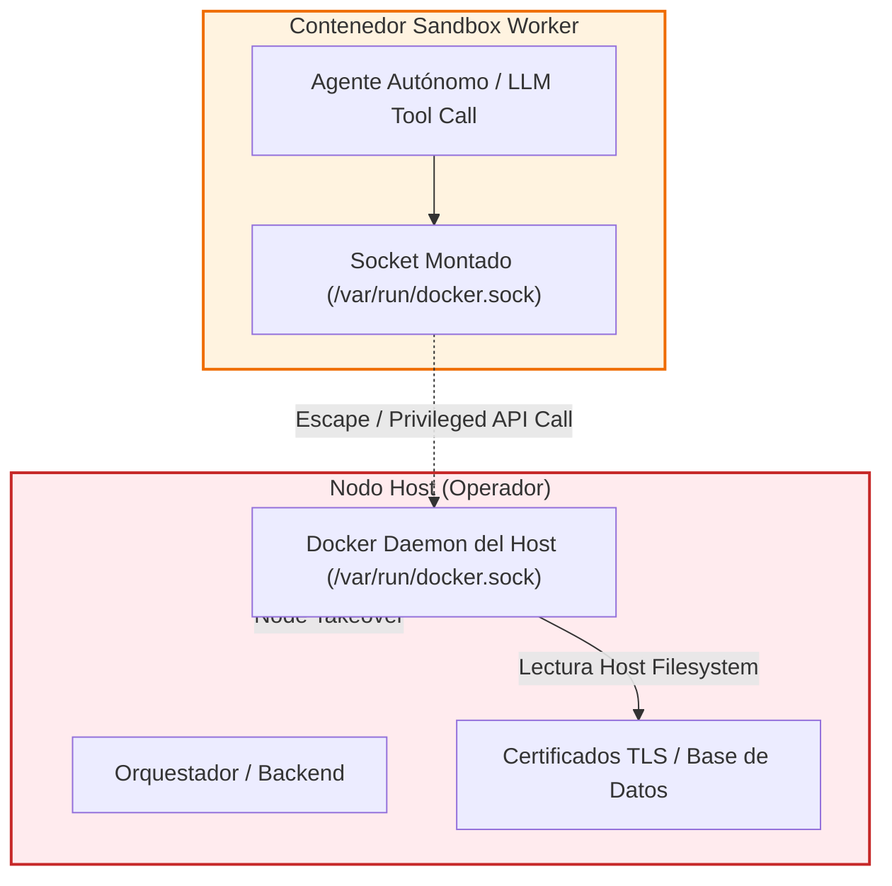

# Aislamiento de Daemons Docker y Sonda OPA Pre-Flight para Sandboxes Agénticos

Este documento establece las directivas arquitectónicas, heurísticas de auditoría y patrones de implementación para prevenir la toma de control del host del operador (*Host / Node Takeover*) en plataformas agénticas que orquestan ejecución de herramientas dentro de contenedores Docker, basado en la ingeniería inversa defensiva de **PentAGI**.

---

## 1. El Riesgo de Co-Ubicación de Daemons (*Daemon Co-Location Hazard*)

### 1.1. Mecanismo de Fallo (`VULN-ARCH-009`)
Cuando un sistema agéntico autónomo ejecuta herramientas (`terminal`, `nmap`, `metasploit`, scripts de usuario) dentro de contenedores Docker pero comparte el socket de Docker del host (`/var/run/docker.sock` o `DOCKER_SOCKET` hacia el daemon principal), cualquier escape o comando del agente que interactúe con el socket puede crear un contenedor con `Privileged: true`, montar la raíz del sistema de archivos del host (`Binds: ["/:/host"]`) y tomar control absoluto del nodo anfitrión.



### 1.2. Detección Estática y Dinámica en Arranque (`runsPentagi`)
El orquestador debe auditar activamente si el daemon al que se conectan los workers es el mismo que aloja al propio orquestador:

```go
func runsPentagi(ctx context.Context, cli *client.Client) (bool, error) {
    hostname, err := os.Hostname()
    if err != nil {
        return false, err
    }

    list, err := cli.ContainerList(ctx, client.ContainerListOptions{
        Filters: make(client.Filters).Add("status", "running"),
    })
    if err != nil {
        return false, err
    }

    for _, item := range list.Items {
        result, err := cli.ContainerInspect(ctx, item.ID, client.ContainerInspectOptions{})
        if err != nil {
            continue
        }
        if result.Container.Config.Hostname == hostname {
            return true, nil // El daemon visible ejecuta al propio orquestador
        }
    }
    return false, nil
}
```

> [!WARNING]
> Si `runsPentagi` retorna `true`, los agentes tienen visibilidad directa sobre el contenedor del orquestador y los contenedores de otros flujos. En entornos multi-tenant o productivos, los workers deben residir en un daemon dedicado en una VM o nodo worker aislado (`DOCKER_INSIDE_HOST`).

---

## 2. Sonda OPA Pre-Flight de 17 Vectores de Escape (`sandbox_probe.sh`)

Para certificar que un plugin de autorización de Docker (como Open Policy Agent `opa-docker-authz`) está activo y bloquea eficazmente intentos de escape, se ejecuta una sonda diagnóstica automatizada interna antes de habilitar la ejecución de agentes.

### 2.1. Matriz Canónica de 17 Vectores de Denegación Requerida

La sonda evalúa que cada una de las siguientes peticiones devuelva estrictamente un código HTTP 403 con mensaje de autorización denegada:

| Vector de Escape | Payload / Endpoint Evaluado | Riesgo Mitigado |
| :--- | :--- | :--- |
| **1. `create/privileged`** | `POST /containers/create` con `{"HostConfig": {"Privileged": true}}` | Escape directo a privilegios de kernel del host. |
| **2. `create/host-bind`** | `POST /containers/create` con `{"HostConfig": {"Binds": ["/:/host"]}}` | Montaje de la raíz del sistema de archivos anfitrión. |
| **3. `create/host-bind-structured`** | `POST /containers/create` con `{"HostConfig": {"Mounts": [{"Type": "bind", "Source": "/etc", "Target": "/h"}]}}` | Montaje estructurado de `/etc` o rutas sensibles. |
| **4. `create/cap-sys-admin`** | `POST /containers/create` con `{"HostConfig": {"CapAdd": ["SYS_ADMIN"]}}` | Inyección de capacidades equivalentes a root. |
| **5. `create/cap-sys-module`** | `POST /containers/create` con `{"HostConfig": {"CapAdd": ["SYS_MODULE"]}}` | Carga de módulos arbitrarios en el kernel. |
| **6. `create/device`** | `POST /containers/create` con `{"HostConfig": {"Devices": [{"PathOnHost": "/dev/null", "PathInContainer": "/dev/x", "CgroupPermissions": "rwm"}]}}` | Acceso y mapeo de dispositivos de bloques. |
| **7. `create/device-cgroup-rule`** | `POST /containers/create` con `{"HostConfig": {"DeviceCgroupRules": ["c 1:3 rwm"]}}` | Modificación de reglas cgroup sobre dispositivos. |
| **8. `create/pid-host`** | `POST /containers/create` con `{"HostConfig": {"PidMode": "host"}}` | Visibilidad e inyección de señales a procesos del host. |
| **9. `create/ipc-host`** | `POST /containers/create` con `{"HostConfig": {"IpcMode": "host"}}` | Acceso a memoria compartida y semáforos del host. |
| **10. `create/userns-host`** | `POST /containers/create` con `{"HostConfig": {"UsernsMode": "host"}}` | Desactivación del aislamiento de user namespaces. |
| **11. `create/seccomp-unconfined`** | `POST /containers/create` con `{"HostConfig": {"SecurityOpt": ["seccomp=unconfined"]}}` | Evasión de filtros de llamadas al sistema seccomp. |
| **12. `create/apparmor-unconfined`** | `POST /containers/create` con `{"HostConfig": {"SecurityOpt": ["apparmor=unconfined"]}}` | Desactivación de perfiles AppArmor. |
| **13. `create/masked-paths-cleared`** | `POST /containers/create` con `{"HostConfig": {"MaskedPaths": []}}` | Exposición de `/proc/kcore` y rutas enmascaradas. |
| **14. `create/readonly-paths-cleared`** | `POST /containers/create` con `{"HostConfig": {"ReadonlyPaths": []}}` | Escritura en `/proc/sys` y subsistemas de solo lectura. |
| **15. `create/cgroup-parent-root`** | `POST /containers/create` con `{"HostConfig": {"CgroupParent": "/"}}` | Ruptura de jerarquías de límites de recursos. |
| **16. `create/sysctl`** | `POST /containers/create` con `{"HostConfig": {"Sysctls": {"net.ipv4.ip_forward": "1"}}}` | Modificación de parámetros de red del kernel. |
| **17. `create/proc-escape-combined`** | `POST /containers/create` con `{"MaskedPaths": [], "ReadonlyPaths": [], "NetworkMode": "host"}` | Combinación multivector de desprotección de `/proc`. |

### 2.2. Verificación de Control Positivo
Un plugin mal configurado que deniegue indiscriminadamente todas las peticiones pasaría los 17 chequeos negativos pero rompería la funcionalidad legítima del agente. Por ende, la sonda exige:
1. **Control de Error Específico:** Una llamada contra una imagen inexistente debe retornar `404 Not Found` (indicando que pasó la autorización de OPA y falló únicamente en la búsqueda de la imagen).
2. **Pruebas Funcionales No Privilegiadas:** Creación, arranque, exec, volumen no ligado y red bridge autorizadas con éxito (`200 OK` / `201 Created`).

---

## 3. Bastionado de Contenedores Worker (`WorkerSpec`)

### 3.1. Política Estricta de Capacidades
```go
func WorkerSpec(cfg *config.Config, image string) (*container.Config, *container.HostConfig) {
    return &container.Config{
        Image:      image,
        Entrypoint: []string{"tail", "-f", "/dev/null"},
    }, &container.HostConfig{
        CapDrop: []string{"ALL"},
        CapAdd:  workerCapabilities(cfg),
    }
}
```

La lista blanca explícita de capacidades permitidas:
- `CHOWN`, `DAC_OVERRIDE`, `FSETID`, `FOWNER`, `SETGID`, `SETUID`, `SETFCAP`, `SETPCAP`, `KILL`, `AUDIT_WRITE`: Operaciones estándar de usuario y empaquetado.
- `NET_RAW`, `NET_BIND_SERVICE`: Necesarios para herramientas de escaneo de red (`nmap`, `ping`).
- `SYS_PTRACE`: Requerido exclusivamente para depuradores de memoria y análisis dinámico de procesos.
- `NET_ADMIN`: Solo condicionalmente bajo flag explícito (`cfg.DockerNetAdmin`).
- **PROHIBICIÓN ESTRICTA:** Queda terminantemente prohibido incluir `MKNOD` (vector de escape mediante creación de nodos de dispositivos de bloques), `SYS_ADMIN`, `SYS_MODULE`, `SYS_RAWIO` o `SYS_BOOT`.

### 3.2. Contención de Filesystem Flooding
Para evitar que un contenedor comprometido desborde la memoria RAM del orquestador creando millones de archivos en `/work`:
- `maxListEntries = 10000`: Límite máximo de entradas procesadas por listado.
- `maxListStdoutBytes = maxListEntries * 4096`: Límite de búfer de salida de exec (40 MB) para truncar respuestas antes de deserializar.
