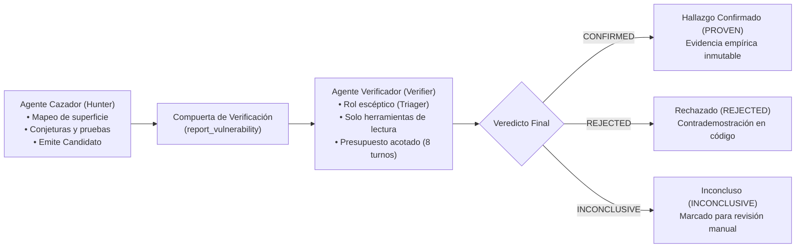

# Arquitectura de Verificador Independiente y Re-Explotación Adversarial Acotada

Este documento establece las directivas técnicas, heurísticas de diseño y patrones de implementación para la **segregación estricta entre agentes de descubrimiento (cazadores) y agentes de verificación independiente (triagers)** dentro de arquitecturas autónomas de auditoría y pentesting con LLMs.

---

## 🏛️ 1. El Axioma de la Verificación Adversarial Desacoplada

> **"The agent that verifies a finding is NEVER the agent that found it."**

En flujos de trabajo autónomos donde un único agente o modelo de lenguaje identifica y evalúa simultáneamente una presunta vulnerabilidad, se produce un **sesgo de confirmación sistemático**:
1. El modelo asume que su conjetura inicial es correcta y tiende a interpretar respuestas ambiguas (errores 400, redirects 302, timeouts o páginas estáticas) como confirmación del ataque.
2. La falta de verificación empírica genera reportes saturados de falsos positivos teóricos (*maybes*).
3. Intentar que el mismo agente re-evalúe su hallazgo conduce a alucinaciones acumulativas y sobregasto de tokens en bucles conversacionales.

### Solución Arquitectónica
La verificación debe configurarse como un **choke point obligatorio** previo al registro o persistencia del hallazgo (`report_vulnerability`), gobernado por un **agente verificador completamente independiente**.

---

## 🔒 2. Principios y Controles de Aislamiento del Verificador

Para garantizar que el verificador opere con rigor matemático y sin riesgo de compromiso o bucles infinitos:

### 2.1. Segregación Estricta del Registro de Herramientas (*Tool Registry Isolation*)
El verificador se instancia con un subconjunto restringido de herramientas de **solo lectura y reproducción activa acotada**:
- **Herramientas Permitidas:** `http_client` (o `curl` con argumentos inmutables), `browser` (inspección DOM), `notes` (memoria de sesión), `web_search` (investigación de gadgets), `oob_check` (verificación de callbacks fuera de banda).
- **Herramientas Prohibidas:**
  - `report_vulnerability` / `persist_finding`: Queda terminantemente prohibido que el verificador persista hallazgos directamente. Su única salida permitida es `submit_verdict`.
  - `spawn_agent` / `invoke_subagent`: No puede delegar ni generar subprocesos recursivos, impidiendo cadenas de agentes infinitas.

### 2.2. Presupuesto Temporal y Turnos Acotados (*Bounded Execution*)
La verificación no es un segundo escaneo completo del objetivo, sino una prueba focalizada:
- **Límite de Turnos:** Máximo **8 turnos** de razonamiento e interacción con herramientas.
- **Límite Temporal (Wall-Clock Deadline):** Máximo **3 minutos**. Si el proceso agota el tiempo, el resultado se clasifica automáticamente como `INCONCLUSIVE` (nunca descartado ni aprobado a ciegas).

### 2.3. Principio de Resolución No-Destructiva ante Ambigüedad (*Fail-Inconclusive*)
Si el verificador emite una salida malformada, falla la conexión o el modelo devuelve un veredicto no parseable:
- **Regla Inmutable:** Tratar como `INCONCLUSIVE`, **jamás como `REJECTED`**. Un fallo en el formato de respuesta del modelo nunca debe provocar el descarte silencioso de una vulnerabilidad crítica real.

---

## 🛠️ 3. Contrato de Veredictos (`submit_verdict`)

El único mecanismo de conclusión del verificador es la invocación de la herramienta terminal `submit_verdict` con los siguientes parámetros tipados:

| Parámetro | Tipo | Descripción y Restricciones |
| :--- | :--- | :--- |
| `verdict` | `enum` | Uno de los tres estados canónicos: `confirmed` (reproducción empírica exitosa), `rejected` (demostración de no-vulnerabilidad / mitigación efectiva) o `inconclusive` (imposibilidad de reproducir sin contrademostración concluyente). |
| `reason` | `string` | Justificación técnica concisa del veredicto basado en hechos observados. |
| `evidence` | `string` | Fragmentos de solicitudes y respuestas, salida de terminal o comparación diferencial contra línea base. |

---

## 📋 4. Heurísticas de Re-Explotación por Clase de Vulnerabilidad

Todo intento de confirmación debe contrastarse obligatoriamente contra una **línea base negativa**:

1. **Path Traversal (CWE-22):**
   - Enviar primero una solicitud de control con nombre inexistente (`missing-file-nonce`).
   - Enviar cargas crudas con `../` a profundidades crecientes (2, 4, 8) asegurando que el cliente HTTP no normalice las rutas (`--path-as-is`).
   - Confirmar únicamente si el contenido sensible (`/etc/passwd`, `win.ini`) aparece en la sonda y está ausente en la línea base.
2. **Server-Side Template Injection (CWE-1336):**
   - Utilizar operandos aritméticos pseudoaleatorios (e.g. $47 \times 83 = 3901$).
   - Confirmar si y solo si el *producto* resultante aparece en el cuerpo de la respuesta y no en la línea base.
3. **Error-Based SQL Injection (CWE-89):**
   - Ejecutar prueba de 3 vías: (1) Benigno $\to$ OK; (2) Con comilla simple $\to$ Error DBMS reconocido; (3) Con comilla duplicada $\to$ Recuperación sin error DBMS.
4. **Blind Timing Injections (CWE-89 / CWE-78):**
   - Descartar la primera petición de calentamiento.
   - Intercalar 3 a 5 pares benigno/sonda alternando el orden (`AB`, `BA`, `AB`).
   - Confirmar si la mediana de deltas supera el retraso esperado en $\ge trials - 1$ pares.
