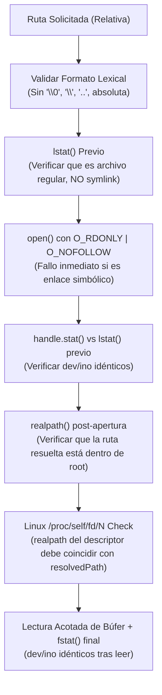

# Arquitectura de Confinamiento de Repositorios y Mitigación Anti-TOCTOU

Este documento establece el estándar autoritativo para implementar o auditar sistemas de jaula (*filesystem jail*) y lectores de archivos en agentes de seguridad y analizadores SAST que inspeccionan repositorios de código no confiables.

---

## 🏛️ 1. La Amenaza: Escape de Jaula y Ataques de Reemplazo en Tiempo de Uso (TOCTOU)

Cuando un agente de seguridad o motor SAST analiza un repositorio de código arbitrario o una aplicación objetivo:
1. **Enlaces Simbólicos Maliciosos (Symlink Traversal):** Un atacante incluye enlaces simbólicos en el repositorio que apuntan a rutas sensibles del sistema anfitrión (`/etc/passwd`, `~/.ssh/id_rsa`, `/proc/self/environ`, `C:\Windows\System32`).
2. **Carreras TOCTOU (*Time-of-Check to Time-of-Use*):** El agente verifica que una ruta relativa es válida y se encuentra dentro de la raíz del repositorio, pero entre la comprobación (`lstat`) y la apertura física (`open`), un proceso concurrente o script reemplaza el directorio o archivo intermedio por un enlace simbólico que apunta al exterior de la jaula.
3. **Descriptor Hijacking:** Un proceso hostil manipula los descriptores de archivo abiertos para desviar la lectura hacia recursos fuera de la frontera de confianza.

---

## 🛡️ 2. El Patrón Defensivo de Confinamiento Férreo (Patrón Shannon/Capella)

Para neutralizar de forma matemática y determinista cualquier escape o condición de carrera en el sistema de archivos, se exige la implementación de una secuencia de 7 guardias inmutables antes y durante la lectura de cualquier byte:

### 2.1. Secuencia de Validación y Doble Verificación Descriptor/Inodo



### 2.2. Implementación de Referencia en TypeScript (Node.js)

```typescript
import { constants as fsConstants, type Stats } from 'node:fs';
import { type FileHandle, lstat, open, realpath } from 'node:fs/promises';
import path from 'node:path';

function sameIdentity(left: Stats, right: Stats): boolean {
  return left.dev === right.dev && left.ino === right.ino && left.isFile() && right.isFile();
}

function isWithin(root: string, candidate: string): boolean {
  const rel = path.relative(root, candidate);
  return rel === '' || (!rel.startsWith(`..${path.sep}`) && rel !== '..' && !path.isAbsolute(rel));
}

export async function readConfinedFile(
  repositoryRoot: string,
  resolvedPath: string,
  maxBytes: number = 1_048_576,
): Promise<{ bytes: Buffer; truncated: boolean }> {
  // 1. Verificación lexical de contención
  if (!isWithin(repositoryRoot, resolvedPath)) {
    throw new SecurityException('ESCAPE: Path escapes the configured repository root');
  }

  // 2. lstat previo: rechazar symlinks antes de abrir
  const before = await lstat(resolvedPath);
  if (!before.isFile() || before.isSymbolicLink()) {
    throw new SecurityException('NOT_REGULAR_FILE: Path is a symbolic link or directory');
  }

  let handle: FileHandle | undefined;
  try {
    // 3. Apertura con flag O_NOFOLLOW: aborta a nivel de kernel si el último componente es un symlink
    handle = await open(resolvedPath, fsConstants.O_RDONLY | fsConstants.O_NOFOLLOW);

    // 4. Verificación de identidad: dev e ino deben coincidir con la inspección previa
    const opened = await handle.stat();
    if (!sameIdentity(before, opened)) {
      throw new SecurityException('RACE_DETECTED: Inode or device changed during open');
    }

    // 5. Re-resolución de realpath tras apertura
    const afterOpenPath = await realpath(resolvedPath);
    if (afterOpenPath !== resolvedPath || !isWithin(repositoryRoot, afterOpenPath)) {
      throw new SecurityException('RACE_DETECTED: Target path resolved outside repository root');
    }

    // 6. Verificación en Linux vía /proc/self/fd: consultar directamente hacia dónde apunta el descriptor
    if (process.platform === 'linux') {
      const descriptorTarget = await realpath(`/proc/self/fd/${handle.fd}`);
      if (descriptorTarget !== resolvedPath || !isWithin(repositoryRoot, descriptorTarget)) {
        throw new SecurityException('RACE_DETECTED: Descriptor target mismatch');
      }
    }

    // 7. Bounded Read: Lectura acotada en memoria sin permitir sobrecarga DoS
    const buffer = Buffer.allocUnsafe(maxBytes + 1);
    let offset = 0;
    while (offset < buffer.length) {
      const readResult = await handle.read(buffer, offset, buffer.length - offset, offset);
      if (readResult.bytesRead === 0) break;
      offset += readResult.bytesRead;
    }

    // 8. Verificación de identidad pos-lectura: dev e ino deben permanecer inalterados
    const afterRead = await handle.stat();
    if (!sameIdentity(opened, afterRead)) {
      throw new SecurityException('RACE_DETECTED: File modified or swapped during read');
    }

    const truncated = offset > maxBytes;
    return {
      bytes: buffer.subarray(0, Math.min(offset, maxBytes)),
      truncated,
    };
  } finally {
    await handle?.close().catch(() => undefined);
  }
}
```

---

## ⚡ 3. Presupuestos Operativos de Seguridad (Bounded Resource Quotas)

Todo motor de inspección estática o enumeración dentro de la jaula debe imponer techos matemáticos estrictos:

| Parámetro | Límite por Defecto | Techo Inflexible Máximo | Justificación Defensiva |
| :--- | :--- | :--- | :--- |
| **Tiempo de Operación (`operationTimeoutMs`)** | 2,000 ms (2s) | 60,000 ms (60s) | Previene bloqueos por archivos FIFO o sockets bloqueantes. |
| **Profundidad de Directorios (`maxDepth`)** | 32 niveles | 64 niveles | Neutraliza ataques de directorios recursivos infinitos. |
| **Límite de Entradas (`maxEntries`)** | 10,000 entradas | 100,000 entradas | Previene agotamiento de memoria por árboles masivos. |
| **Tamaño Máximo de Archivo (`maxFileBytes`)** | 1,048,576 (1 MB) | 8,388,608 (8 MB) | Previene desbordamiento de búfer en memoria RAM. |

---

## 🚫 4. Pruning Silencioso de Subárboles Denegados

Cuando el operador define reglas de exclusión (*avoid / deny rules*):
1. **Pruning Silencioso:** Si un subdirectorio coincide con una regla denegada (e.g. `.git/`, `.env`, `secrets/`), la jaula **debe podarlo silenciosamente durante la traversal**, tratando la rama como si físicamente no existiera.
2. **Cero Divulgación:** Jamás emitir mensajes de error que revelen la existencia de rutas denegadas en respuestas hacia modelos de lenguaje o reportes públicos.

---

## 📋 5. Checklist de Auditoría de Jaulas y Lectores de Archivos

Al evaluar herramientas de lectura de agentes autónomos o motores SAST:
- [ ] ¿Se utiliza `path.resolve` o `path.normalize` de forma aislada sin verificar `realpath` e inodos? *(Vulnerabilidad TOCTOU si no hay validación de descriptor).*
- [ ] ¿Se pasa el flag `O_NOFOLLOW` en la llamada a `open()`?
- [ ] ¿Se comparan los campos `dev` e `ino` antes y después de abrir el descriptor de archivo?
- [ ] ¿En sistemas Linux se valida el enlace simbólico del descriptor `/proc/self/fd/<fd>`?
- [ ] ¿Se ignoran o descartan los enlaces simbólicos en enumeraciones recursivas (`dirent.isSymbolicLink()`)?
- [ ] ¿Existen límites estrictos de bytes leídos y timeouts por operación para evitar bloqueos en FIFOs/dispositivos?
