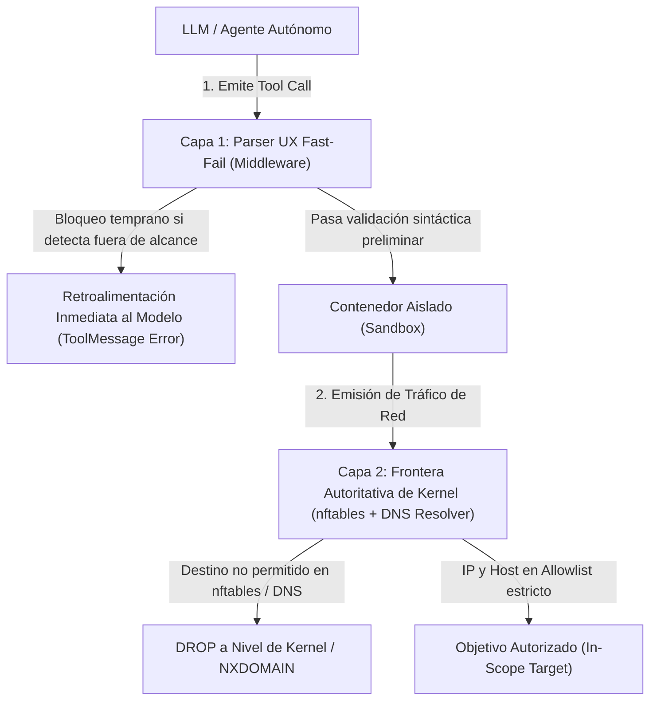

# Guía Técnica: Arquitectura de Reglas de Compromiso (RoE) y Guardrails en Doble Capa

## 📌 Identificador y Clasificación
- **Identificador Canónico:** `VULN-IAM-005` / `VULN-ARCH-006`
- **Dimensión Canónica:** `IDENTITY_ACCESS_SESSION` / `ARCHITECTURE_BOUNDARIES_ZERO_TRUST`
- **Taxonomía:** CWE-20 (Improper Input Validation) / CWE-863 (Incorrect Authorization) / CWE-668 (Exposure of Resource Through Incompatible Scope)
- **Marco OWASP:** OWASP Top 10: `A01:2021/2025` (Broken Access Control)
- **Severidad Típica:** **HIGH** (CVSS: 8.1)

---

## 🎯 1. La Falacia del Parser de Comandos como Única Frontera

En agentes autónomos de seguridad, pruebas de penetración o auditoría externa, una práctica habitual pero críticamente defectuosa es confiar exclusivamente en un **middleware de inspección sintáctica de comandos** (CLI parsing) para restringir el alcance a los objetivos autorizados (*In-Scope*):

```python
# ANTIPATRÓN VULNERABLE: El parser asume que ve el destino literal
def is_command_allowed(cmd: str, allowed_host: str) -> bool:
    target = extract_target_from_cli(cmd)
    return target == allowed_host
```

### ¿Por qué el Parser No Puede Ser la Frontera Autoritativa?
Un agente autónomo (o un atacante mediante *prompt injection*) puede camuflar fácilmente el destino real mediante:
1. **Indirección de Variables de Entorno:**
   ```bash
   TARGET=$(echo "169.254.169.254"); curl "http://$TARGET/latest/meta-data/"
   ```
2. **Sustitución de Comandos / Evaluación Dinámica:**
   ```bash
   eval $(printf 'curl http://evil.corp'); python -c "import urllib.request; urllib.request.urlopen(...)"
   ```
3. **Resolución DNS Dinámica o CNAME Chaining:**
   Configurar un dominio propio `myinscope.corp` que resuelva vía registro CNAME o DNS dinámico a una IP prohibida interna.

---

## 🏛️ 2. Arquitectura Defensiva en Dos Capas (Dual-Layer Defense-in-Depth)

Para garantizar que ningún paquete pueda abandonar el perímetro autorizado independientemente de las artimañas sintácticas del comando, la arquitectura debe estructurarse en **dos capas complementarias**:



### Capa 1: Gate Advisory UX (Fast-Fail Signal)
- **Ubicación:** Middleware del orquestador (antes del despacho al sandbox).
- **Rol:** Analizar el texto literal del comando en busca de IPs, URLs y hostnames explícitos.
- **Beneficio:** Ahorra tiempo y tokens informando inmediatamente al agente mediante un mensaje de error explicativo si el destino no está autorizado, permitiéndole corregir su estrategia sin esperar timeouts de red.

### Capa 2: Frontera Autoritativa en el Borde de Red (Kernel Egress)
- **Ubicación:** Reglas `nftables` y configuración de resolución DNS local dentro del contenedor de ejecución.
- **Rol:** **El único límite de seguridad real**. Aunque el comando shell oculte el host detrás de variables o subprocesos, el kernel del contenedor intercepta el paquete en el momento exacto de la conexión TCP/UDP:
  1. **Allowlist DNS (`render_dns_allowlist`):** El resolver DNS local solo responde consultas para nombres de dominio o comodines explícitamente autorizados.
  2. **Allowlist de Conexión `nftables` (`render_nftables`):** Todos los paquetes salientes cuyo CIDR o IP de destino no figuren en la tabla de alcance son descartados (`DROP`) por el kernel antes de alcanzar la interfaz de red del host.

---

## 🚨 3. El Caso Crítico: Bypass FQDN Trailing-Dot (`VULN-IAM-005`)

Durante la auditoría forense de motores de alcance se identificó una vulnerabilidad sutil pero de impacto crítico en la normalización de nombres de host.

### El Antipatrón
El estándar DNS estipula que un nombre de dominio completamente calificado (**FQDN**) puede incluir un punto final (`.`) para denotar la raíz del espacio de nombres (e.g. `fbi.gov.` o `metadata.google.internal.`). El resolver del sistema operativo y herramientas como `curl` o bibliotecas HTTP resuelven `fbi.gov.` de forma idéntica a `fbi.gov`.

Sin embargo, las funciones de comprobación de sufijos o diccionarios en memoria a menudo realizan:

```python
# CÓDIGO VULNERABLE (VULN-IAM-005)
def is_sensitive_tld(host: str, sensitive_tlds: tuple[str, ...]) -> bool:
    host = host.strip().lower()
    # FALLO: no elimina el punto final '.'
    return any(host.endswith(tld) for tld in sensitive_tlds)
```

Si `sensitive_tlds = (".gov", ".mil", ".edu", ".int")`:
- `is_sensitive_tld("fbi.gov")` $\to$ `True` (Bloqueado).
- `is_sensitive_tld("fbi.gov.")` $\to$ `False` (**¡BYPASS!** Termina en `.gov.` y no en `.gov`).

Asimismo, al evaluar direcciones IP con punto final (`169.254.169.254.`), parsers estándar como `ipaddress.ip_address()` arrojan `ValueError` en lugar de detectar la IP de metadatos, provocando que la comprobación de denegación falle silenciosamente (*Fail-Open*).

### La Remediación Canónica
Todo analizador de alcance y evaluador de guardrails debe normalizar bidireccionalmente tanto la regla como el objetivo:

```python
def normalize_target_host(target: str) -> str:
    host = target.strip().lower()
    # Eliminar puerto si está presente
    if ":" in host and not host.count(":") > 1: # IPv4 o hostname
        host = host.split(":", 1)[0]
    elif host.startswith("[") and "]" in host: # IPv6 bracketed
        host = host[1:].split("]")[0]
    
    # NORMALIZACIÓN FQDN INMUTABLE: Despojar siempre los puntos finales
    return host.rstrip(".")
```

---

## 📋 4. Checklist de Auditoría para Confinamiento de Agentes

- [ ] ¿Existe una política de red obligatoria en kernel (`nftables` / `iptables`) además de las comprobaciones de software en el agente?
- [ ] ¿El resolver DNS del sandbox está configurado para bloquear resolución de dominios fuera del alcance?
- [ ] ¿Los endpoints de metadatos cloud (`169.254.169.254`, `fd00:ec2::254`, `metadata.google.internal`, `metadata.azure.com`, `100.100.100.200`) están bloqueados por defecto con máxima precedencia sobre cualquier regla *allow*?
- [ ] ¿Se sanitizan los destinos despojando puntos finales FQDN (`rstrip('.')`) antes de contrastar contra denylist o TLDs protegidos?
- [ ] ¿Los patrones de comodín (`*.target.corp`) restringen la coincidencia a un único nivel de subdominio sin incluir el ápex a menos que esté explícitamente concedido?
