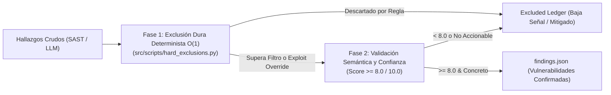

# Catálogo Canónico de 17 Reglas de Exclusión Dura y 12 Precedentes de Anthropic

Este documento establece el marco autoritativo de **Filtrado Antiruido y Exclusión Dura** de **Devia-CyberSecurity**, adaptado y robustecido a partir de la ingeniería de seguridad de **Anthropic** (`claude-code-security-review`).

Su objetivo fundamental es eliminar el 90% de los falsos positivos teóricos y la fatiga de alertas (*alert fatigue*) en auditorías estáticas y revisiones de código realizadas por agentes de IA, sin suprimir vulnerabilidades genuinamente explotables.

---

## 🏛️ El Pipeline de Filtrado en Dos Fases

Toda auditoría de seguridad implementa una arquitectura de compuerta en dos etapas:



---

## 🚫 Las 17 Reglas Inmutables de Exclusión Dura

Salvo que exista un vector demostrado de explotación activa (*Exploit Override*), todo hallazgo que encaje en los siguientes 17 patrones se descarta automáticamente:

1. **Denegación de Servicio (DoS) o Agotamiento de Recursos:**  
   Bucles potencialmente intensivos, recursión profunda o consumo de CPU/memoria. La denegación de servicio a nivel de aplicación no se reporta en auditorías de código salvo que constituya RCE o bloqueo crítico autenticado sin autoscaling.
2. **Secretos en Disco si están Protegidos:**  
   Archivos de configuración locales o en disco con credenciales protegidas por permisos del sistema operativo.
3. **Falta de Rate Limiting:**  
   Ausencia de limitadores de tasa en APIs o endpoints de login. La limitación de peticiones se gestiona a nivel perimetral (API Gateway / WAF / Cloudflare), no en código fuente.
4. **Fugas de Recursos y Memoria no Críticas:**  
   Conexiones a base de datos o descriptores de archivo sin cerrar explícitamente (`unclosed resource/file`). Son incidencias de calidad de software (*code smell*), no vulnerabilidades explotables.
5. **Validación de Entradas en Campos no Críticos para Seguridad:**  
   Falta de validación en parámetros donde no se demuestra inyección (SQL, Command, Path, XSS). La ausencia de validación per se no es un fallo sin un sumidero sensible (*sink*).
6. **Sanitización de Entradas en GitHub Actions Salvo Desencadenante No Confiable:**  
   Variables de entorno o inputs en workflows de GitHub Actions no se reportan a menos que provengan demostradamente de un evento externo no autenticado (e.g. `issue_comment`, `pull_request_target`).
7. **Falta Aislada de Medidas de Hardening:**  
   Cabeceras de seguridad ausentes (X-Frame-Options, HSTS), banner disclosure o verbose logging en entornos de desarrollo. El código no está obligado a implementar todas las directivas de bastionado salvo en perímetros expuestos.
8. **Condiciones de Carrera Teóricas (Race Conditions / TOCTOU):**  
   Ventanas de carrera puramente teóricas sin ventana de tiempo práctica ni concurrencia explotable.
9. **Librerías de Terceros Desactualizadas (CVEs):**  
   Vulnerabilidades en dependencias externas se auditan exclusivamente a través de la dimensión `SUPPLY_CHAIN_SCA` (Snyk, Dependabot, pnpm audit). No deben saturar reportes de código fuente (SAST).
10. **Seguridad de Memoria en Lenguajes Seguros (Rust / Go / TS / C#):**  
    Reportar desbordamientos de búfer, *use-after-free* o desreferenciación nula en lenguajes administrados o con seguridad de memoria garantizada en tiempo de compilación.
11. **Archivos de Prueba y Suites Unitarias:**  
    Cualquier archivo de test (`test_*.py`, `*.spec.ts`, `*.test.js`, carpetas `tests/`, `fixtures/`). El código vulnerable intencional en mocks no es vulnerabilidad.
12. **Log Spoofing (Inyección de Saltos de Línea en Logs):**  
    Escribir entradas de usuario sin sanitizar a logs no es una vulnerabilidad de seguridad ejecutable.
13. **SSRF con Control Limitado a la Ruta:**  
    SSRF solo es una vulnerabilidad crítica si el atacante puede controlar el **host** o el **protocolo/esquema** (`http://`, `gopher://`, `file://`). Controlar solo el path (`https://api.empresa.com/<user_path>`) no califica como SSRF.
14. **Inclusión de Contenido de Usuario en System Prompts de IA:**  
    Incluir datos de usuario en prompts no es una falla de código fuente en sí misma; requiere vector de jailbreak o acceso a herramientas destructivas.
15. **Regex Injection:**  
    Inyectar cadenas no confiables en expresiones regulares no se considera vector ejecutable de compromiso.
16. **Regex DoS (ReDoS) en Operaciones Internas:**  
    Expresiones regulares complejas no se reportan salvo que se ejecuten síncronamente en el hilo principal de un servidor HTTP expuesto a tráfico no autenticado.
17. **Documentación y Archivos Markdown:**  
    Cualquier archivo de texto (`.md`, `.rst`, `.txt`) no ejecutable queda excluido.

---

## ⚖️ Los 12 Precedentes Canónicos de Arquitectura de Seguridad

1. **Logging de Credenciales vs URLs:**  
   Registrar contraseñas o tokens en texto plano es una brecha crítica (`VULN-RESI-002`). Registrar URLs completas (incluso con parámetros de query no sensibles) se asume seguro.
2. **Inalcanzabilidad de UUIDs:**  
   Los UUIDs v4 se consideran matemáticamente no adivinables ($2^{122}$ bits de entropía). No se requiere validación de acceso basada en secuencialidad.
3. **Variables de Entorno y Flags CLI como Valores Confiables:**  
   En entornos de producción seguros, las variables de entorno (`process.env`, `os.environ`) y flags de invocación CLI son establecidos por el operador de infraestructura. Ningún vector que dependa de manipular estas variables desde la red es válido.
4. **Fugas de Recursos vs Fallos de Seguridad:**  
   Las fugas de descriptores de socket o memoria son bugs operativos, no brechas de confidencialidad o integridad.
5. **Vulnerabilidades Web Sutiles Requieren Alta Confianza:**  
   Tabnabbing inverso (`rel="noopener"`), XS-Leaks, polución de prototipos y *open redirects* solo son reportables si forman parte demostrada de una cadena de secuestro de cuenta (*Account Takeover - ATO*).
6. **Inmunidad Estructural contra XSS en Frameworks Modernos:**  
   React, Angular (Signals/Templates) y Vue escapan datos por defecto en su motor de renderizado. Queda prohibido reportar XSS en código cliente salvo uso explícito de APIs inseguras (`dangerouslySetInnerHTML`, `bypassSecurityTrustHtml`, `innerHTML`).
7. **Flujos de CI/CD en GitHub Actions Requieren Explotabilidad Concreta:**  
   La inmensa mayoría de advertencias en workflows de GitHub Actions son falsos positivos. Para validar un fallo en GHA, debe demostrarse un camino de inyección ejecutable desde un PR de fork sin aprobación.
8. **Invalidez de Chequeos de Autenticación/Permisos en Frontend:**  
   El código cliente (JS/TS) jamás es confiable ni puede forzar seguridad. La falta de verificación de roles en el cliente NO es una vulnerabilidad; la autorización se exige y evalúa exclusivamente en los controladores y APIs del backend.
9. **Umbral Estricto para Severidad Media:**  
   Los hallazgos catalogados como `MEDIUM` deben ser evidentes y concretos. Hallazgos ambiguos deben ser descartados.
10. **Jupyter Notebooks (`.ipynb`):**  
    Los notebooks de investigación de datos no reciben tráfico hostil no confiable. No deben auditarse bajo el modelo de aplicaciones web expuestas.
11. **Logging de Datos Sensibles No-PII:**  
    Solo se reporta fuga en logs si involucra secretos criptográficos, tokens de sesión o datos personales identificables (PII) bajo regulaciones (GDPR/HIPAA).
12. **Inyección de Comandos en Shell Scripts Internos:**  
    Los scripts bash o de mantenimiento de infraestructura no interactúan con inputs no autenticados de usuarios externos; no deben marcarse como vulnerables a menos que procesen datos de red sin filtrar.

---

## 🎯 Compuerta de Confianza (Confidence Scoring 1-10)

Para los hallazgos que superan la exclusión determinista, se aplica la evaluación de confianza semántica:

| Puntuación | Clasificación | Disposición |
| :---: | :--- | :--- |
| **1 – 3** | Baja Confianza / Ruido Especulativo | **Descartar inmediatamente.** |
| **4 – 6** | Confianza Media / Requiere Supuestos No Probados | **Descartar salvo exploit chain demostrada.** |
| **7 – 10** | Alta Confianza / Vulnerabilidad Real Concreta | **Registrar en findings.json si score $\ge 8.0$.** |

---

## 💻 Herramienta de Ejecución

Esta metodología se ejecuta en Capa 3 mediante el script:
```bash
python src/scripts/hard_exclusions.py filter <findings.json> -o <filtered.json> --json
```
