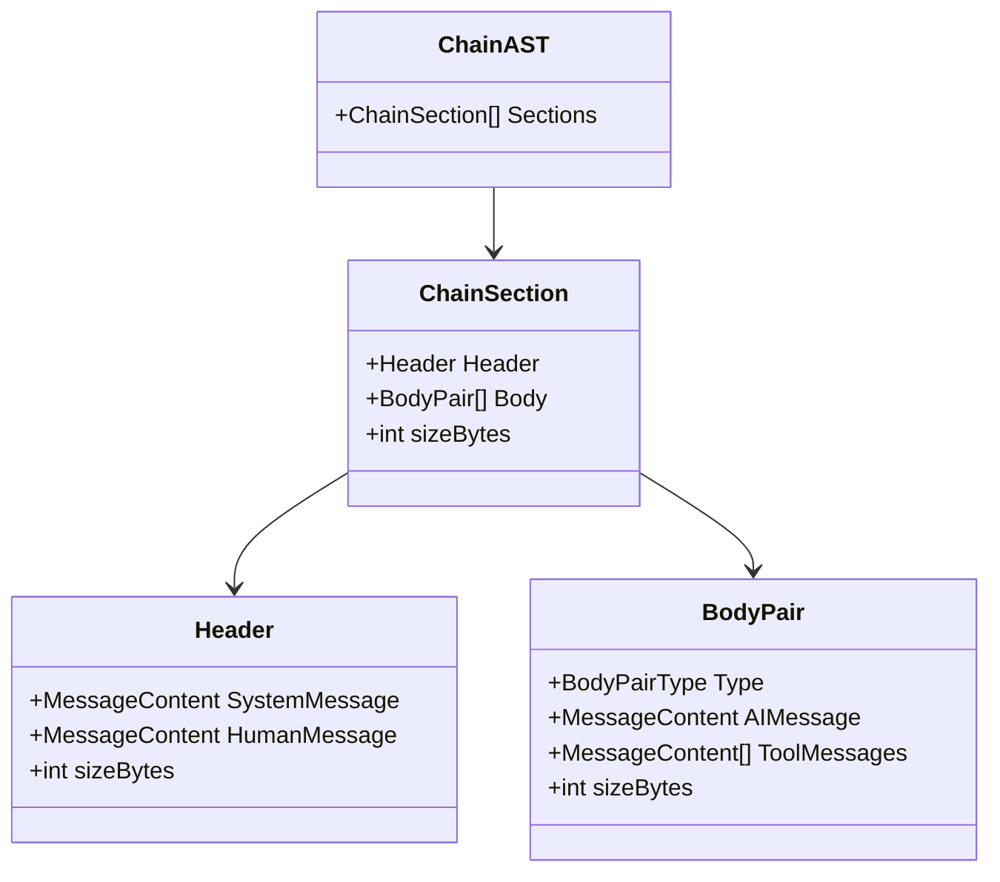

# Modelado de Cadenas LLM con AST (ChainAST) y Resumen Progresivo Semántico (csum)

Este documento describe la arquitectura defensiva para gobernar el desbordamiento de contexto, la pérdida de atención y el fallo de validación de esquemas en bucles agénticos autónomos de larga duración, derivado de la ingeniería inversa de **PentAGI**.

---

## 1. El Problema del Desbordamiento de Contexto Agéntico (`VULN-RESI-005`)

En plataformas de auditoría de seguridad o penetration testing autónomo, un flujo puede prolongarse durante cientos o miles de turnos, acumulando salidas masivas de escaneos (`nmap`, `dirb`, volcados de peticiones HTTP, logs de subprocesos). Si el historial de mensajes se envía de forma plana al modelo de lenguaje:
1. **Agotamiento del Límite de Contexto:** El coste en tokens escala linealmente hasta alcanzar la ventana máxima del proveedor (128k, 1M), provocando errores HTTP 400 (`context_length_exceeded`).
2. **Degradación de Razonamiento (*Lost in the Middle*):** El modelo pierde la capacidad de prestar atención a directivas iniciales del sistema o hallazgos críticos tempranos.
3. **Rechazo por Inconsistencia de Firmas de Razonamiento:** Proveedores como Gemini o Anthropic exigen firmas de validación criptográfica o tokens de pensamiento (`thought_signature`) para mensajes intermedios generados con modos de razonamiento. Si un historial es podado o editado ingenuamente, el API rechaza la petición por considerar la estructura malformada.

---

## 2. La Arquitectura ChainAST (Árbol de Sintaxis de Diálogo)

En lugar de tratar la conversación como una lista plana de mensajes, PentAGI deconstruye el historial en un Árbol de Sintaxis Abstracta estructurado:



### 2.1. Tipos Canónicos de Pares de Cuerpo (`BodyPairType`)
- **`RequestResponse`:** Mensaje de IA que invoca una o más herramientas (`ToolCalls`), seguido inmediatamente por las respuestas correspondientes emitidas por dichas herramientas.
- **`Completion`:** Mensaje final o respuesta en prosa del modelo que no ejecuta llamadas a herramientas.
- **`Summarization`:** Par sintético generado por el motor de resumen donde se encapsula el resultado consolidado de una subtarea previa.

### 2.2. Contabilidad Exacta de Bytes
Cada nodo (`ChainSection`, `Header`, `BodyPair`) mantiene un contador exacto de su tamaño en memoria en bytes (`sizeBytes`). Esto permite tomar decisiones de poda o compresión en tiempo constante $O(1)$ sin necesidad de volver a serializar el historial completo en cada evaluación.

---

## 3. Algoritmo de Compresión Progresiva (`csum`)

El motor de resumen opera bajo una política de preservación contextual ponderada:

```go
const (
    maxLastSectionByteSize    = 50 * 1024 // 50 KB reservados para la última sección
    maxSingleBodyPairByteSize = 16 * 1024 // 16 KB límite por par individual
    maxQAPairSections         = 10        // Máximo de secciones Q&A preservadas
    maxQAPairByteSize         = 64 * 1024 // 64 KB para histórico de preguntas y respuestas
    lastSectionReservePct     = 25        // 25% reservado para turnos futuros
    SummarizedContentPrefix   = "**summarized content:**\n"
)
```

### 3.1. Fases del Algoritmo de Resumen
1. **Identificación de la Sección Activa:** La última sección (`PreserveLast`) jamás se condensa para garantizar que el modelo comprenda el turno conversacional inmediatamente en curso.
2. **Transformación de Salidas Voluminosas:** Las llamadas históricas a herramientas cuyos resultados superan `maxSingleBodyPairByteSize` se sustituyen por una llamada sintética al pseudo-tool `execute_task_and_return_summary`, acompañada de un extracto condensado precedido por el prefijo formal `SummarizedContentPrefix`.
3. **Inyección de Firmas de Razonamiento Sintéticas:**
   Para modelos que validan metadatos de pensamiento:
   ```go
   const FakeReasoningSignatureGemini = "skip_thought_signature_validator"
   ```
   Al sustituir o resumir un bloque que originalmente contenía metadatos de pensamiento, el motor inyecta una firma sintética autorizada para que el validador del backend del LLM acepte la estructura sin errores de esquema.

---

## 4. Protocolo de Aislamiento en el System Prompt

El agente debe recibir instrucciones explícitas en su prompt de sistema para que entienda cómo interpretar los resúmenes sin intentar imitarlos:

> [!IMPORTANT]
> **Reglas Inmutables para el Agente:**
> 1. Tratar todo contenido con `**summarized content:**` estrictamente como contexto histórico de hechos ya ocurridos.
> 2. Prohibido al agente emitir el prefijo `**summarized content:**` en sus propias respuestas.
> 3. Prohibido al agente invocar directamente la herramienta interna de resumen (`execute_task_and_return_summary`).
> 4. Todas las acciones activas deben emitirse mediante llamadas estructuradas a herramientas reales.
