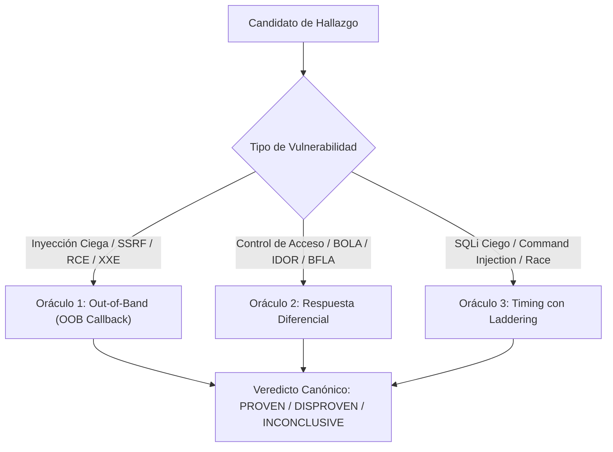

# Compuerta de Verificación Empírica con Oráculos Externos No-LLM

Este documento establece la especificación técnica de la **Compuerta de Verificación Externa Tri-Oráculo** (*Non-LLM External Oracles*) dentro del ecosistema **Devia-CyberSecurity**, diseñada para erradicar falsos positivos y desvincular la validación de hallazgos del juicio estocástico de modelos de lenguaje.

---

## 🏛️ 1. Filosofía: La Asimetría Probatoria y el Fin de la Alucinación

En auditorías basadas puramente en LLMs o escáneres estáticos, los modelos tienden a calificar un endpoint como "vulnerable" basándose en apariencias sintácticas (*"la respuesta HTTP contiene error 500"*, *"el parámetro se llama id"*). 

Para lograr grado industrial, Devia-CyberSecurity exige que los hallazgos de alto impacto pasen por **oráculos deterministas que interactúan con el entorno vivo**:
- Un oráculo no es un LLM: es un test empírico repetible que mide señales físicas (latencia de reloj, interacción de red o divergencia de contenido).
- Si el oráculo demuestra la vulnerabilidad $\to$ **`PROVEN`** (confianza 1.0, arista verificada en el grafo de ataque).
- Si el oráculo demuestra que la mutación colapsa sobre el comportamiento seguro $\to$ **`DISPROVEN`** (hallazgo refutado y descartado).
- Si la prueba no puede ejecutarse por timeout o filtrado de red $\to$ **`INCONCLUSIVE`** (principio de honestidad epistemológica: la falta de prueba no es prueba de ausencia).

---

## 📡 2. Los Tres Oráculos Deterministas

---

### 2.1. Oráculo 1: Interacción Fuera de Banda (Out-of-Band Callback - OOB)
Aplica a: **Blind SSRF**, **Blind XXE**, **Blind SQLi (DNS exfiltration)**, **Blind RCE** (`log4shell`, `jndi`, etc.).

#### Mecanismo Operativo:
1. **Reserva Previa de Token:** Antes de enviar la carga útil, el oráculo reserva un subdominio único efímero en un listener controlado (e.g. Interactsh o Collaborator):
   $$\text{URL}_{\text{oob}} = \text{hash32}(\text{session} : \text{findingId}) \cdot \text{oob-listener.corp}$$
2. **Inyección y Entrega:** Se transmite la carga útil hacia el objetivo.
3. **Escucha con Ventana Temporal:** El listener espera durante una ventana acotada ($15\text{ s}$).
4. **Asimetría Honesta:**
   - Si se registra interacción DNS/HTTP/LDAP con el token exacto $\to$ **`PROVEN`**.
   - Si no hay interacción $\to$ **`INCONCLUSIVE`**. *Jamás reportar `DISPROVEN` por silencio*: un WAF, filtrado de egress en firewall o lentitud en colas asíncronas producen silencio aun en presencia de vulnerabilidad.

---

### 2.2. Oráculo 2: Divergencia de Respuesta Diferencial
Aplica a: **BOLA / IDOR**, **BFLA (Broken Function Level Auth)**, **Bypass de Autenticación**.

#### Mecanismo Operativo:
El oráculo realiza **dos peticiones pareadas** y compara sus respuestas:
1. **Petición de Ataque ($R_{\text{attack}}$):** La mutación que intenta acceder a un recurso privilegiado o ajeno (e.g. `order_id` ajeno, o rol mutado en JWT).
2. **Control Negativo ($R_{\text{control}}$):** La petición idéntica ejecutada bajo condiciones que **deben ser denegadas** (e.g. sin autenticación, o solicitando un recurso inexistente).

#### Cálculo de Divergencia:
Sea $\text{Sim}(B_1, B_2) \in [0.0, 1.0]$ el coeficiente de similitud de texto normalizado entre los cuerpos de respuesta:
- Si $R_{\text{attack}}.\text{status} == 200$ y $R_{\text{control}}.\text{status} \in \{401, 403, 404\}$ con $\text{Sim}(B_{\text{attack}}, B_{\text{control}}) < 0.95 \implies$ **`PROVEN`**.
- Si $R_{\text{attack}}$ colapsa sobre el control negativo ($R_{\text{attack}}.\text{status} == R_{\text{control}}.\text{status}$ y $\text{Sim} \ge 0.95$) $\implies$ **`DISPROVEN`**.
- Si ambos fallan con errores 500 intermitentes $\implies$ **`INCONCLUSIVE`**.

---

### 2.3. Oráculo 3: Análisis Estadístico de Timing con Escalado Lineal (Laddering)
Aplica a: **Time-Based Blind SQLi**, **Blind OS Command Injection** (`sleep`, `pg_sleep`).

#### El Problema del Jitter de Red:
En conexiones remotas o redes congestionadas, una respuesta puede demorarse 5 segundos simplemente por saturación del servidor web, induciendo a herramientas como SQLMap o LLMs a reportar falsos positivos críticos.

#### El Protocolo de Prueba Escalonada (*Laddering*):
Para confirmar que el retardo proviene de la ejecución de una instrucción de sueño y no de ruido de red:
1. **Línea Base ($N=5$ muestras):** Se ejecutan 5 peticiones limpias sin inyección de retardo, calculando la media de latencia $\mu_{\text{base}}$ y la desviación estándar $\sigma_{\text{base}}$.
2. **Muestra de Retardo Primario ($\Delta = 5\text{ s}$, $M=3$ muestras):**
   Se exige que la latencia media inducida supere el umbral estadístico:
   $$\bar{t}_{\Delta} \ge \mu_{\text{base}} + 3\sigma_{\text{base}} \quad \text{y} \quad \bar{t}_{\Delta} - \mu_{\text{base}} \ge 0.6 \cdot \Delta$$
3. **Paso Crítico de Escalado Lineal (Laddering $2\times \Delta = 10\text{ s}$):**
   Se inyecta una segunda carga con el **doble de retardo** ($10\text{ s}$). Se exige que el tiempo de respuesta escale proporcionalmente:
   $$\bar{t}_{2\Delta} - \mu_{\text{base}} \approx 2 \cdot (\bar{t}_{\Delta} - \mu_{\text{base}})$$
   - Si la latencia escala linealmente con $\Delta$ y $2\Delta \implies$ **`PROVEN`** (certeza matemática absoluta).
   - Si la prueba primaria supera el umbral pero la prueba $2\Delta$ no escala $\implies$ **`DISPROVEN`** (se demostró que fue un pico aleatorio de latencia).

---

## 📊 3. Matriz de Decisión y Acciones de Auditoría

| Veredicto del Oráculo | Estado en `findings.json` | Confianza | Acción en Devia-CyberSecurity |
| :--- | :--- | :--- | :--- |
| **`PROVEN`** | `CONFIRMED` | **10.0 / 10.0** | Asignar Badge `VERIFIED`, arista peso 1.0 en grafo de ataque, incluir evidencia de red directa en el reporte terminal. |
| **`DISPROVEN`** | `REJECTED` | **0.0 / 10.0** | Descartar inmediatamente vía `hard_exclusions.py`, archivar en `ruled_out` de cobertura con la prueba negativa. |
| **`INCONCLUSIVE`** | `SUSPECTED` | **Original** | Conservar la severidad teórica con advertencia explícita de inconclusión por barreras de red. |
