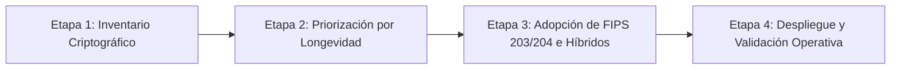

# Guía de Auditoría y Migración a Criptografía Post-Cuántica (PQC)

Este documento establece la metodología de auditoría, las etapas de migración y los estándares criptográficos autoritativos para evaluar la preparación de sistemas frente a la amenaza de la computación cuántica dentro de **Devia-CyberSecurity**.

---

## 🏛️ 1. La Amenaza Cuántica y el Principio "Harvest Now, Decrypt Later"

Los ordenadores cuánticos basados en el algoritmo de Shor comprometerán la seguridad de los algoritmos de clave pública tradicionales basados en factorización entera y logaritmos discretos:
- **Algoritmos Vulnerables:** RSA, Diffie-Hellman (DH), Criptografía de Curvas Elípticas (ECC, ECDH, ECDSA, Ed25519).
- **Riesgo Activo (HNDL):** Adversarios avanzados interceptan y almacenan tráfico cifrado hoy (*Harvest Now*) con la expectativa de descifrarlo en el futuro (*Decrypt Later*) cuando dispongan de capacidad cuántica suficiente.

---

## 🧭 2. Las 4 Etapas del Plan de Migración PQC

### Etapa 1: Inventario Criptográfico Exhaustivo
Crear un catálogo determinista de todas las dependencias y primitivas criptográficas utilizadas en el software, servicios de infraestructura y transporte:
- **Propósito y Tiempo de Vida:** Transporte TLS, almacenamiento en reposo, protección de claves maestras o firmas de firmware/código; duración requerida de la confidencialidad.
- **Implementación Técnica:** Protocolos, suites de cifrado, parámetros de clave, versiones de bibliotecas criptográficas (OpenSSL, BouncyCastle, WebCrypto).
- **Dependencias y Responsabilidad:** Clientes, servidores, proxies, HSMs, KMS y equipo responsable del ciclo de vida.

### Etapa 2: Priorización de la Migración
1. **Confidencialidad a Largo Plazo (Máxima Prioridad):**  
   Conexiones expuestas y datos en reposo cuyas claves dependen de RSA o ECC. Actualizar el cifrado en el futuro no protege copias que un atacante ya haya capturado del tráfico de red.
2. **Confianza a Largo Plazo:**  
   Firmas de software, certificados raíz, anclas de confianza y registros sellados que deben permanecer confiables durante años.
3. **Criptografía Simétrica:**  
   Preferir **AES-256** frente a AES-128 para garantizar un margen de seguridad cuántica adecuado (el algoritmo de Grover reduce la seguridad efectiva a la mitad: AES-256 ofrece 128 bits de seguridad cuántica).

### Etapa 3: Adopción de Algoritmos Estandarizados (NIST FIPS / RFCs)

| Caso de Uso | Estándar Post-Cuántica (PQC) | Descripción Técnica y Directiva |
| :--- | :--- | :--- |
| **Establecimiento de Claves (KEM)** | **ML-KEM (FIPS 203)** | *Module-Lattice-Based Key-Encapsulation Mechanism*. Establece secretos compartidos para cifrado simétrico; no cifra directamente datos de aplicación. |
| **Transporte Seguro (TLS)** | **X25519MLKEM768 (RFC 10024)** | Intercambio híbrido que combina la curva clásica X25519 con ML-KEM-768. Garantiza seguridad dual frente a vulnerabilidades en cualquiera de las dos primitivas. |
| **Firmas Digitales** | **ML-DSA (FIPS 204)** | *Module-Lattice-Based Digital Signature Algorithm*. Migración de firmas digitales para software, tokens y certificados. |
| **Firmas Hash-Based** | **SLH-DSA (FIPS 205)** | *Stateless Hash-Based Digital Signature Algorithm*. Ideal para firmas de firmware y entornos donde se requiere máxima confianza matemática independiente de retículos. |

### Etapa 4: Enfoque Híbrido y Verificación Estricta
- **Construcciones Híbridas Canónicas:** Utilizar siempre implementaciones oficiales de protocolos híbridos (como el soporte nativo en OpenSSL 3.4+ o BoringSSL). Queda estrictamente prohibido improvisar combinaciones criptográficas caseras.
- **Principio de Verificación Dual:** En esquemas de firma o intercambio dual, el sistema DEBE exigir la verificación exitosa de ambos componentes (clásico y post-cuántico). Aceptar cualquiera de los dos de forma independiente permite degradación clásica (*classical-only fallback*).

---

## 🔍 Checklist de Auditoría SAST / Criptografía

- [ ] ¿Existe un inventario centralizado de primitivas criptográficas y dependencias?
- [ ] ¿Los canales de comunicación expuestos a internet soportan o tienen en hoja de ruta TLS híbrido (`X25519MLKEM768`)?
- [ ] ¿El cifrado de datos confidenciales de larga duración utiliza AES-256 (GCM o XTS)?
- [ ] ¿Se han identificado las dependencias que aún utilizan RSA o DH para intercambio de claves?
- [ ] ¿Los mecanismos de verificación de firmas duales rechazan firmas si cualquiera de las dos verificaciones falla?
- [ ] ¿Las bibliotecas criptográficas están actualizadas a versiones con soporte oficial de FIPS 203 (ML-KEM) y FIPS 204 (ML-DSA)?
