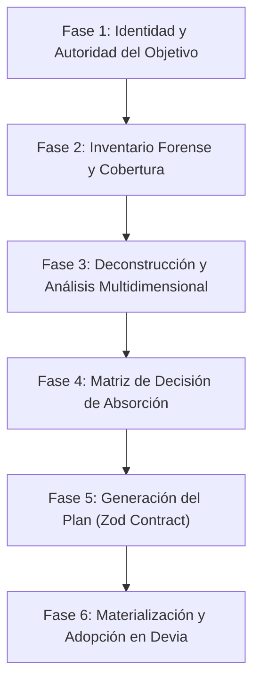

# Auditoría Forense de Ingeniería Inversa y Absorción de Seguridad

Esta Skill dota al agente del rol de **Lead Security Reverse Engineer & Forensic Absorption Architect** dentro del ecosistema **Devia-CyberSecurity**. Permite inspeccionar, deconstruir y auditar cualquier repositorio, plugin, skill, carpeta de código o artefacto externo sin ejecutar código hostil, extraer sistemáticamente sus metodologías, heurísticas y modelos de seguridad bajo las 8 Dimensiones Canónicas, y transformar ese conocimiento en herramientas operativas (Skills, Referencias, Esquemas Zod o Scripts Python) perfectamente integradas en el repositorio.

---

## 🏛️ Las 7 Leyes Inmutables de la Ingeniería Inversa Defensiva

1. **Soberanía y No-Ejecución de Código No Confiable (*Zero Execution of Untrusted Code*):**
   El código o paquete analizado es tratado como dato hostil. Queda estrictamente prohibido ejecutar scripts del objetivo (`npm install`, `setup.py`, `pip install`, macros, migraciones, scripts de build o tests) sin autorización explícita previa del operador. Toda inspección es estática, determinista y aislada.
2. **Precisión Epistemológica Inmutable:**
   Toda afirmación en reportes o planes de absorción debe categorizarse en una de las cuatro categorías: `OBSERVED` (hecho empírico verificado en código o manifest), `DERIVED` (demostración lógica formal), `INFERRED` (hipótesis o convención) o `UNKNOWN` (incertidumbre explícita). Jamás transformar la falta de evidencia en prueba de ausencia o seguridad.
3. **Reconstrucción Clean-Room (*Clean-Room Reverse Engineering*):**
   Se reconstruye lo que el software *hace*, sus invariantes, contratos y lógica; jamás se copia código ciego ni se infringen licencias propietarias (*"Rebuilds what it does, never what it owns"*).
4. **Cadena de Custodia en Cuatro Ledgers:**
   Toda investigación exhaustiva produce y mantiene cuatro ledgers deterministas:
   - `inventory.jsonl` / `summary.json`: Metadatos del sistema de archivos y boundaries.
   - `coverage.jsonl`: Disposición por archivo (`inventoried`, `read`, `traced`, `verified`, `excluded`, `blocked`).
   - `evidence.jsonl`: Citas factuales con identificadores (`SRC-XXX`, `ART-XXX`, `RUN-XXX`), digests SHA-256 y líneas base 1.
   - `unknowns.jsonl`: Preguntas pendientes, contradicciones y dependencias no resueltas.
5. **Absorción Contract-First Tri-Tier:**
   Todo conocimiento absorbido se traduce a la capa técnica exacta de Devia-CyberSecurity:
   - Capa 1: `.agent/skills/` (Skills y Referencias).
   - Capa 2: TypeScript + Zod (`src/schemas/`, `src/types/`, `src/engine/`).
   - Capa 3: Python 3.11+ (`src/scripts/`).
   Ningún artefacto se incorpora sin validar contra esquemas Zod rigurosos.
6. **Reutilización antes de Añadir Maquinaria (*Reuse Before Adding Machinery*):**
   Antes de crear un nuevo archivo o herramienta, evaluar si el conocimiento enriquece un componente existente. Evitar la proliferación innecesaria de archivos o herramientas fragmentadas.
7. **Invariante de Taxonomía Canónica Cerrada (Frontera Inmutable de 8 Dimensiones):**
   Al auditar o absorber conocimiento externo, queda terminantemente prohibido inventar o proponer nuevas dimensiones de seguridad. Cualquier vector de ataque, tecnología externa o paradigma emergente (IA/LLMs, Web3/Smart Contracts, Firmware/IoT, Cloud Serverless) **DEBE obligatoriamente categorizarse y adaptarse a alguna de las 8 dimensiones canónicas autorizadas** (`SecurityDimensionSchema`), preservando el principio MECE del repositorio.

---

## 🧭 Flujo Operativo en 6 Fases



---

### Fase 1: Establecer Identidad, Autoridad y Fronteras del Objetivo

1. **Fijar Rutas e Identidad:**
   - Registrar la ruta suministrada y su resolución canónica absoluta.
   - Registrar fecha/hora UTC (`timestamp ISO 8601`).
   - Si existe Git en el objetivo, capturar el estado sin modificar el working tree:
     ```powershell
     git -C "<TARGET>" rev-parse HEAD
     git --no-optional-locks -C "<TARGET>" status --porcelain=v1 --untracked-files=all
     ```
   - Si no existe `.git`, tratar el objetivo como un snapshot físico determinista.
2. **Definir Fronteras Excluidas:**
   - Excluir explícitamente directorios de runtime o dependencias masivas (`node_modules`, `.venv`, `.git`, `__pycache__`) y registrarlos como límites no atravesados.
   - Detectar enlaces simbólicos o junctions de Windows (`reparse points`) para no caer en ciclos infinitos.

---

### Fase 2: Inventario Forense Determinista y Ledger de Cobertura

Consultar [references/forensic-evidence-and-coverage.md](references/forensic-evidence-and-coverage.md) antes de iniciar la traversal.

1. **Ejecutar el Engine Forense:**
   Utilizar el script de la skill para catalogar el objetivo sin ejecutar ningún archivo:
   ```bash
   python .agent/skills/security-reverse-engineering/scripts/forensic_inventory.py "<TARGET>" -o "<OUTPUT_DIR>/inventory"
   ```
   *Salida generada:* `inventory.jsonl` y `summary.json`.
2. **Construir `coverage.jsonl`:**
   Para cada archivo inventoried, asignar su disposición inicial:
   - `inventoried`: Registrado, pendiente de lectura.
   - `excluded`: Fuera del alcance con justificación explícita.
   - `blocked`: No accesible por permisos o corrupción.
3. **Clasificar el Arquetipo del Objetivo:**
   El engine detecta automáticamente si el objetivo es un Repositorio Source, un Paquete de Skills/Plugins IA, una Aplicación Desktop (Electron/ASAR), un Binario Compilado o una Especificación API. Consultar [references/target-archetypes-guide.md](references/target-archetypes-guide.md) para adaptar la técnica de análisis.

---

### Fase 3: Deconstrucción Arquitectónica y Análisis Multidimensional

1. **Mapeo de Entradas y Superficie de Ataque:**
   - Identificar puntos de entrada (*Entry Points*): rutas HTTP, argumentos CLI, mensajes IPC, variables de entorno, sockets.
   - Identificar límites de confianza (*Trust Boundaries*): separación entre datos no autenticados y procesos de alto privilegio.
2. **Trazabilidad Multidireccional de Flujos (*Taint Analysis*):**
   - **Forward Trace:** Seguir entradas no confiables hasta sumideros sensibles (`eval`, `exec`, `query SQL`, `writeFile`).
   - **Backward Slicing:** Desde operaciones críticas hacia atrás para verificar si existen mecanismos de sanitización o validación de esquemas (e.g. Zod, Pydantic).
3. **Recuperación de Algoritmos e Invariantes:**
   Para cada algoritmo o mecanismo relevante de seguridad (cifrado, validación de tokens, gestión de memoria, control de concurrencia), construir un dossier técnico que detalle:
   - Propósito y módulo propietario.
   - Tipos de entrada y salida, unidades y precondiciones.
   - Pseudocódigo fiel a la implementación (incluyendo ramas de fallo).
   - Invariantes preservados y complejidad computacional temporal/espacial.
4. **Mapeo contra las 8 Dimensiones Canónicas:**
   Clasificar sistemáticamente los hallazgos según [references/security-dimensions-mapping.md](references/security-dimensions-mapping.md):
   1. `THREAT_MODELING_ATTACK_SURFACE`
   2. `SOURCE_CODE_SAST`
   3. `SECRETS_CRYPTOGRAPHY`
   4. `IDENTITY_ACCESS_SESSION`
   5. `SUPPLY_CHAIN_SCA`
   6. `ARCHITECTURE_BOUNDARIES_ZERO_TRUST`
   7. `CONFIGURATION_HARDENING`
   8. `RESILIENCE_LOGGING_TELEMETRY`

---

### Fase 4: Matriz de Decisión y Evaluación Evolutiva de Absorción

Para cada técnica, algoritmo, modelo o metodología de seguridad descubierta en el objetivo, consultar [references/absorption-routing-matrix.md](references/absorption-routing-matrix.md) para determinar su destino canónico y su **intención evolutiva** dentro de **Devia-CyberSecurity**:

#### 1. Mapeo de Destino Canónico
| Si el conocimiento extraído es... | Destino Canónico | Ubicación en Devia-CyberSecurity |
| :--- | :--- | :--- |
| **Metodología agentica completa, autónoma y especializada** | `NEW_SKILL` | `.agent/skills/<nombre-skill>/SKILL.md` |
| **Técnica específica, checklist, catálogo de vectores o guía** | `SKILL_REFERENCE` | `.agent/skills/<skill>/references/<tema>.md` |
| **Algoritmo determinista, cálculo de entropía, AST o parsing** | `PYTHON_SCRIPT` | `src/scripts/<herramienta>.py` |
| **Modelo formal de datos, taxonomía o contrato de validación** | `ZOD_SCHEMA` | `src/schemas/<nombre>.schema.ts` |
| **Runner MCP, comando CLI o motor de orquestación** | `MCP_TOOL_OR_ENGINE` | `src/engine/<módulo>.ts` |
| **Mejora o extensión de una herramienta/schema preexistente** | `UPDATE_EXISTING` | Componente existente (*Reuse before adding*) |

#### 2. Clasificación de Intención Evolutiva (*Evolutionary Intent*)
El agente debe contrastar activamente el hallazgo contra el catálogo central [`docs/VULNERABILITIES.md`](file:///docs/VULNERABILITIES.md) y los componentes existentes en el repositorio, clasificando la acción bajo una de las 6 intenciones formales:

- **`CREATE_NEW` (Crear):** Se descubre una metodología, vector o herramienta sin precedente en el repositorio.
- **`ABSORB_EXPAND` (Absorber y Expandir):** Se adopta conocimiento nuevo dentro de un contenedor o skill preexistente sin crear módulos redundantes.
- **`UPDATE_ENHANCE` (Actualizar y Mejorar):** La técnica externa es más moderna, profunda o exhaustiva que la implementación actual.
- **`ROBUSTIFY_HARDEN` (Robustecer y Endurecer):** Se identifica un método más estricto para mitigar o detectar una vulnerabilidad ya registrada en [`docs/VULNERABILITIES.md`](file:///docs/VULNERABILITIES.md) (e.g. reducción drástica de falsos positivos, mejores umbrales de entropía o filtros AST más seguros).
- **`REFINE_OPTIMIZE` (Refinar y Optimizar):** Se adopta una variante con mejor complejidad algorítmica ($O(1)$, $O(\log n)$), menor consumo de memoria o tipado más estricto (*Kuna Principle*).
- **`CORRECT_FIX` (Corregir):** La evidencia externa demuestra que una regla, patrón regex o asunción previa en nuestro repositorio contenía un fallo, falso negativo o desactualización.

#### 3. Sincronización con el Catálogo de Vulnerabilidades
Si el conocimiento auditado atañe a una vulnerabilidad ya catalogada (e.g. `VULN-SAST-001`, `VULN-CRYP-001`), la acción debe asociar su `existingVulnerabilityId` y estipular la actualización de [`docs/VULNERABILITIES.md`](file:///docs/VULNERABILITIES.md) con los nuevos vectores, severidades o heurísticas descubiertas.

---

### Fase 5: Generación del Plan de Absorción y Ledgers

1. **Ejecutar el Absorption Planner:**
   Sintetizar el inventario y las observaciones en un plan estructurado:
   ```bash
   python .agent/skills/security-reverse-engineering/scripts/absorption_planner.py "<TARGET>" -i "<OUTPUT_DIR>/inventory/inventory.jsonl" -s "<OUTPUT_DIR>/inventory/summary.json" -o "<OUTPUT_DIR>/absorption-plan.json"
   ```
2. **Validar contra el Esquema Zod:**
   El archivo generado `absorption-plan.json` debe validar estrictamente contra `AbsorptionPlanSchema` (`src/schemas/absorption-plan.schema.ts`).
3. **Consolidar Evidencia e Incertidumbres:**
   - Asegurar que cada cita en `evidence.jsonl` tenga `authority` (`SOURCE`, `ARTIFACT`, `RUNTIME`), `claim_class` (`OBSERVED`, `DERIVED`, `INFERRED`) y digest SHA-256 cuando aplique.
   - Asegurar que toda contradicción o aspecto no verificable se registre en `unknowns.jsonl`.

---

### Fase 6: Materialización y Adopción en Devia-CyberSecurity

Una vez aprobado el plan de absorción, materializar los componentes en el repositorio siguiendo el contrato de ingeniería:

1. **Si el destino es `NEW_SKILL`:**
   - Crear el directorio `.agent/skills/<nombre>/` con su respectivo `SKILL.md` y `references/`.
   - Garantizar que adopte el rol defensivo, las directivas de `AGENTS.md` y el idioma español.
2. **Si el destino es `SKILL_REFERENCE`:**
   - Redactar la guía técnica en Markdown con ejemplos de código vulnerable vs seguro y mapeo CWE.
3. **Si el destino es `PYTHON_SCRIPT`:**
   - Escribir código en `src/scripts/` en Python 3.11+ con tipos estrictos y CLI `--json`.
   - Incluir tests unitarios en `tests/` o `scripts/test_*.py` verificados con `python -m unittest`.
4. **Si el destino es `ZOD_SCHEMA`:**
   - Definir el esquema en `src/schemas/<nombre>.schema.ts`.
   - Exportar tipos inferidos en `src/types/index.ts` y el esquema en `src/schemas/index.ts`.
   - Ejecutar `pnpm build` para garantizar cero errores de TypeScript.
5. **Si el destino es `UPDATE_EXISTING`:**
   - Modificar in-place el componente objetivo, preservando comentarios existentes y actualizando las pruebas correspondientes.

---

## 🛠️ Herramientas Integradas de la Skill

| Herramienta | Rol y Ejecución | Salida |
| :--- | :--- | :--- |
| **`forensic_inventory.py`** | Traversal determinista sin ejecución; maneja reparse points / symlinks y calcula hashes de archivos críticos. | `inventory.jsonl`, `summary.json` |
| **`absorption_planner.py`** | Mapea observaciones contra las 8 dimensiones y genera el plan de adopción y dossier ejecutivo. | `absorption-plan.json`, `absorption-plan.md` |
| **`test_forensic_tools.py`** | Suite de pruebas unitarias automáticas para verificar la estabilidad de los scripts. | Aserciones de testing |

---

## 📚 Documentación de Referencia

- [references/forensic-evidence-and-coverage.md](references/forensic-evidence-and-coverage.md) — Cadena de custodia, estados de revisión y clasificación epistemológica.
- [references/security-dimensions-mapping.md](references/security-dimensions-mapping.md) — Mapeo de las 8 Dimensiones Canónicas con taxonomías CWE, OWASP y MITRE.
- [references/absorption-routing-matrix.md](references/absorption-routing-matrix.md) — Matriz de decisión técnica y criterios de asignación por capa.
- [references/target-archetypes-guide.md](references/target-archetypes-guide.md) — Metodologías de deconstrucción según el tipo de objetivo.

---

## ✅ Checklist de Verificación y Cero Deriva

Antes de dar por finalizada una auditoría de ingeniería inversa y absorción, confirmar:

- [ ] Se fijó la identidad del objetivo (ruta canónica, timestamp UTC y commit/checksum).
- [ ] No se ejecutó ningún código no confiable durante la inspección.
- [ ] Se generó `inventory.jsonl` con manejo seguro de symlinks y junctions.
- [ ] Todo juicio emitido está sustentado en `evidence.jsonl` con nivel epistemológico explícito.
- [ ] Las lagunas e incertidumbres están registradas en `unknowns.jsonl`.
- [ ] El plan de absorción clasifica cada elemento estrictamente en las 8 Dimensiones Canónicas sin excepciones ni categorías inventadas.
- [ ] Ningún ítem de conocimiento ni hallazgo propone o utiliza dimensiones fuera de las 8 canónicas autorizadas en `SecurityDimensionSchema`.
- [ ] Cada acción de absorción tiene una capa técnica justificada (Capa 1, 2 o 3) y una ruta en el repositorio.
- [ ] Los esquemas Zod o scripts de Python creados compilan y pasan tests (`pnpm build` y `python -m unittest`).
