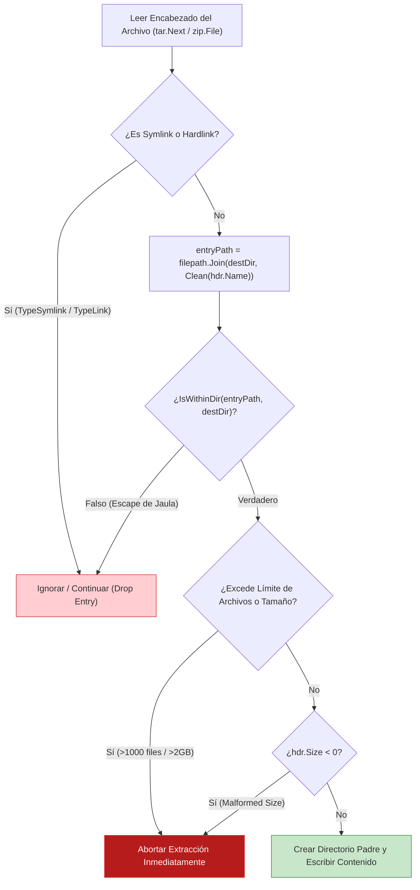

# Sanitización Multiplataforma de Rutas y Prevención Rigurosa de Zip Slip

Este documento consolida las directivas canónicas de análisis estático (SAST) y patrones seguros para descompresión de archivos (Zip / Tar), prevención de Zip Slip (CWE-22) y sanitización de rutas en entornos heterogéneos (Windows / Linux), fundamentado en el diseño defensivo de **PentAGI**.

---

## 1. La Trampa del Separador de Rutas en Windows (`VULN-SAST-007`)

### 1.1. Mecanismo de Evasión
Muchos desarrolladores sanitizan nombres de archivo de usuario aplicando expresiones lineales como:
```javascript
const safeName = userInput.replace(/\//g, "-");
```
O en Go:
```go
cleanName := path.Base(path.Clean(userInput))
```

En entornos Windows, el paquete estándar `path` (a diferencia de `path/filepath`) únicamente reconoce la barra normal `/` como separador. Una entrada hostil como:
`..\..\..\Windows\System32\cmd.exe`
no es segmentada por `path.Base`, permitiendo que la contrabarra `\` atraviese la jaula de directorios al concatenarse con `filepath.Join(uploadDir, cleanName)`.

### 1.2. Patrón de Sanitización Multiplataforma Canónico (`SanitizeFileName`)

Para garantizar total seguridad en cualquier sistema operativo:

```go
func SanitizeFileName(fileName string) (string, error) {
    trimmedName := strings.TrimSpace(fileName)
    if trimmedName == "" {
        return "", errors.New("file name is required")
    }

    // 1. Normalizar todas las contrabarras de Windows a barras canónicas
    normalizedName := strings.ReplaceAll(trimmedName, "\\", "/")

    // 2. Pre-fijar barra raíz para forzar contexto absoluto, limpiar y extraer la base
    cleanName := path.Base(path.Clean("/" + normalizedName))

    // 3. Validación estricta del componente de ruta
    return validatePathComponent(cleanName)
}

func validatePathComponent(component string) (string, error) {
    cleanName := strings.TrimSpace(component)
    if cleanName == "." || cleanName == ".." || cleanName == "/" || cleanName == "" {
        return "", errors.New("invalid file name")
    }
    if len(cleanName) > 255 {
        return "", errors.New("file name exceeds 255 bytes")
    }

    // Rechazar caracteres de control ASCII y caracteres reservados de Windows
    for _, r := range cleanName {
        if r < 0x20 || r == 0x7f {
            return "", errors.New("file name contains control characters")
        }
        switch r {
        case '/', '\\', ':', '*', '?', '"', '<', '>', '|':
            return "", errors.New("file name contains reserved platform characters")
        }
    }

    return cleanName, nil
}
```

---

## 2. Prevención en Profundidad de Zip Slip en Extracción de Archivos

Al descomprimir archivos `tar` o `zip` procedentes de clientes o contenedores Docker de agentes:



### 2.1. Descarte Obligatorio de Enlaces Simbólicos y Físicos
Un atacante puede incluir un enlace simbólico que apunte a `/etc/passwd` o `C:\Windows\System32`, seguido de un archivo regular con el mismo nombre relativo que sobrescriba el archivo del host al desempacar.
```go
if hdr.Typeflag == tar.TypeSymlink || hdr.Typeflag == tar.TypeLink {
    continue // Descartar incondicionalmente enlaces en archivos no confiables
}
```

### 2.2. Verificación Estricta de Contención con Separador de Ruta (`IsWithinDir`)
Comprobar únicamente `strings.HasPrefix(entryPath, destDir)` es vulnerable si `destDir` es `/tmp/target` y `entryPath` es `/tmp/target_evil`. La comprobación debe anexar el separador de ruta del sistema de archivos:

```go
func IsWithinDir(absPath, dir string) bool {
    return strings.HasPrefix(
        filepath.Clean(absPath) + string(filepath.Separator),
        filepath.Clean(dir) + string(filepath.Separator),
    )
}
```

### 2.3. Cuotas de Protección contra Tar / Zip Bombs
- **Límite de Cantidad de Archivos:** Rechazar archivos con más de 1,000 entradas (`MaxPullFiles = 1000`).
- **Límite de Tamaño Descomprimido:** Acumular el tamaño de cada archivo (`totalSize += hdr.Size`) y abortar si excede 2 GB (`MaxPullTotalSize`).
- **Validación de Tamaño Negativo:** Rechazar encabezados con `hdr.Size < 0` para evitar desbordamientos de enteros en asignación de memoria.
