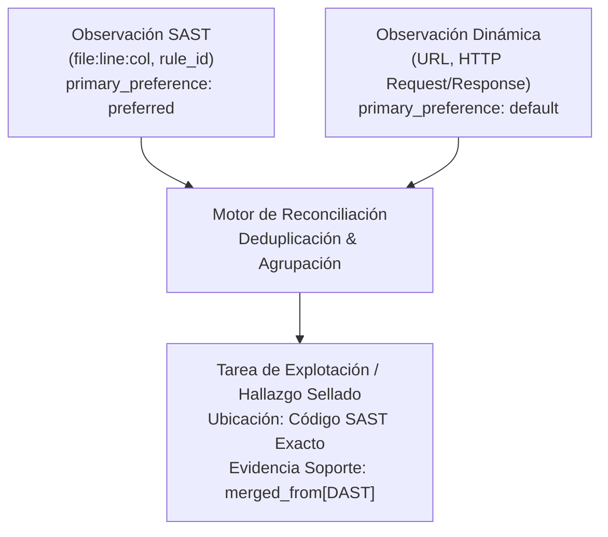

# Reconciliación Determinista de Hallazgos SAST/DAST y Linaje Criptográfico de Auditorías

Este documento establece la metodología autoritativa para fusionar, deduplicar y conciliar hallazgos provenientes de múltiples motores de análisis (Análisis Estático de Código SAST y Pruebas Dinámicas / DAST / Pentest) preservando una cadena de custodia criptográfica inmutable.

---

## 🏛️ 1. El Problema de la Deriva entre Análisis Estático y Dinámico

En auditorías integrales de seguridad, los escáneres estáticos (SAST) y los agentes de explotación dinámica (DAST) analizan el mismo sistema desde perspectivas complementarias:
- **SAST:** Conoce la ubicación exacta del código fuente (archivo, función, línea, columna y regla AST), pero carece de certeza sobre la alcanzabilidad en runtime (*reachability*), lo que genera falsos positivos teóricos.
- **DAST / Pentest Dinámico:** Descubre endpoints vulnerables y demuestra el impacto con un exploit funcional o PoC en runtime, pero desconoce la línea de código exacta o la función raíz causante de la falla.

**El Antipatrón Habitual:**
1. Tratar ambos flujos como incidencias independientes, duplicando alertas para el mismo fallo en el reporte final.
2. Permitir que la observación dinámica sobrescriba la ubicación de código fuente con una conjetura superficial de LLM.
3. Manipular artefactos intermedios en formato Markdown sin verificar la integridad criptográfica de las etapas anteriores.

---

## 🛡️ 2. El Contrato de Reconciliación con Linaje Criptográfico (Patrón Shannon)

### 2.1. Regla de Precedencia Primaria (*Primary Preference Contract*)

Cuando la reconciliación identifica que una observación estática (`sast`) y una dinámica (`vulnerability_analysis`) corresponden al mismo vector subyacente:

$$\text{Task}_{\text{primary}} = \text{Finding}_{\text{SAST}} \quad \text{con} \quad \text{Finding}_{\text{DAST}} \in \text{Task.merged\_from}$$

- **La evidencia SAST se convierte en el registro primario de la tarea:** Preserva el archivo exacto, número de línea, columna y `rule_id` autoritativo verificado en el AST.
- **La evidencia DAST se conserva como evidencia de soporte:** Se anexa a la lista `merged_from` con sus parámetros HTTP, payload de prueba y respuesta del servidor.
- **La propiedad `primary_preference` es efímera:** Una vez materializada la tarea, este campo interno se elimina para no contaminar el reporte final.



---

## 🔗 3. Linaje Criptográfico en Cadena de Artefactos (*Artifact Input Digests*)

Cada fase del pipeline de análisis produce artefactos intermedios numerados e inmutables:
1. `producer-observations`: Observaciones brutas emitidas por cada analizador.
2. `supplemental-observations`: Observaciones enriquecidas con contexto de código y mappings CWE.
3. `task-formation`: Agrupación y descarte de redundancias.
4. `fixed-tasks`: Tareas finales reconciliadas y listas para el reporte o verificación.

### 3.1. Estructura de Control de Integridad

Cada artefacto generado debe calcular y almacenar la lista de hashes SHA-256 de todos sus insumos directos:

```typescript
export interface ArtifactInputDigest {
  readonly artifactKind: string;
  readonly sha256: string;
}

export interface ArtifactRef {
  readonly path: string;
  readonly artifactKind: string;
  readonly schemaVersion: 1;
  readonly sha256: string;
  readonly inputs: readonly ArtifactInputDigest[];
  readonly counts: Readonly<Record<string, number>>;
}
```

### 3.2. Verificación de Invariante de Linaje

Antes de procesar la fase $N+1$, el motor verifica que el hash SHA-256 del archivo en disco coincida exactamente con el digest registrado en el ticket de entrada. Si un archivo fue modificado, truncado o regenerado fuera de orden, el pipeline aborta con `INTEGRITY_MISMATCH`.

---

## 📊 4. Mapeo Canónico de Taxonomía CWE hacia Familias Operativas

Para evitar la dispersión de categorías en el reporte SARIF o en la visualización para el operador, las debilidades CWE se proyectan deterministamente hacia familias funcionales:

| Familia Funcional | CWEs Representativos Mapeados | Prioridad Típica |
| :--- | :--- | :--- |
| **`INJECTION`** | CWE-89 (SQLi), CWE-78 (OS Cmd), CWE-94/95 (Code Injection), CWE-502 (Deserialization), CWE-22 (Path Traversal), CWE-1321 (Prototype Pollution), CWE-1336 (SSTI). | **P1** |
| **`XSS`** | CWE-79 (Cross-Site Scripting Reflected/Stored/DOM). | **P1** |
| **`AUTH`** | CWE-287 (Broken Auth), CWE-798 (Hardcoded Credentials), CWE-306 (Missing Auth), CWE-330 (Weak Randomness), CWE-327 (Broken Crypto). | **P1 / P2** |
| **`AUTHZ`** | CWE-639 (IDOR/BOLA), CWE-285 (Improper Authz), CWE-269 (Privilege Escalation), CWE-862 (Missing Authz), CWE-653 (Tenant Isolation). | **P1** |
| **`SSRF`** | CWE-918 (Server-Side Request Forgery). | **P1** |
| **`MISCELLANEOUS`** | Cualquier CWE válido que no pertenezca a las 5 clases principales (CWE-601 Open Redirect, CWE-1021 Clickjacking, CWE-1333 ReDoS, CWE-532 Logging). | **P2 / P3** |

> [!NOTE]
> **Principio de Fallback Seguro:** Ningún hallazgo con formato CWE válido debe descartarse por ausencia en el mapeo principal. Se enruta automáticamente a la familia `MISCELLANEOUS` conservando su identificador original para garantizar cobertura completa en exports SARIF 2.1.0.
