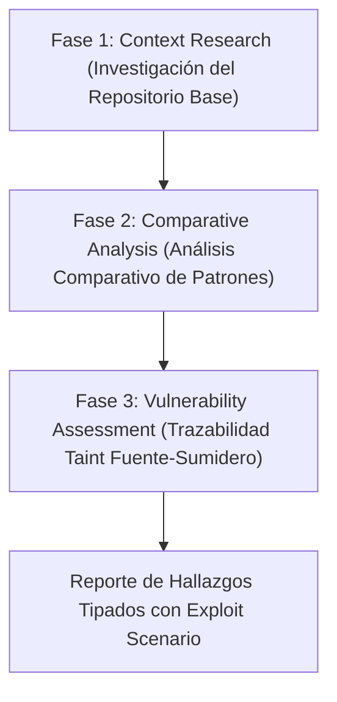

# Guía Metodológica de Auditoría Semántica y Comparativa de Pull Requests (Diff-Aware SAST)

Esta guía establece el protocolo operativo para la auditoría de seguridad de cambios de código incrementales en **Pull Requests (PRs)** y ramas git dentro de la Skill **`source-code-sast`** de **Devia-CyberSecurity**, absorbida y adaptada a partir de los patrones de ingeniería de **Anthropic** (`claude-code-security-review`).

---

## 🎯 El Desafío del Análisis Diferencial

Analizar únicamente el diff (`git diff`) de un cambio introduce un riesgo epistemológico severo: **Discontinuidad de Taint en Código Incremental (`VULN-SAST-006`)**. Si el escáner ignora el contexto del repositorio base, asumirá falsamente que las funciones de base de datos no usan parametrización o que las entradas no están validadas, inundando la revisión de falsos positivos o sufriendo puntos ciegos.

Para solucionar esto, se aplica la **Metodología de Auditoría en 3 Fases**.

---

## 🧭 Flujo de Auditoría en Tres Fases



---

### Fase 1: Investigación del Contexto del Repositorio (*Repository Context Research*)

Antes de evaluar una sola línea del diff, el auditor debe mapear la arquitectura y las defensas preexistentes en la rama base:

1. **Frameworks y Librerías de Sanitización:**
   - Identificar ORMs o Query Builders en uso (Prisma, TypeORM, SQLAlchemy, Hibernate, Dapper). Si el proyecto usa Prisma u ORMs tipados, las consultas normales están automáticamente parametrizadas; solo las consultas raw (`$queryRawUnsafe`) requieren alerta.
   - Detectar frameworks de validación de esquemas (Zod, Pydantic, Joi, class-validator).
   - Identificar motores de plantillas y su configuración de auto-escape (Jinja2, Mustache, React JSX, Angular Signals).
2. **Límites de Confianza y Middleware de Seguridad:**
   - Ubicación y reglas de autenticación centralizada (Cognito, Supabase Auth, Passport, Spring Security).
   - Middleware global de autorización (RBAC/ABAC) y CORS/CSP en routers perimetrales.
3. **Descarte Temprano de Archivos Generados:**
   - Omitir inmediatamente diffs que contengan encabezados de generación automática:
     ```text
     @generated
     Code generated by OpenAPI Generator
     Code generated by protoc-gen-go
     AUTO-GENERATED FILE DO NOT EDIT
     ```

---

### Fase 2: Análisis Comparativo de Patrones (*Comparative Analysis*)

En esta fase se contrastan las modificaciones contra las convenciones seguras ya establecidas en el repositorio:

1. **Desviaciones de Patrones Seguros:**
   - ¿El nuevo código introduce una llamada `db.query("SELECT ... " + input)` en un módulo donde el resto del código usa consultas parametrizadas con placeholders `$1`?
   - ¿El nuevo endpoint omite el middleware `@UseGuards(AuthGuard)` presente en todos los demás controladores hermanos?
2. **Aparición de Nuevas Superficies de Ataque:**
   - ¿El PR expone una ruta pública no autenticada?
   - ¿Se incorporan nuevos parsers de archivos (XML, YAML, ZIP, tar) o librerías de deserialización (`pickle`, `unserialize`, `eval`)?

---

### Fase 3: Evaluación de Vulnerabilidades y Taint Tracking (*Vulnerability Assessment*)

Para cada archivo modificado con impacto potencial:

1. **Forward Taint Slicing:**
   - Identificar los puntos de entrada creados o modificados (`req.body`, `req.query`, `sys.argv`, eventos de socket).
   - Seguir el flujo de los datos a través de asignaciones, retornos de función y llamadas a métodos hasta llegar a un **sumidero sensible (*sink*)**:
     - *SQL Sink:* `db.execute()`, `cursor.execute()`, `$queryRaw()`.
     - *Command Sink:* `subprocess.run()`, `exec()`, `spawn()`, `os.system()`.
     - *Path Sink:* `fs.readFile()`, `open()`, `shutil.unpack_archive()`.
     - *Code Sink:* `eval()`, `Function()`, `yaml.load(Loader=Loader)`.
2. **Backward Verification:**
   - Desde el sink hacia atrás, confirmar si existe sanitización demostrable. Si la sanitización ocurre en un helper de la rama base, inspeccionar dicho archivo para validar su robustez antes de emitir un fallo.

---

## 📋 Estructura Canónica del Hallazgo en PRs

Todo hallazgo emitido debe proporcionar datos estructurados que incluyan un escenario concreto de explotación (*exploit scenario*):

```json
{
  "file": "src/controllers/search.controller.ts",
  "line": 42,
  "severity": "HIGH",
  "category": "sql_injection",
  "description": "El parámetro 'query' recibido en el endpoint de búsqueda se concatena directamente en la consulta SQL sin parametrización.",
  "exploit_scenario": "Un atacante no autenticado puede enviar en la URL '?query=admin%27--' para bypass de autenticación o '?query=1; DROP TABLE users--' para destrucción de datos.",
  "recommendation": "Sustituir la interpolación de cadenas por la función parametrizada prisma.$queryRaw`SELECT * FROM items WHERE name = ${query}`.",
  "confidence": 0.95,
  "codeEvidence": [
    {
      "role": "user_input",
      "path": "src/controllers/search.controller.ts",
      "line": 38,
      "snippet": "const { query } = req.query;"
    },
    {
      "role": "sink",
      "path": "src/controllers/search.controller.ts",
      "line": 42,
      "snippet": "const results = await db.$queryRawUnsafe(`SELECT * FROM items WHERE name = '${query}'`);"
    }
  ]
}
```

---

## ⚡ Regla de Oro en Auditorías Incrementales

> **Invariante:** En la auditoría de un Pull Request, **solo se reportan vulnerabilidades introducidas o empeoradas por el diff**. Las deficiencias históricas preexistentes en código no modificado no deben bloquear el PR y deben canalizarse a revisiones periódicas de repositorio completo.
