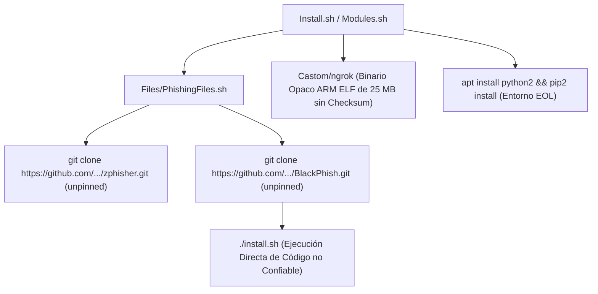

# Criterios de Seguridad y Auditoría de Cadena de Suministro en Meta-Instaladores y Agregadores de Software

Esta referencia técnica define el marco de evaluación de riesgos de la cadena de suministro de software (SCA) enfocado en suites de empaquetado, meta-instaladores y herramientas que agregan código de terceros (`VULN-SCA-008`, `VULN-SCA-009`, `VULN-SCA-010`).

---

## 🏛️ 1. El Riesgo Sistémico del Patrón "Meta-Installer"

Un **Meta-Instalador** es un script o framework que promete centralizar la instalación y ejecución de múltiples utilidades independientes (e.g. suites de pentesting, instaladores de entornos o gestores de scripts).

Desde una perspectiva defensiva, este modelo introduce **vulnerabilidades críticas en cascada**:
1. **Multiplicación de la Superficie de Ataque:** La seguridad del sistema anfitrión queda supeditada a la postura del proyecto más débil o descuidado entre todos los agregados.
2. **Dependencias sin Fijar (Unpinned Upstream Repositories):** Clonar repositorios de Git directamente desde la rama por defecto (`main`, `master`) expone a los usuarios a ejecuciones maliciosas ante cualquier commit no supervisado.
3. **Ejecución Incondicional de Hooks de Instalación:** Invocar scripts de configuración externos (`./install.sh`, `python setup.py`, `bash install-termux.sh`) otorga privilegios de ejecución de comandos sin previa inspección estática.

---

## 🔍 2. Caso de Estudio: AllHackingTools

En la auditoría forense de `AllHackingTools` se documentaron tres manifestaciones severas de este fallo:



### 2.1. Clonado Masivo no Anclado (VULN-SCA-008)
El script `Files/PhishingFiles.sh` clona secuencialmente:
- `htr-tech/zphisher`
- `AbirHasan2005/ShellPhish`
- `hangetzzu/saycheese`
- `iinc0gnit0/BlackPhish` $\to$ ejecuta `./install.sh`
- `mishakorzik/Mask-Phish.Termux`
- `thewhiteh4t/seeker`
- `DeepSociety/AIOPhish` $\to$ ejecuta `bash install-termux.sh`
- `Viralmaniar/I-See-You`
- `An0nUD4Y/blackeye`

**Vectores de Explotación:**
- **Repo-Jacking:** Si el desarrollador original elimina o renombra su cuenta de GitHub, un atacante puede registrar el nombre antiguo y tomar el control del repositorio clonado por todos los clientes del meta-instalador.
- **Compromiso de Cuenta Upstream:** Un compromiso de credenciales del autor de cualquiera de los proyectos permite inyectar payloads destructivos en `./install.sh`.

### 2.2. Binarios Opacos Bundled (VULN-SCA-009)
Se incluye en el árbol de control de versiones un archivo ELF binario de 25.98 MB (`Castom/ngrok`) compilado para ARM de 32 bits, sin archivo de procedencia, manifiesto SBOM ni checksum SHA-256. El script lo copia a `$HOME` y le otorga permisos de ejecución (`chmod +x`).

### 2.3. Adopción de Runtimes Descontinuados (VULN-SCA-010)
Se fuerza al usuario a instalar `python2` y `pip2` para operar herramientas legacy, forzando la cohabitación con librerías obsoletas que ya no reciben parches de seguridad (EOL Enero 2020).

---

## 🛡️ 3. Reglas Inmutables para la Auditoría de Meta-Instaladores

Al auditar cualquier agregador de software o script de aprovisionamiento masivo, el analista debe exigir el cumplimiento de los siguientes controles:

### Control 1: Fijación Criptográfica Inmutable (Commit SHA-256 / SHA-1 de 40 Hex)
Queda terminantemente prohibido el uso de `git clone` apuntando a ramas mutables (`main`, `master`, `dev`) o tags mutables (`@v1`, `@latest`). Todo recurso externo debe descargarse anclado a un commit hash estricto:
```bash
# Correcto: Clonado anclado por commit SHA inmutable
git clone https://github.com/trusted/tool.git && cd tool && git checkout 514c1dc0dd28c2f2d2468f5d46fa153f4f904a44
```

### Control 2: Validación de Integridad Pre-Ejecución
Ningún archivo binario o script descargado de internet debe ejecutarse sin verificar previamente su hash SHA-256 contra un catálogo inmutable firmado:
```bash
echo "538a7431df141a929a250eaf6ed7afdcce817bcd8cfe60b61f4c6d7a289b1d1c  binary" | sha256sum -c - || exit 1
```

### Control 3: Prohibición de Binarios Opacos en Repositorios Source
Los repositorios de código fuente no deben alojar binarios ejecutables compilados (`.exe`, `.bin`, `.so`, ELF). Los binarios deben generarse mediante compilación reproducible o distribuirse a través de canales de lanzamiento con firmas GPG y atestaciones SLSA (*Supply-chain Levels for Software Artifacts*).

### Control 4: Aislamiento en Contenedores Epímeros (Zero Trust Host)
Toda suite de herramientas de prueba debe instanciarse dentro de contenedores independientes (Docker, Podman) con perfiles de red restringidos (`--net=none` o allowlists de DNS) y capacidades de Linux mínimas (`--cap-drop=ALL`), impidiendo que un hook de instalación altere el sistema operativo anfitrión.
