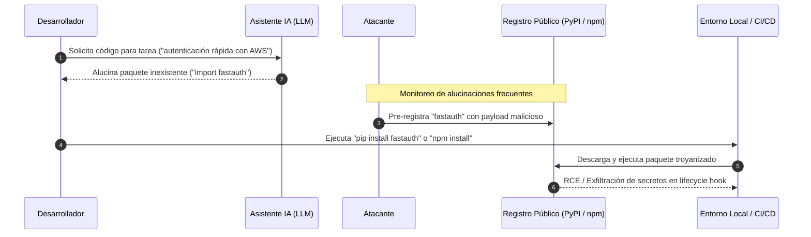

# Detección de Slopsquatting y Alucinaciones de Paquetes en Dependencias IA

Este documento establece la metodología autoritativa para detectar, clasificar y mitigar ataques de **Slopsquatting** (pre-registro malicioso de paquetes alucinados por modelos de IA generativa) en el ecosistema **Devia-CyberSecurity**, conforme a la taxonomía canónica (`VULN-SCA-006` / CWE-829 / CWE-1395 / OWASP A08:2025).

---

## 🎯 1. Anatomía del Ataque de Slopsquatting

El auge de asistentes de codificación (GitHub Copilot, ChatGPT, Claude, Cursor) ha introducido una nueva superficie de ataque en la cadena de suministro de software:



---

## 🔬 2. Heurística Canónica de Clasificación en 3 Estados

Al auditar cualquier base de código o manifest generado o asistido por IA, cada paquete de terceros no registrado en lockfiles deterministas se clasifica en uno de los tres estados:

| Estado | Definición Operativa | Criterio Técnico | Nivel de Riesgo |
| :--- | :--- | :--- | :--- |
| **`phantom`** | **Alucinación Fantasma** | El paquete es importado en el código fuente pero **no existe en el registro público oficial** (PyPI HTTP 404 / npm HTTP 404). | **CRITICAL** (Vector inminente de pre-registro por atacantes). |
| **`suspicious`** | **Trampa Potencial** | El paquete existe en el registro, pero su fecha de creación inicial es **menor a 30 días** ($\Delta t < 30 \text{ días}$) y carece de tracción comunitaria probada. | **HIGH** (Posible trampa ya plantada esperando instalaciones inadvertidas). |
| **`verified`** | **Paquete Maduro** | El paquete existe en el registro con una antigüedad mayor a 30 días y múltiples releases históricas. | **LOW / INFORMATIONAL** (Sujeto a auditoría SCA estándar de CVEs). |

---

## 🛠️ 3. Algoritmo Seguro de Extracción AST vs Regex

### El Antipatrón: Expresiones Regulares Lineales
La extracción de paquetes mediante expresiones regulares lineales (`re.match(r"^import\s+(\w+)", line)`) genera:
1. **Falsos Positivos:** Confunde imports comentados dentro de docstrings multilínea o bloques de documentación con código activo.
2. **Falsos Negativos:** Ignora imports dinámicos (`__import__('pkg')`, `importlib.import_module('pkg')`) o sentencias estructuradas complejas.

### El Patrón Seguro: Análisis Sintáctico AST en Python

```python
import ast
from typing import Set

def extract_python_ast_imports(source_code: str) -> Set[str]:
    """Extrae paquetes de primer nivel utilizando el árbol sintáctico abstracto."""
    packages: Set[str] = set()
    try:
        tree = ast.parse(source_code)
    except SyntaxError:
        return packages

    for node in ast.walk(tree):
        if isinstance(node, ast.Import):
            for alias in node.names:
                packages.add(alias.name.split(".")[0])
        elif isinstance(node, ast.ImportFrom):
            if node.module and node.level == 0:  # Ignora imports relativos (.module)
                packages.add(node.module.split(".")[0])
    return packages
```

---

## 🌐 4. Validación Segura contra APIs de Registros

Al consultar APIs remotas (PyPI o npm), se deben aplicar dos invariantes de seguridad obligatorias:

1. **Codificación URL Estricta (`urllib.parse.quote`):**  
   Los nombres de paquetes en npm que utilizan scope (`@scope/package`) deben codificar la barra inclinada como `%2F`:
   `https://registry.npmjs.org/@scope%2Fpackage`  
   Nunca interpolar cadenas directamente en URLs para prevenir traversals o peticiones malformadas.
2. **Cálculo de Antigüedad Basado en Releases Iniciales:**
   ```python
   import httpx
   from datetime import datetime, timezone
   import urllib.parse

   def verify_pypi_age(package_name: str) -> dict:
       encoded = urllib.parse.quote(package_name, safe="")
       url = f"https://pypi.org/pypi/{encoded}/json"
       resp = httpx.get(url, timeout=10.0, follow_redirects=False)
       if resp.status_code == 404:
           return {"name": package_name, "status": "phantom"}
       
       data = resp.json()
       releases = data.get("releases", {})
       created_dt = None
       for files in releases.values():
           for f in files:
               up_time = f.get("upload_time")
               if up_time:
                   dt = datetime.fromisoformat(up_time).replace(tzinfo=timezone.utc)
                   if created_dt is None or dt < created_dt:
                       created_dt = dt

       age_days = (datetime.now(timezone.utc) - created_dt).days if created_dt else 999
       return {
           "name": package_name,
           "status": "suspicious" if age_days < 30 else "verified",
           "age_days": age_days
       }
   ```

---

## 📋 5. Acciones de Remediación Defensiva

1. **Si un paquete es `phantom`:**
   - Retirar inmediatamente la sentencia de importación del código fuente.
   - Reemplazar la funcionalidad con bibliotecas consolidadas del ecosistema o módulos nativos (`stdlib`).
   - Bloquear el nombre del paquete en las políticas de gobernanza de dependencias internas.
2. **Si un paquete es `suspicious`:**
   - Detener la construcción en CI/CD y requerir auditoría manual del código fuente del paquete y sus hooks de instalación (`setup.py`, `postinstall`).
   - Congelar el hash de integridad criptográfica (SHA-512) en el lockfile determinista antes de permitir su uso.
