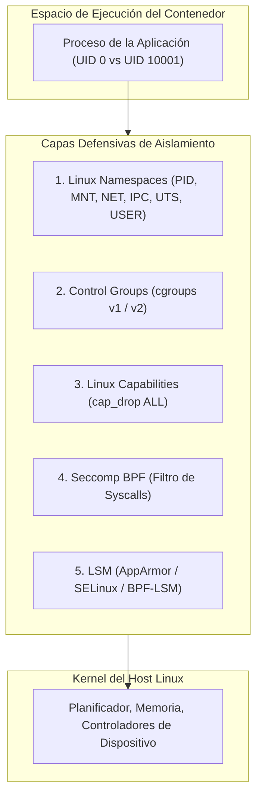

# Auditoría de Aislamiento, Ruptura de Contención y Evasión de Contenedores (Container Breakout & Namespace Hardening)

Este documento establece las directivas y patrones de evaluación técnica para auditar fronteras de aislamiento en entornos de contenedores (**Docker**, **containerd**, **Podman** y **Kubernetes**), previniendo y mitigando vectores de escape hacia el sistema operativo anfitrión (*host*).

---

## 🏛️ Taxonomía y Mapeo Multimarco

| Marco de Seguridad | Identificador | Denominación Oficial |
| :--- | :--- | :--- |
| **Dimensión Canónica** | `ARCHITECTURE_BOUNDARIES_ZERO_TRUST` | Fronteras de Aislamiento, IPC y Zero Trust |
| **Catálogo Devia** | [`VULN-ARCH-017`](file:///docs/VULNERABILITIES.md) | Root Execution with Container Escape & Headless Browser Sandbox Disablement |
| **CWE** | [`CWE-250`](https://cwe.mitre.org/data/definitions/250.html) | Execution with Unnecessary Privileges |
| **CWE** | [`CWE-653`](https://cwe.mitre.org/data/definitions/653.html) | Improper Isolation or Compartmentalization |
| **CWE** | [`CWE-668`](https://cwe.mitre.org/data/definitions/668.html) | Exposure of Resource to Wrong Sphere |
| **OWASP Top 10** | `A05:2021` | Security Misconfiguration |
| **MITRE ATT&CK** | `T1611` | Escape to Host |
| **MITRE ATT&CK** | `T1068` | Exploitation for Privilege Escalation |

---

## 🔍 1. Anatomía del Aislamiento en Contenedores Linux

Los contenedores no son máquinas virtuales; son **procesos confinados en el espacio de usuario que comparten el mismo kernel del anfitrión**. Su frontera de aislamiento depende de cinco primitivas interconectadas:



Si cualquiera de estas capas se debilita mediante configuraciones erróneas (`--privileged`, montajes de sockets de control o capabilities no filtradas), el límite de confianza colapsa, permitiendo al proceso subordinado tomar el control del nodo anfitrión.

---

## ⚠️ 2. Catálogo de Vectores Críticos de Fuga (Breakout)

### Vector 2.1: Abuso del Socket de Gestión del Runtime (`/var/run/docker.sock`)
- **Mecanismo:** Montar el socket de control de Docker dentro de un contenedor otorga acceso de superusuario al demonio de Docker del anfitrión. Un atacante con ejecución dentro del contenedor puede interactuar con el socket vía HTTP/REST y solicitar la creación de un nuevo contenedor sobreprivilegiado con la raíz del host montada (`/ -> /host`).
- **Comprobación Estática:**
  ```bash
  # Detección de montaje del socket en docker-compose.yml o manifiestos de K8s
  grep -rn "/var/run/docker.sock" .
  ```
- **Remediación:** Erradicar montajes de `/var/run/docker.sock`. Si se requiere construcción de imágenes en pipelines CI/CD, migrar a herramientas daemonless y de espacio de usuario seguro como **Kaniko**, **Buildah** o **Podman rootless**.

---

### Vector 2.2: Contenedor Privilegiado (`--privileged`) y Montaje de Disco
- **Mecanismo:** El parámetro `--privileged` deshabilita el filtro Seccomp, otorga la totalidad de las Linux Capabilities al contenedor y levanta el confinamiento de `/dev`. Un atacante puede crear nodos de dispositivo en `/dev` o montar particiones físicas del anfitrión:
  ```bash
  # Identificación de particiones del host desde el contenedor privilegiado
  fdisk -l
  # Montaje directo del sistema de archivos raíz del host
  mkdir /mnt/host && mount /dev/sda1 /mnt/host
  ```
- **Remediación:** Prohibir terminantemente `--privileged` en entornos de producción y CI/CD mediante políticas de admisión Kubernetes (`PodSecurityStandard: Restricted`).

---

### Vector 2.3: Capabilities de Alto Riesgo (`CAP_SYS_ADMIN`, `CAP_SYS_PTRACE`, `CAP_NET_ADMIN`)
Aun sin `--privileged`, la concesión individual de ciertas capabilities abre rutas directas de escape:

| Capability | Riesgo Arquitectónico | Mecanismo Típico de Escape |
| :--- | :--- | :--- |
| `CAP_SYS_ADMIN` | Equivalente al 80% de root | Montaje de sistemas de archivos (`mount`), manipulación de namespaces y configuración de cgroups. |
| `CAP_SYS_PTRACE` | Depuración e inyección | Si se comparte el PID namespace (`--pid=host`), permite inyectar código en procesos del anfitrión vía `ptrace`. |
| `CAP_SYS_MODULE` | Carga de módulos de kernel | Carga de módulos `.ko` maliciosos directamente en el espacio de kernel del host. |
| `CAP_DAC_OVERRIDE` | Bypass de permisos POSIX | Lectura/escritura en cualquier archivo si se montó algún directorio del anfitrión. |
| `CAP_NET_ADMIN` | Control de red y tablas de enrutamiento | Manipulación de interfaces físicas, ARP spoofing y envenenamiento de tráfico en redes host. |

---

### Vector 2.4: Evasión de cgroups v1 mediante `notify_on_release`
- **Mecanismo:** En kernels Linux con cgroups v1, si el contenedor posee `CAP_SYS_ADMIN`, puede montar un cgroup propio, habilitar `notify_on_release=1` y definir `release_agent` apuntando a un script ejecutable. Al terminar el último proceso del cgroup, el kernel del anfitrión ejecuta el comando definido en `release_agent` con privilegios de superusuario del host.
- **Remediación:** Migración mandatoria a **cgroups v2** (unificado), donde `release_agent` ha sido eliminado y sustituido por notificaciones eBPF sin ejecución automática arbitraria.

---

### Vector 2.5: Fugas por Descriptores de Archivo del Runtime (Leaky Vessels - CVE-2024-21626)
- **Mecanismo:** En versiones vulnerables de `runc` ($\le 1.1.11$), durante la inicialización del proceso hijo antes de ejecutar `execve`, quedaban abiertos descriptores de archivo apuntando a `/sys/fs/cgroup` o directorios del host. Un proceso podía navegar a través de `/proc/self/fd/<fd>` y escapar hacia el sistema de archivos del anfitrión antes del sellado del chroot.
- **Remediación:** Actualizar `runc` a la versión $\ge 1.1.12$ y habilitar `O_CLOEXEC` en todos los descriptores de infraestructura del runtime.

---

## 🛡️ 3. Directivas de Bastionado Defensivo (Zero Trust Container Blueprint)

### 3.1. Dockerfile Seguro por Defecto (Secure by Default)

```dockerfile
# Antipatrón Vulnerable:
# FROM node:20
# COPY . .
# CMD ["node", "server.js"]  <-- Ejecuta como root (UID 0), FS escribible

# Blueprint Bastionado Devia-CyberSecurity:
FROM node:20-alpine AS build
WORKDIR /app
COPY package*.json ./
RUN npm ci --only=production
COPY . .

FROM node:20-alpine AS runtime
WORKDIR /app

# 1. Crear usuario sin privilegios explícito con UID/GID > 10000
RUN addgroup -g 10001 appgroup && \
    adduser -u 10001 -G appgroup -s /sbin/nologin -D appuser

# 2. Copiar artefactos verificados con propiedad estricta
COPY --from=build --chown=10001:10001 /app /app

# 3. Forzar ejecución como usuario no-root
USER 10001:10001

# 4. Exponer puertos no privilegiados (> 1024)
EXPOSE 8080

ENTRYPOINT ["node", "server.js"]
```

---

### 3.2. Configuración de Despliegue Docker Compose Bastionada

```yaml
version: "3.8"
services:
  web-service:
    image: app:secure-v1
    user: "10001:10001"
    # 1. Eliminar la totalidad de capabilities de Linux
    cap_drop:
      - ALL
    # 2. Sistema de archivos inmutable en memoria de solo lectura
    read_only: true
    # 3. Montar directorios temporales estrictamente en tmpfs con noexec y nosuid
    tmpfs:
      - /tmp:rw,noexec,nosuid,size=64m
      - /run:rw,noexec,nosuid,size=16m
    # 4. Prevenir ganancia de privilegios adicionales
    security_opt:
      - no-new-privileges:true
      - seccomp:unconfined # Falso -> Usar perfil Seccomp estricto por defecto
    # 5. Límites deterministas de CPU y Memoria (prevención DoS / OOM)
    deploy:
      resources:
        limits:
          cpus: "1.0"
          memory: 512M
    # 6. Aislamiento de red (prohibido host networking)
    network_mode: bridge
```

---

## 📋 4. Checklist de Auditoría Forense y Verificación

Antes de aprobar el despliegue de cualquier imagen o pod, el auditor debe validar:

- [ ] **No-Root:** El contenedor corre bajo un UID no cero (`id -u` $\neq 0$).
- [ ] **Drop Capabilities:** La lista `cap_drop` incluye explícitamente `ALL`, añadiendo solo las requeridas estrictamente (e.g. `NET_BIND_SERVICE`).
- [ ] **No Privileged:** El parámetro `--privileged` está ausente de manifiestos y scripts de arranque.
- [ ] **Sin Sockets Host:** No existen montajes de `/var/run/docker.sock`, `/var/run/containerd.sock` ni `/run/podman/podman.sock`.
- [ ] **Filesystem Inmutable:** `read_only: true` está activo; escrituras volátiles confinadas en `tmpfs:noexec,nosuid`.
- [ ] **No New Privileges:** La flag `PR_SET_NO_NEW_PRIVS` está activada impidiendo escaladas mediante binarios SUID.
- [ ] **Runtimes Actualizados:** Motores `runc`, `containerd` y `docker-ce` parcheados contra CVE-2024-21626 y CVE-2019-5736.
