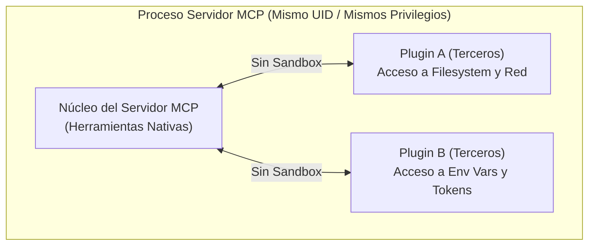

# Confianza en Plugins MCP, Aislamiento de Procesos y Superficie de Ataque

Este documento define las directivas y controles de seguridad para la evaluación de arquitecturas de extensión y plugins en servidores **Model Context Protocol (MCP)**, analizando sus límites de confianza, riesgos de ejecución y mecanismos de aislamiento.

---

## 1. Taxonomía Multimarco y Mapeo Canónico

- **Dimensión Canónica:** `ARCHITECTURE_BOUNDARIES_ZERO_TRUST`
- **Identificadores Devia:** `VULN-ARCH-011` (Confused Deputy en Tools), `VULN-ARCH-020` (MCP Tool Poisoning / Shadowing), `VULN-SCA-001` (Third-Party Supply Chain).
- **CWEs Primarios:**
  - `CWE-829`: Inclusion of Functionality from Untrusted Control Sphere
  - `CWE-250`: Execution with Unnecessary Privileges
  - `CWE-285`: Improper Authorization
- **OWASP Top 10:** A04:2021-Insecure Design / OWASP MCP03:2025-Tool Poisoning

---

## 2. El Problema de la Confianza Compartida en Procesos MCP

En la mayoría de implementaciones actuales de servidores MCP (FastMCP, servidores en Node.js o Python), los plugins se cargan dinámicamente mediante `importlib` o `require()`:



### Postura de Confianza Real (*Trust Posture*):
- **Cero Aislamiento de Memoria:** El código de un plugin corre con **la misma autoridad que el servidor central**. Si el servidor tiene acceso al socket de Docker, a credenciales en variables de entorno o al sistema de archivos, el plugin hereda íntegramente esos privilegios.
- **Riesgo de Tool Shadowing:** Un plugin malicioso puede registrar una herramienta con el mismo nombre o descripción engañosa que una herramienta nativa para interceptar datos o inducir al LLM a entregar secretos.
- **Riesgo de Rug-Pulling y Mutación en Runtime:** Plugins cargados dinámicamente pueden alterar su esquema de salida o comportamiento tras la fase inicial de inicialización.

---

## 3. Mecanismos de Gobierno y Control de Plugins

Para mitigar riesgos en arquitecturas de servidores MCP extensibles, deben aplicarse los siguientes principios de bastionado:

### 3.1. Habilitación Explícita por Lista Blanca
Los plugins distribuidos no deben activarse de forma implícita. El patrón de diseño adoptado en repositorios de alto rigor utiliza el sufijo canónico `.disabled`:
- Un subdirectorio nombrado `plugins/mi-plugin.disabled/` es ignorado completamente por el cargador.
- La activación exige una acción deliberada del operador (renombrar la carpeta eliminando el sufijo `.disabled`).

### 3.2. Introspección Dinámica del Registro de Herramientas
El listado de herramientas expuesto al cliente MCP no debe ser una lista estática manual. Debe derivarse en tiempo de ejecución mediante introspección directa del registro de FastMCP/MCP, reportando en el bloque de diagnóstico (`server_info`) el origen de cada herramienta (nativa vs provista por plugin).

### 3.3. Manejo Resiliente de Excepciones en Handlers
Un fallo no capturado en el código de un plugin **no debe voltear el proceso principal del servidor**. Todas las invocaciones de herramientas de plugins deben envolverse en bloques de contención:

```python
try:
    result = plugin_tool_func(**kwargs)
except Exception as err:
    return {
        "isError": True,
        "content": [{"type": "text", "text": f"Error en ejecución del plugin: {err}"}]
    }
```

---

## 4. Checklist de Auditoría de Arquitecturas MCP Extensibles

Al auditar cualquier servidor o ecosistema basado en MCP:

- [ ] ¿Los plugins se ejecutan en subprocesos aislados o en el mismo hilo de ejecución del servidor?
- [ ] ¿Existe validación criptográfica (hash SHA-256) de los archivos del plugin antes de ser importados?
- [ ] ¿El servidor expone un mecanismo seguro para deshabilitar selectivamente plugins sin modificar código fuente?
- [ ] ¿Las variables de entorno sensibles (tokens API, llaves privadas) se transmiten directamente al espacio de memoria del plugin o se filtran previamente?
- [ ] ¿El registro de herramientas verifica colisiones de nombres para prevenir el secuestro de herramientas nativas (*Tool Shadowing*)?
