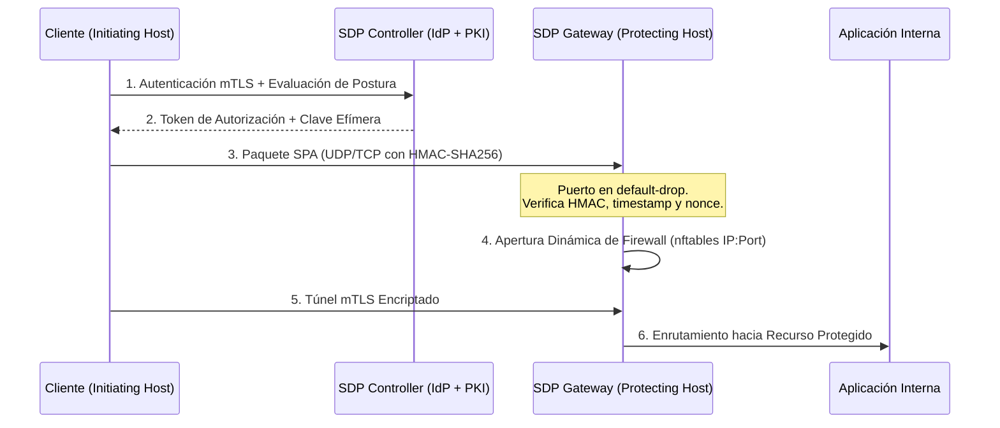

# Perímetro Definido por Software (SDP) y Single Packet Authorization (SPA)

Este documento establece los principios de ingeniería, arquitectura de pasarelas y validación criptográfica para implementar y auditar soluciones de **Perímetro Definido por Software (SDP)** según la especificación **CSA v2.0** en el ecosistema **Devia-CyberSecurity**.

---

## 🏛️ 1. Arquitectura de Nube Oscura (*Dark Cloud Architecture*)

En las arquitecturas tradicionales de red (VPNs convencionales, firewalls de borde), los servicios exponen puertos abiertos (e.g. 443, 80, 22) que son visibles para cualquier escáner no autenticado (Nmap, Shodan, Masscan), convirtiéndose en objetivos directos de ataques de día cero y explotación de vulnerabilidades.

El **Perímetro Definido por Software (SDP)** invierte este paradigma adoptando la arquitectura **"Verificar Primero, Conectar Después"** (*Verify-Before-Connect*):



1. **Invisibilidad Absoluta (*Dark Gateways*):** La pasarela SDP tiene una regla por defecto de descarte total (`iptables -P INPUT DROP`). Escaneos de puertos no reciben respuesta (aparecen como `filtered` o `invisible`).
2. **Autorización de Paquete Único (SPA):** Un solo paquete criptográfico autentica y autoriza al cliente antes de que la pasarela responda con un paquete TCP SYN-ACK.
3. **Apertura Efímera y Microsegmentada:** El cortafuegos abre una regla exclusivamente para la IP de origen del cliente, en el puerto acordado y durante un tiempo acotado.

---

## 🔐 2. Estructura Criptográfica del Paquete SPA

El paquete SPA debe ser compacto, estructurado y resistente a ataques de manipulación y repetición (*Replay Attacks*):

```
┌───────────────────┬───────────────────────────────────────────┬────────────────────┐
│ Longitud (4 bytes)│ Payload JSON Serializado (Variable)       │ HMAC-SHA256 (32 B) │
│ (Big-Endian UInt) │ {version, source_ip, service, ts, nonce}  │                    │
└───────────────────┴───────────────────────────────────────────┴────────────────────┘
```

### Contenido del Payload JSON:
- `version`: Entero que identifica la versión del protocolo (e.g. `2`).
- `source_ip`: Dirección IP pública del cliente que solicita la conexión.
- `service`: Identificador del recurso o servicio solicitado.
- `timestamp`: Marca de tiempo Unix en segundos (con soporte decimal).
- `nonce`: Cadena pseudoaleatoria criptográfica de alta entropía (mínimo 16 caracteres).

---

## 🚨 3. Análisis de Vulnerabilidad y Mitigación Anti-Replay (`VULN-ARCH-026`)

### El Antipatrón Inseguro (Omisión de Caché de Nonces):
En implementaciones deficientes de SPA, el validador verifica la firma HMAC y comprueba únicamente que la antigüedad del paquete no exceda la ventana de tolerancia (e.g. 60 segundos):

```python
# ❌ INSEGURO: Omisión de caché de nonces (VULN-ARCH-026)
age = time.time() - payload["timestamp"]
if age > 60:
    return False # Rechazado por antigüedad
# Vulnerable: Un atacante puede retransmitir el paquete capturado
# dentro de los 60 segundos y abrir el puerto repetidamente.
```

### El Patrón Seguro de Devia-CyberSecurity:
Se exige la implementación obligatoria de una **caché de ventana deslizante con expiración TTL** que registre cada nonce procesado:

```python
# ✅ SEGURO: Verificación HMAC + Validación Temporal + Deduplicación de Nonces
def validate_spa_secure(packet: bytes, key: str, max_age: int = 60, nonce_cache: dict = None) -> bool:
    payload_len = struct.unpack("!I", packet[:4])[0]
    payload = packet[4:4 + payload_len]
    mac = packet[4 + payload_len:]
    
    # 1. Verificación de firma en tiempo constante
    expected_mac = hmac.new(key.encode(), payload, hashlib.sha256).digest()
    if not hmac.compare_digest(mac, expected_mac):
        return False
        
    data = json.loads(payload.decode())
    now = time.time()
    age = now - data["timestamp"]
    
    # 2. Tolerancia temporal bidireccional
    if age > max_age or age < -5.0:
        return False
        
    # 3. Mitigación Anti-Replay: Detección y registro de Nonce
    nonce = data["nonce"]
    if nonce in nonce_cache:
        raise SecurityException(f"SPA Replay Attack detected for nonce {nonce}")
        
    nonce_cache[nonce] = now + max_age # Expira al pasar la ventana
    return True
```

---

## 📋 4. Checklist de Hardening para Pasarelas SDP (CSA v2.0)

- [ ] **Default-Drop:** La pasarela descarta todo tráfico entrante por defecto (`DROP` en `iptables`/`nftables`).
- [ ] **Validación SPA Obligatoria:** Ningún socket TCP escucha de forma pública sin previa autorización SPA.
- [ ] **Mitigación Anti-Replay en SPA:** Registro en memoria de nonces con expiración TTL acotada (`VULN-ARCH-026`).
- [ ] **mTLS con Certificados Efímeros:** Los certificados de cliente emitidos por el controlador deben tener una validez máxima de 72 horas para minimizar ventanas de revocación.
- [ ] **Alineación de Controladores:** El controlador SDP debe estar protegido en alta disponibilidad (HA) e integrado con IdP corporativo (SAML/OIDC).
