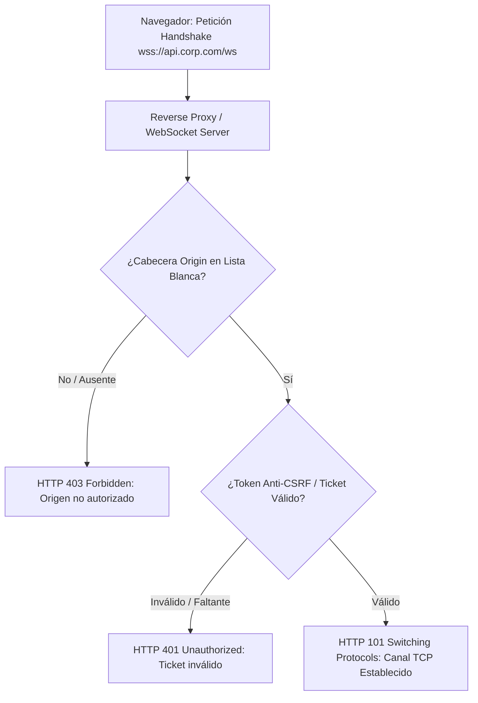

# Guía de Bastionado de Canales WebSocket y Mitigación de CSWSH

Esta referencia técnica describe los principios de análisis arquitectónico, modelado de fronteras de confianza y bastionado defensivo contra **Cross-Site WebSocket Hijacking (CSWSH)** y manipulación no autorizada de flujos de mensajes, catalogada bajo **`VULN-ARCH-030`** en **Devia-CyberSecurity**.

---

## 🏛️ Contexto y Mecanismo del Fallo

El protocolo WebSocket (RFC 6455) inicia mediante una petición HTTP estándar con cabecera `Upgrade: websocket`. Tras el apretón de manos (handshake) exitoso, la conexión cambia a un canal TCP dúplex bidireccional de baja latencia.

A diferencia de las peticiones HTTP tradicionales donde aplica la política de mismo origen (*Same-Origin Policy - SOP*), **los navegadores web no aplican la SOP por defecto a las conexiones WebSocket**:
- Un script que se ejecuta en `https://attacker.com` puede iniciar una conexión WebSocket hacia `wss://victim-bank.com/ws`.
- El navegador web del usuario adjunta automáticamente las cookies de sesión y credenciales de autenticación HTTP existentes para `victim-bank.com` en la petición de handshake inicial.
- Si el servidor WebSocket no valida la cabecera `Origin` o no exige un token anti-CSRF efímero, la conexión se establece exitosamente.
- El atacante puede enviar comandos arbitrarios a través del socket o escuchar la telemetría y mensajes privados transmitidos en tiempo real al usuario (**Cross-Site WebSocket Hijacking - CSWSH**).

---

## 🔍 Taxonomía y Mapeo Multimarco

| Estándar / Marco | Identificador | Denominación Oficial |
| :--- | :--- | :--- |
| **CWE** | **CWE-346** | Origin Validation Error |
| **CWE** | **CWE-352** | Cross-Site Request Forgery (CSRF) |
| **OWASP Top 10** | **A01:2021/2025** | Broken Access Control |
| **MITRE ATT&CK** | **T1189** | Drive-by Compromise |
| **Devia Catalog** | **`VULN-ARCH-030`** | Cross-Site WebSocket Hijacking (CSWSH) & Missing Handshake Origin Validation |

---

## ⚙️ Invariante de Seguridad y Arquitectura de Handshake



---

## 💻 Implementación Vulnerable vs Bastionada en Node.js (ws)

### Antipatrón Vulnerable: Aceptación Ciega de Handshake
```typescript
// VULNERABLE: Confianza ciega en cookies sin validar Origin
import { WebSocketServer } from "ws";

const wss = new WebSocketServer({ port: 8080 });

wss.on("connection", (ws, req) => {
  // Peligro: Si req.headers.origin es 'https://evil.com', el socket se abre igual!
  console.log("Nueva conexión establecida desde:", req.headers.origin);
  
  ws.on("message", (data) => {
    // Procesa transacciones basándose en la sesión autenticada por cookie
    processTransaction(data);
  });
});
```

### Patrón Seguro: Validación de Origin y Autenticación Basada en Tickets Efímeros
```typescript
// SEGURO: Validación estricta de Origin y verificación de ticket de conexión
import { WebSocketServer } from "ws";
import http from "node:http";

const ALLOWED_ORIGINS = new Set([
  "https://app.corp.local",
  "https://portal.corp.local"
]);

const server = http.createServer();
const wss = new WebSocketServer({ noServer: true });

server.on("upgrade", (req, socket, head) => {
  const origin = req.headers.origin;

  // 1. Verificación obligatoria de Origin
  if (!origin || !ALLOWED_ORIGINS.has(origin.toLowerCase())) {
    socket.write("HTTP/1.1 403 Forbidden\r\n\r\n");
    socket.destroy();
    return;
  }

  // 2. Validación de Ticket Efímero (Token de un solo uso entregado previamente vía HTTPS)
  const url = new URL(req.url!, `https://${req.headers.host}`);
  const ticket = url.searchParams.get("ticket");

  if (!ticket || !validateAndConsumeTicket(ticket)) {
    socket.write("HTTP/1.1 401 Unauthorized\r\n\r\n");
    socket.destroy();
    return;
  }

  // 3. Completar apretón de manos seguro
  wss.handleUpgrade(req, socket, head, (ws) => {
    wss.emit("connection", ws, req);
  });
});
```

---

## 🛡️ Principios Canónicos de Hardening en WebSockets

1. **Atributo `SameSite=Strict` en Cookies:**
   - Si las cookies de sesión tienen `SameSite=Strict`, los navegadores modernos **no las enviarán** en la petición de handshake de WebSocket si la conexión se originó desde un sitio cruzado (cross-site).
2. **Tokens Efímeros de Handshake (WebSocket Ticket Pattern):**
   - El cliente obtiene un ticket de sesión criptográficamente aleatorio y de corta duración (<30 segundos) mediante una llamada REST autenticada (`POST /api/ws-ticket`).
   - El ticket se pasa como parámetro en la URL de conexión (`wss://example.com/ws?ticket=...`) y se consume de forma atómica in-memory.
3. **Autenticación a Nivel de Mensaje:**
   - En canales de alta sensibilidad, no asumir que la apertura del socket confiere autorización permanente. Exigir firmas o tokens de sesión en transacciones críticas transmitidas sobre el socket.

---

## ✅ Checklist de Auditoría para Evaluadores de Devia-CyberSecurity

- [ ] El servidor WebSocket valida obligatoriamente la cabecera `Origin` en el handshake HTTP contra una lista blanca explícita de dominios.
- [ ] No se utilizan cookies como único factor de autenticación para el handshake de WebSocket.
- [ ] Se implementa el patrón de tickets efímeros de conexión de un solo uso (*Single-Use WebSocket Tickets*).
- [ ] Las cookies de autenticación de la aplicación tienen configurado el atributo `SameSite=Strict` o `SameSite=Lax`.
- [ ] Se rechazan conexiones que no especifiquen cabecera `Origin` cuando la API esté diseñada exclusivamente para clientes de navegador.
- [ ] Se aplican límites de tasa (rate limiting) y límites máximos de tamaño de mensaje (e.g. `maxPayload: 64 * 1024`) para prevenir DoS por fragmentación de frames.
