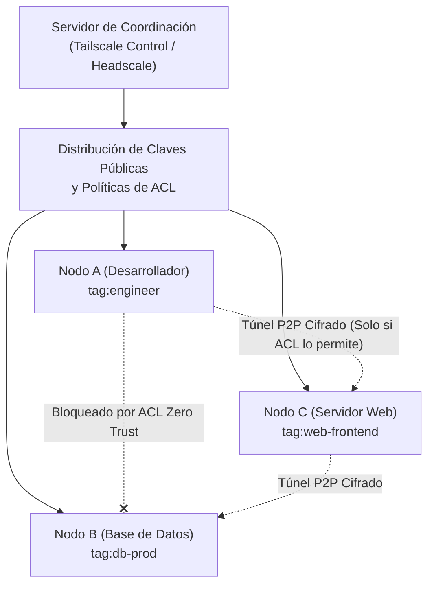

# Hardening de Redes de Malla Zero Trust WireGuard y Políticas Tailscale

Este documento establece las directivas técnicas de bastionado (*Hardening*), gobernanza de listas de control de acceso (ACLs) y mitigación de brechas de persistencia en redes malladas peer-to-peer (Tailscale / Headscale / WireGuard) dentro del ecosistema **Devia-CyberSecurity**.

---

## 🏛️ 1. Arquitectura de Malla Zero Trust (*WireGuard Mesh Architecture*)

Tailscale y Headscale construyen una red mallada cifrada punto a punto (*overlay network*) utilizando el protocolo **WireGuard** con intercambio de claves Curve25519 sobre el framework de ruido (*Noise protocol*).

A diferencia de las VPNs tradicionales basadas en concentradores perimetrales donde un cliente autenticado obtiene visibilidad sobre toda la subred interna, una red Zero Trust mallada exige:



1. **Aislamiento por Defecto:** Ningún nodo puede comunicarse con otro a menos que exista una regla ACL explícita que lo autorice.
2. **Identidad Vinculada a Tags:** Las políticas deben asociarse a etiquetas de infraestructura inmutables (`tag:db-prod`, `tag:ingress`) en lugar de direcciones IP volátiles o usuarios humanos específicos.
3. **Control Plano Desacoplado:** El tráfico de datos viaja directamente de nodo a nodo (P2P cifrado); el servidor de coordinación únicamente distribuye claves públicas y políticas.

---

## 🚨 2. Detección y Mitigación de Antipatrones Críticos de ACL

### 1. La Regla Permisiva "Allow-All" (`src=* dst=*:*`):
El error más común en despliegues iniciales es configurar una regla permisiva para simplificar pruebas:

```json
// ❌ INSEGURO: Anula la microsegmentación Zero Trust
{
  "acls": [
    { "action": "accept", "src": ["*"], "dst": ["*:*"] }
  ]
}
```

**Impacto:** Permite que cualquier dispositivo conectado al tailnet (incluyendo computadoras personales de empleados o dispositivos comprometidos) alcance todos los puertos de los servidores productivos.

**Patrón Seguro:** Segmentación estricta por roles y etiquetas:
```json
// ✅ SEGURO: Microsegmentación de mínimo privilegio
{
  "tagOwners": {
    "tag:production-servers": ["group:cloud-admins"],
    "tag:developer-workstations": ["group:engineering"]
  },
  "acls": [
    {
      "action": "accept",
      "src": ["tag:developer-workstations"],
      "dst": ["tag:production-servers:443", "tag:production-servers:22"]
    }
  ]
}
```

---

## 🚨 3. Análisis de Vulnerabilidad: Desactivación de Caducidad de Claves (`VULN-ARCH-027`)

### El Riesgo de `keyExpiryDisabled: true`:
Por defecto, Tailscale exige que los nodos renueven su clave y reautentiquen su sesión contra el proveedor de identidad (Okta, Google, Azure AD) cada 180 días.

Muchos administradores configuran `keyExpiryDisabled: true` en laptops o dispositivos de usuario para evitar interrupciones de sesión:

```json
// ❌ INSEGURO: Dispositivo sin expiración de clave (VULN-ARCH-027)
{
  "hostname": "laptop-contractor",
  "keyExpiryDisabled": true
}
```

**Impacto:** Si la estación de trabajo es robada, extraviada o el empleado es desvinculado de la empresa sin revocar manualmente el dispositivo en la consola, el nodo retiene acceso permanente a la red interna sin requerir reautenticación ante el IdP.

**Directiva de Devia-CyberSecurity:**
- La directiva `keyExpiryDisabled: true` queda **estrictamente restringida a servidores desatendidos** (`tags` de servidor) que cuenten con claves de autenticación fija (*authkeys*) y monitoreo centralizado.
- Todos los dispositivos con sesión interactiva de usuario deben exigir caducidad de clave periódica obligatoria.

---

## 🛡️ 4. Checklist de Hardening para Redes Malladas WireGuard

- [ ] **Erradicación de `src=* dst=*:*`:** Verificar que no existan reglas de acceso universal en la sección `acls`.
- [ ] **Auditoría de Expiración de Claves:** Confirmar que ningún nodo de usuario tenga `keyExpiryDisabled: true` (`VULN-ARCH-027`).
- [ ] **Modo Escudos Arriba (*Shields Up*):** Habilitar `blocksIncomingConnections: true` en estaciones de trabajo para impedir que otros peers inicien conexiones entrantes hacia el equipo local.
- [ ] **Reglas de Acceso SSH Granulares:** Exigir `action: "check"` para conexiones SSH en lugar de `action: "accept"`, forzando MFA periódica en sesiones de consola administrativa.
- [ ] **Aprobación Manual de Subnet Routers:** Restringir las rutas de subred y nodos de salida (*exit nodes*) mediante aprobadores automáticos acotados (`autoApprovers`), evitando que un nodo no autorizado secuestre el tráfico de red de la empresa.
