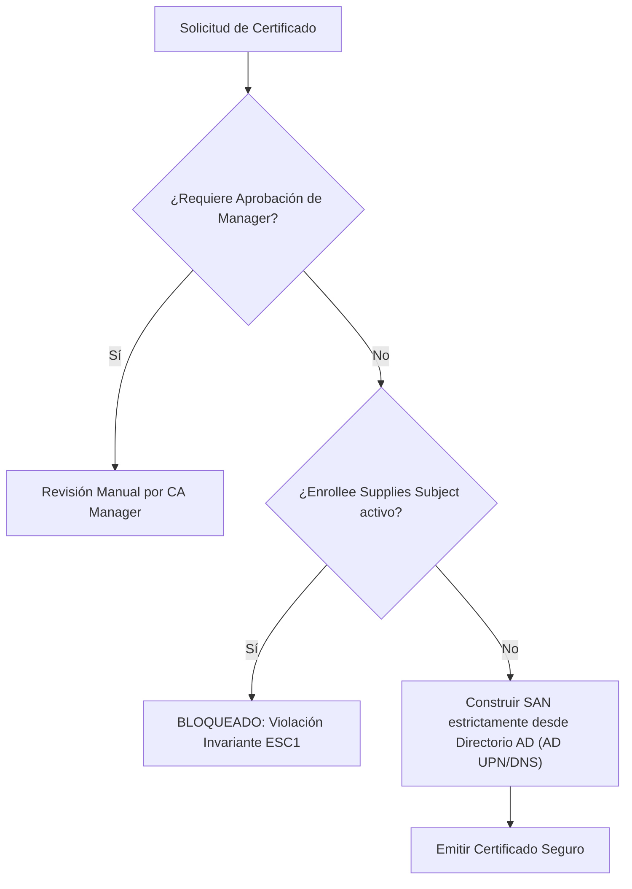

# Guía de Auditoría de Plantillas AD CS (ESC1 a ESC8) y Prevención de Falsificación SAN

Esta referencia técnica proporciona la metodología de auditoría defensiva, detección y remediación para vulnerabilidades en **Active Directory Certificate Services (AD CS)**, catalogada canónicamente bajo **`VULN-IAM-015`** en el ecosistema **Devia-CyberSecurity**.

---

## 🏛️ Contexto y Mecanismo del Fallo

Active Directory Certificate Services (AD CS) actúa como la infraestructura de clave pública (PKI) nativa para entornos Windows Server. Cuando una plantilla de certificado combina:
1. Permisos de inscripción (`Enroll` o `AutoEnroll`) para grupos no privilegiados (e.g. `Domain Users` o `Authenticated Users`).
2. La bandera `CT_FLAG_ENROLLEE_SUPPLIES_SUBJECT` (`0x00000001`) en el atributo `msPKI-Certificate-Name-Flag`.
3. Un Extended Key Usage (EKU) que permite autenticación (`Client Authentication` OID `1.3.6.1.5.5.7.3.2` o `Smartcard Logon` OID `1.3.6.1.5.2.3.4`).
4. Ausencia de aprobación administrativa previa (`CT_FLAG_PEND_ALL_REQUESTS`).

Cualquier usuario del dominio puede solicitar un certificado digital especificando un **Subject Alternative Name (SAN)** arbitrario correspondiente a una cuenta de alto privilegio (e.g. `administrator@corp.local` o el controlador de dominio). Una vez emitido el certificado, el atacante utiliza **PKINIT** para solicitar un Ticket Granting Ticket (TGT) de Kerberos como el usuario suplantado, logrando compromiso total del dominio (*Domain Takeover*).

---

## 🔍 Taxonomía y Mapeo Multimarco

| Estándar / Marco | Identificador | Denominación Oficial |
| :--- | :--- | :--- |
| **CWE** | **CWE-295** | Improper Certificate Validation |
| **CWE** | **CWE-287** | Improper Authentication |
| **OWASP Top 10** | **A07:2021/2025** | Identification and Authentication Failures |
| **MITRE ATT&CK** | **T1649** | Steal or Forge Authentication Certificates |
| **MITRE ATT&CK** | **T1558.001** | Steal or Forge Kerberos Tickets: Golden Ticket |
| **Devia Catalog** | **`VULN-IAM-015`** | Active Directory Certificate Services (AD CS) ESC1 Misconfiguration |

---

## 🛡️ Taxonomía de Escenarios de Abuso AD CS (ESC1 a ESC8)

- **ESC1:** `ENROLLEE_SUPPLIES_SUBJECT` habilitado + EKU de autenticación cliente + permisos de enrolamiento a grupos generales.
- **ESC2:** Plantilla con EKU `Any Purpose` (OID `2.5.29.37.0`) o sin EKU, utilizable para cualquier función criptográfica.
- **ESC3:** Plantilla de agente de inscripción de certificados (`Certificate Request Agent` OID `1.3.6.1.4.1.311.20.2.1`), que permite enrolar certificados en nombre de terceros.
- **ESC4:** Permisos de escritura sobre el objeto de plantilla AD (`GenericAll`, `WriteDacl`, `WriteOwner`), permitiendo a un operador no privilegiado activar `ENROLLEE_SUPPLIES_SUBJECT`.
- **ESC6:** La CA tiene configurada la bandera `EDITF_ATTRIBUTESUBJECTALTNAME2` a nivel global, permitiendo inyectar SAN en cualquier plantilla, incluso en aquellas sin `ENROLLEE_SUPPLIES_SUBJECT`.
- **ESC7:** Permisos administrativos sobre el servicio de la CA (`ManageCA` o `ManageCertificates`).
- **ESC8:** Endpoints HTTP de inscripción Web de la CA (`/certsrv/`) sin firma requerida, susceptibles a **NTLM Relay**.

---

## ⚙️ Invariante de Seguridad y Configuración Defensiva



### Configuración Vulnerable en Active Directory (LDAP msPKI-Certificate-Name-Flag)
```ldif
# Plantilla vulnerable: el usuario cliente suministra el SAN
dn: CN=VulnerableUserCert,CN=Certificate Templates,CN=Public Key Services,CN=Services,CN=Configuration,DC=corp,DC=local
msPKI-Certificate-Name-Flag: 1
pKIExtendedKeyUsage: 1.3.6.1.5.5.7.3.2
```

### Configuración Hardened (Remediada)
```powershell
# 1. Desactivar el flag ENROLLEE_SUPPLIES_SUBJECT en la plantilla
Set-ADObject -Identity "CN=VulnerableUserCert,CN=Certificate Templates,CN=Public Key Services,CN=Services,CN=Configuration,DC=corp,DC=local" `
    -Replace @{'msPKI-Certificate-Name-Flag' = 0x44000001} # CT_FLAG_SUBJECT_REQUIRE_DIRECTORY_PATH | CT_FLAG_SUBJECT_REQUIRE_COMMON_NAME

# 2. Exigir aprobación explícita de CA Manager si la plantilla debe soportar SANs externos
Set-ADObject -Identity "CN=VulnerableUserCert,CN=Certificate Templates,CN=Public Key Services,CN=Services,CN=Configuration,DC=corp,DC=local" `
    -Add @{'msPKI-Enrollment-Flag' = 0x00000002} # CT_FLAG_PEND_ALL_REQUESTS
```

---

## 📊 Telemetría y Caza de Amenazas en Windows Event Log

1. **Event ID 4886 (Certificate Services received a certificate request):**
   - Auditar el campo `Requester` vs `Attributes` (especialmente `SAN: upn=administrator@corp.local`).
2. **Event ID 4887 (Certificate Services approved and issued a certificate):**
   - Correlacionar certificados emitidos con duraciones anómalas o extensiones SAN divergentes del nombre SAM de la cuenta que realizó la solicitud.
3. **Event ID 4768 (A Kerberos authentication ticket (TGT) was requested):**
   - `Pre-Authentication Type: 16` (PKINIT).
   - `CertIssuerName` y `CertSerialNumber` registran el certificado específico utilizado para autenticarse como Administrador.

---

## ✅ Checklist de Auditoría para Evaluadores de Devia-CyberSecurity

- [ ] Todas las plantillas con EKU `Client Authentication` obtienen el nombre de sujeto exclusivamente desde el Directorio (`Build from Active Directory information`).
- [ ] Ninguna plantilla con `CT_FLAG_ENROLLEE_SUPPLIES_SUBJECT` tiene permisos de inscripción asignados a `Domain Users` o `Authenticated Users`.
- [ ] La bandera global `EDITF_ATTRIBUTESUBJECTALTNAME2` está deshabilitada en todas las CAs del bosque (`certutil -config "CA" -setreg policy\EditFlags -EDITF_ATTRIBUTESUBJECTALTNAME2`).
- [ ] Los endpoints HTTP de inscripción (`/certsrv/`) exigen HTTPS estricto y Extended Protection for Authentication (EPA) o han sido dados de baja.
- [ ] Se monitorizan los eventos 4886/4887 en el SIEM con reglas de alerta ante discrepancias entre la cuenta solicitante y el UPN del certificado.
