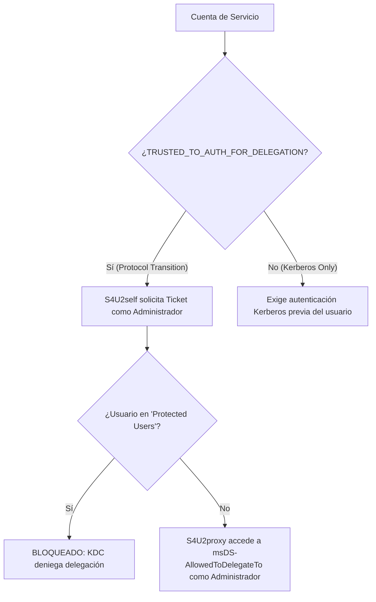

# Guía de Auditoría de Delegación Restringida Kerberos y Transición de Protocolos S4U

Esta referencia técnica proporciona los principios de auditoría defensiva, detección y remediación para riesgos derivados de la **Delegación Restringida Kerberos (KCD)** y las extensiones **Service for User (S4U)**, catalogada bajo **`VULN-IAM-016`** en **Devia-CyberSecurity**.

---

## 🏛️ Contexto y Mecanismo del Fallo

Kerberos provee mecanismos para que un servicio de aplicación (e.g. un servidor web IIS) pueda actuar en nombre de un usuario ante un recurso backend (e.g. una base de datos SQL):

1. **Delegación No Restringida (Unconstrained Delegation):**
   - El controlador de dominio (KDC) incrusta una copia completa del TGT del usuario en el Ticket de Servicio. El servidor receptor puede impersonar al usuario ante **cualquier** servicio de la red. Si el servidor es comprometido, cualquier TGT almacenado en memoria (LSASS) queda expuesto.
2. **Delegación Restringida Clásica (KCD con Protocol Transition):**
   - El atributo `msDS-AllowedToDelegateTo` enumera los nombres de servicio (SPNs) exactos a los que la cuenta puede delegar.
   - Sin embargo, si la cuenta tiene activa la bandera `TRUSTED_TO_AUTH_FOR_DELEGATION` en `userAccountControl`, puede invocar la extensión **S4U2self** para solicitar un ticket de servicio para sí misma impersonando a **cualquier usuario** (incluso sin que el usuario se haya autenticado mediante Kerberos).
   - A continuación, mediante **S4U2proxy**, la cuenta utiliza ese ticket para solicitar un ticket hacia los SPNs listados en `msDS-AllowedToDelegateTo` como el usuario suplantado (e.g. un Domain Admin).
3. **Delegación Restringida Basada en Recursos (RBCD):**
   - El recurso backend define en su atributo `msDS-AllowedToActOnBehalfOfOtherIdentity` qué cuentas tienen autorización para delegar hacia él.

---

## 🔍 Taxonomía y Mapeo Multimarco

| Estándar / Marco | Identificador | Denominación Oficial |
| :--- | :--- | :--- |
| **CWE** | **CWE-287** | Improper Authentication |
| **CWE** | **CWE-269** | Improper Privilege Management |
| **OWASP Top 10** | **A01:2021/2025** | Broken Access Control |
| **MITRE ATT&CK** | **T1558** | Steal or Forge Kerberos Tickets |
| **MITRE ATT&CK** | **T1078.002** | Valid Accounts: Domain Accounts |
| **Devia Catalog** | **`VULN-IAM-016`** | Kerberos Constrained Delegation & S4U Protocol Transition Abuse |

---

## ⚙️ Invariante de Seguridad y Controles de Mitigación

### Directivas de Endurecimiento en Active Directory

1. **Inclusión en el Grupo de Seguridad `Protected Users`:**
   - Todo usuario miembro de `Protected Users` (SID `S-1-5-21-...-525` introducido en Windows Server 2012 R2) **no puede ser objeto de delegación Kerberos**, ni restringida ni no restringida.
   - El KDC rechaza cualquier solicitud S4U2self o S4U2proxy que intente impersonar a un miembro de este grupo.
2. **Atributo `ACCOUNTDISABLE` y `NOT_DELEGATED`:**
   - Habilitar la bandera `Account is sensitive and cannot be delegated` en las cuentas administrativas (`userAccountControl` flag `0x100000` / `TRUSTED_FOR_DELEGATION` invertido).
3. **Migración a RBCD con Cuentas de Servicio Administradas por Grupos (gMSA):**
   - Reemplazar cuentas con contraseñas estáticas por gMSAs cuyas contraseñas de 128 caracteres rotan automáticamente cada 30 días.
   - Configurar la delegación en el destino (`msDS-AllowedToActOnBehalfOfOtherIdentity`) eliminando privilegios delegados globales en la cuenta emisora.

---

## 📊 Telemetría y Caza de Amenazas en Windows Event Log

1. **Event ID 4769 (A Kerberos service ticket was requested):**
   - `ServiceName`: Monitorear solicitudes hacia servicios de infraestructura (`CIFS`, `LDAP`, `HOST`, `RPCSS`).
   - `TicketEncryptionType`: Tickets generados vía S4U con cifrado RC4 (`0x17`) o discrepancias de IP de origen.
   - Cuando S4U2self se ejecuta, se observa un Event 4769 donde la cuenta solicitante y el nombre de servicio coinciden (`TargetUserName == ServiceName`).
2. **Event ID 4672 (Special privileges assigned to new logon):**
   - Asignación de privilegios `SeSecurityPrivilege`, `SeBackupPrivilege`, etc., a sesiones creadas a través de delegación.

---

## ✅ Checklist de Auditoría para Evaluadores de Devia-CyberSecurity

- [ ] Se identificaron todas las cuentas con `TRUSTED_TO_AUTH_FOR_DELEGATION` en `userAccountControl` y se justificó la necesidad de transición de protocolo.
- [ ] Todas las cuentas con membresía en `Domain Admins`, `Enterprise Admins` o roles tier-0 están incorporadas en el grupo `Protected Users`.
- [ ] No existen controladores de dominio con cuentas de servicio delegando hacia sus propios SPNs (`krbtgt`, `ldap/dc`, `cifs/dc`).
- [ ] Se audita periódicamente el atributo `msDS-AllowedToDelegateTo` para erradicar servicios comodín o desactualizados.
- [ ] Se verifica que las cuentas de servicio utilicen gMSA en lugar de cuentas de usuario estándar con SPN.
