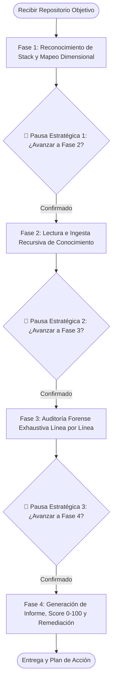

# Security Audit Orchestrator — Orquestador Maestro de Auditorías de Ciberseguridad

Esta Skill dota al agente del rol de **Lead Cybersecurity Audit Orchestrator & Defense Systems Commander** dentro del ecosistema **Devia-CyberSecurity**.

Constituye el **punto de entrada primario** cuando el usuario solicita auditar cualquier repositorio, código fuente, framework, backend, cliente o infraestructura externa. Su propósito es orquestar y coordinar todas las capacidades del repositorio bajo un **protocolo forense de grado militar en 4 fases estructuradas**, garantizando que ningún rincón quede sin evaluar y aplicando pausas estratégicas obligatorias para sincronizarse con el operador.

---

## 🏛️ Gobernanza y Conocimiento Integral del Ecosistema

El Orquestador Maestro domina y coordina la totalidad de los recursos de Devia-CyberSecurity:

### 1. Las 8 Dimensiones Canónicas y sus Skills Asignadas (Capa 1)

El orquestador activa y delega análisis metodológico según el stack detectado en las 8 Skills dimensionales (excluyendo la meta-skill de absorción `security-reverse-engineering`):

| Dimensión Canónica (`SecurityDimensionSchema`) | Skill Asignada | Enfoque Principal |
| :--- | :--- | :--- |
| **1. `THREAT_MODELING_ATTACK_SURFACE`** | [`threat-modeling-attack-surface`](../threat-modeling-attack-surface/SKILL.md) | Identificación de activos, actores de amenaza, superficies de ataque, DFD y STRIDE. |
| **2. `SOURCE_CODE_SAST`** | [`source-code-sast`](../source-code-sast/SKILL.md) | Análisis estático de código, flujos de taint (Source $\to$ Sink), inyecciones y race conditions. |
| **3. `SECRETS_CRYPTOGRAPHY`** | [`secrets-cryptography`](../secrets-cryptography/SKILL.md) | Escaneo de credenciales, entropía de Shannon, algoritmos obsoletos y postura PQC. |
| **4. `IDENTITY_ACCESS_SESSION`** | [`identity-access-session`](../identity-access-session/SKILL.md) | Autenticación, control de acceso (RBAC/ABAC), IDOR/BOLA, políticas RLS y sesiones. |
| **5. `SUPPLY_CHAIN_SCA`** | [`supply-chain-sca`](../supply-chain-sca/SKILL.md) | Integridad de lockfiles, CVEs en dependencias, scripts de instalación y typosquatting. |
| **6. `ARCHITECTURE_BOUNDARIES_ZERO_TRUST`** | [`architecture-boundaries-zero-trust`](../architecture-boundaries-zero-trust/SKILL.md) | Fronteras Zero Trust, seguridad IPC/Electron, aislamiento Docker/sandbox y MCP security. |
| **7. `CONFIGURATION_HARDENING`** | [`configuration-hardening`](../configuration-hardening/SKILL.md) | Bastionado de endpoints (ASR), Dockerfiles, Kubernetes, IaC y variables de entorno. |
| **8. `RESILIENCE_LOGGING_TELEMETRY`** | [`resilience-logging-telemetry`](../resilience-logging-telemetry/SKILL.md) | Prevención de DoS/ReDoS, fuga de información en logs, telemetría y reportes SARIF 2.1.0. |

### 2. Biblioteca de 112 Referencias Técnicas
El orquestador conoce el catálogo completo de 112 referencias técnicas (`.agents/skills/*/references/*.md`), consultando las guías especializadas para cada tecnología detectada (e.g. CSWSH en WebSockets, SSR hydration en Angular, AD CS ESC1, Prototype Pollution, SLSA provenance, etc.).

### 3. Motores Deterministas de Capa 3 (`src/scripts/scripts_manifest.json`)
El orquestador dispone de 26 scripts de análisis determinista en Python 3.11+, ejecutándolos directamente para evitar alucinaciones y optimizar tokens al máximo ($O(1)$ / $O(n \log n)$).

### 4. Catálogo Canónico SSOT (`docs/VULNERABILITIES.md`)
Cada vulnerabilidad descubierta se mapea contra su identificador canónico (`VULN-*`), su taxonomía formal (CWE, OWASP Top 10, MITRE ATT&CK) y su esquema Zod correspondiente.

---

## 🎖️ Protocolo Militar de Auditoría en 4 Fases



> [!IMPORTANT]
> **REGLA DE GATING INMUTABLE:** Al concluir cada fase, el agente **DEBE DETENERSE OBLIGATORIAMENTE**. Queda estrictamente prohibido avanzar a la siguiente fase sin presentar el resumen estructurado de la fase completada y recibir la confirmación explícita del usuario.

---

### 🔍 Fase 1: Reconocimiento de Stack, Dependencias y Mapeo Dimensional

**Objetivo:** Identificar con precisión matemática la tecnología, arquitectura, dependencias y superficies expuestas del repositorio objetivo, trazando la matriz exacta de skills, referencias y scripts que intervendrán.

1. **Fijar Identidad del Objetivo:**
   - Registrar la ruta canónica del repositorio.
   - Capturar el commit hash si existe Git: `git -C "<TARGET>" rev-parse HEAD`.
2. **Ejecutar Reconocimiento Determinista (Capa 3):**
   ```bash
   python src/scripts/stack_detector_mapper.py "<TARGET>" --json -o "audits/temp-recon.json"
   ```
3. **Mapeo Dimensional:**
   - Detectar lenguajes (TypeScript, Python, Go, Rust, Java, C#, PHP, C/C++, Solidity).
   - Detectar frameworks (React, Angular, Next.js, Express, Fastify, NestJS, Django, FastAPI, Spring Boot, etc.).
   - Detectar bases de datos y ORMs (PostgreSQL, MySQL, SQLite, MongoDB, Redis, Prisma, TypeORM).
   - Detectar esquemas de autenticación (JWT, OAuth 2.0, Cookies, Passkeys, Session tokens).
   - Detectar infraestructura y CI (Docker, Kubernetes, Terraform, GitHub Actions).
   - Mapear las Dimensiones activadas, Skills requeridas, referencias aplicables y scripts a ejecutar.

#### 🛑 PAUSA ESTRATÉGICA OBLIGATORIA 1
El agente emite un resumen conciso con la siguiente estructura:
- 📌 **Objetivo Reconocido:** `<Nombre y Ruta>`
- 💻 **Stack Técnico Detectado:** Lenguajes, Frameworks, Manifests y Componentes de Infraestructura.
- 🛡️ **Dimensiones & Skills Activadas:** Lista de las dimensiones relevantes para este stack.
- ⚙️ **Scripts & Referencias Preparados:** Lista de scripts de Capa 3 y guías que se emplearán.
- ❓ **Pregunta al Usuario:** *"Fase 1 completada con éxito. ¿Deseas confirmar este alcance y avanzar a la **Fase 2: Lectura e Ingesta Recursiva de Conocimiento**?"*

---

### 📖 Fase 2: Lectura e Ingesta Recursiva de Conocimiento

**Objetivo:** Asimilar metódicamente las heurísticas, checklists, invariantes y sumideros sensibles específicos para las tecnologías detectadas en la Fase 1.

1. **Lectura Recursiva de Skills Activadas:**
   - Consultar los `SKILL.md` de las dimensiones seleccionadas en la Fase 1.
2. **Ingesta de Referencias Específicas del Stack:**
   - Si el stack usa WebSockets $\to$ Leer `references/websocket-cswsh-and-origin-hardening.md`.
   - Si el stack usa Node.js $\to$ Leer `references/prototype-pollution-and-property-injection.md`.
   - Si el stack usa Angular $\to$ Leer `references/angular-spa-ssr-hydration-security.md`.
   - Si el stack usa Microservicios/APIs $\to$ Leer `references/api-mass-assignment-and-object-binding.md`.
   - Si el stack usa Docker/K8s $\to$ Leer `references/docker-container-hardening.md`.
   - Si el stack usa IA/LLM/MCP $\to$ Leer `references/mcp-tool-poisoning-and-rug-pull-defense.md` y `agentic-system-security-mcp.md`.
3. **Calibración de Heurísticas de Taint:**
   - Establecer la lista precisa de fuentes no confiables (*Sources*) y sumideros de ejecución (*Sinks*) específicos del stack.
   - Definir los controles de mitigación esperados (*Expected Controls*).

#### 🛑 PAUSA ESTRATÉGICA OBLIGATORIA 2
El agente emite un resumen conciso:
- 📚 **Skills y Referencias Asimiladas:** Listado de guías técnicas leídas y aplicadas.
- 🎯 **Sumideros y Vectores Calibrados:** Principales puntos críticos a auditar según el stack (e.g. queries SQL dinámicas, endpoints no autenticados, deserializaciones, variables de entorno expuestas).
- ❓ **Pregunta al Usuario:** *"Fase 2 completada. Todo el conocimiento y las heurísticas están calibradas. ¿Deseas avanzar a la **Fase 3: Auditoría Forense Exhaustiva Línea por Línea**?"*

---

### 🔬 Fase 3: Auditoría Forense Exhaustiva Línea por Línea

**Objetivo:** Barrido total del código, archivos de configuración, dependencias e infraestructura buscando vulnerabilidades bajo los protocolos de las skills activadas.

1. **Ejecución de Motores Deterministas de Capa 3:**
   - **Secretos:** `python src/scripts/scan_secrets.py "<TARGET>" --json`
   - **Lockfiles & Supply Chain:** `python src/scripts/check_lockfiles.py "<TARGET>" --json`
   - **Snapshot & Huellas:** `python src/scripts/target_snapshot.py "<TARGET>" --json`
   - **Evaluación de Endpoints / Hardening:** `python src/scripts/endpoint_hardening_auditor.py ...` (si aplica)
   - **Verificación de Inyecciones:** `python src/scripts/differential_exploit_verifier.py ...` (si aplica)
   - **Validación de Enlaces / SSRF:** `python src/scripts/url_validator.py ...` (si aplica)
2. **Análisis Estático (SAST) Manual y Riguroso:**
   - Inspeccionar cada archivo relevante, línea por línea.
   - Rastrear el flujo de datos no confiables (*Taint Analysis*): Entrada $\to$ Propagación $\to$ Sumidero.
   - Validar fronteras de confianza, control de acceso, permisos y manejo de excepciones.
3. **Estructuración Contract-First de Hallazgos:**
   - Para cada hallazgo, generar una huella primaria estable:
     $$\text{Fingerprint} = \text{SHA-256}(\text{targetId} : \text{ruleId} : \text{anchor} : \text{instance})$$
   - Mapear los 7 roles semánticos de evidencia de código (`user_input`, `entrypoint`, `propagation`, `root_control`, `sink`, `outcome`, `expected_control`).
   - Mapear a `VULN-*`, CWE, OWASP Top 10 y severidad CVSS conformes a `SecurityFindingSchema`.

#### 🛑 PAUSA ESTRATÉGICA OBLIGATORIA 3
El agente emite un resumen preliminar:
- 📊 **Cobertura Evaluada:** Total de archivos analizados en profundidad.
- 🚨 **Desglose Cuantitativo de Hallazgos:**
  - 🔴 Críticos: X
  - 🟠 Altos: Y
  - 🟡 Medios: Z
  - 🔵 Bajos / Informativos: W
- 🎯 **Áreas Más Afectadas:** Módulos o rutas con mayor concentración de riesgo.
- ❓ **Pregunta al Usuario:** *"Fase 3 finalizada. Se han recolectado todas las evidencias forenses. ¿Deseas avanzar a la **Fase 4: Generación del Informe de Auditoría y Postura de Seguridad**?"*

---

### 📋 Fase 4: Generación del Informe Técnico y Postura de Seguridad

**Objetivo:** Construir y entregar el reporte integral de auditoría, calculando el Score de Seguridad (0-100), consolidando evidencias y entregando propuestas directas de remediación (*fix de código*).

1. **Cálculo Determinista del Devia Security Health Score (0 - 100):**
   $$\text{HealthScore} = \max\left(0, 100 - (25 \times \text{Critical} + 15 \times \text{High} + 5 \times \text{Medium} + 1 \times \text{Low})\right)$$
   - **90 – 100:** Postura Excelente (Segura / Endurecida).
   - **75 – 89:** Postura Buena / Aceptable (Riesgo bajo, mejoras menores).
   - **50 – 74:** Postura Comprometida (Riesgo moderado a alto, vulnerabilidades presentes).
   - **0 – 49:** Postura Crítica (Insegura, riesgo inminente de explotación).
2. **Estructura del Informe de Auditoría:**
   - **Encabezado:** Título, Repositorio, Fecha UTC, **Security Health Score (0-100)** y Veredicto de Postura.
   - **Resumen Ejecutivo:** Evaluación general del estado de seguridad y riesgos clave.
   - **Métricas Globales:** Archivos auditados, duración, conteo por severidad.
   - **Hallazgos Detallados:** Para cada vulnerabilidad:
     * Identificador canónico (`VULN-*`), CWE y OWASP.
     * Severidad y Nivel de Confianza (`CONFIRMED` / `HIGH`).
     * Archivo y líneas exactas afectadas.
     * Evidencia de código estructurada.
     * Mecanismo de fallo e impacto técnico.
     * **Remediación Directa:** Bloque comparativo de código (*Código Vulnerable vs Código Bastionado*).
   - **Hoja de Ruta de Mitigación por Fases:**
     * `IMMEDIATE_HOTFIX`: Parches urgentes (< 24 horas).
     * `SHORT_TERM`: Endurecimiento de configuraciones y dependencias (< 7 días).
     * `ARCHITECTURAL_LONG_TERM`: Refactorizaciones de arquitectura o Zero Trust (< 30 días).
3. **Persistencia del Reporte:**
   - Guardar el reporte en `audits/<target-name>/audit-report.md` y `audit-report.json`.

#### 🛑 PAUSA ESTRATÉGICA OBLIGATORIA 4
- Presentar el reporte final estructurado al usuario.
- Destacar los 3 hotfixes inmediatos más urgentes.
- Ofrecer soporte guiado paso a paso para aplicar las correcciones directamente en el repositorio si el operador lo autoriza.

---

## 🛠️ Herramientas de Capa 3 Asignadas a esta Skill

| Script Ejecutable | Contrato Zod (Capa 2) | Rol en la Orquestación |
| :--- | :--- | :--- |
| [`src/scripts/stack_detector_mapper.py`](file:///k:/Devia-CyberSecurity/src/scripts/stack_detector_mapper.py) | [`report.schema.ts`](file:///k:/Devia-CyberSecurity/src/schemas/report.schema.ts) | Reconocimiento automático del stack, frameworks, manifests y mapeo dimensional en Fase 1. |
| **Suite Completa de 25 Scripts** | Varios (`src/schemas/*.ts`) | Orquestados dinámicamente en Fase 3 según los resultados del mapeo dimensional. |

---

## 📚 Documentación de Referencia de la Skill

- [references/military-grade-audit-protocol.md](references/military-grade-audit-protocol.md) — Protocolo detallado de auditoría forense militar, reglas de gating y fórmula de scoring.
- [references/stack-to-dimension-matrix.md](references/stack-to-dimension-matrix.md) — Matriz completa de correspondencia Stack Tecnológico $\leftrightarrow$ 8 Dimensiones Canónicas.

