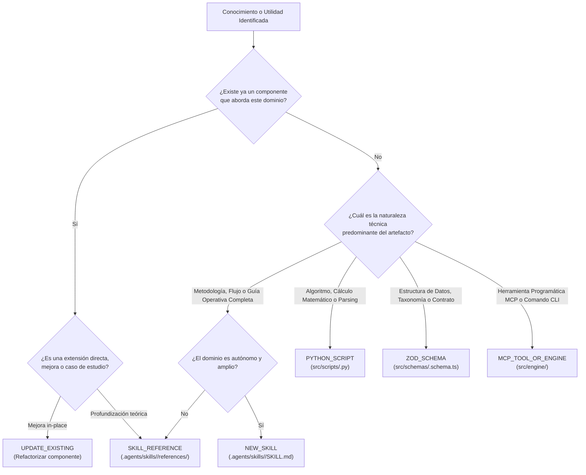

# Matriz de Decisión de Absorción Técnica (Absorption Routing Matrix)

Este documento define el marco metodológico y el árbol de decisión autoritativo para determinar con exactitud **hacia dónde** y **cómo** debe absorberse cualquier práctica, metodología, regla o algoritmo extraído de repositorios externos en el ecosistema **Devia-CyberSecurity**.

---

## 🏛️ Alineación con el Modelo Tri-Tier de Devia-CyberSecurity

Toda absorción debe respetar la división estricta de responsabilidades del repositorio:

```
[CONOCIMIENTO EXTERNO AUDITADO]
             │
             ▼
[ANÁLISIS FORENSE Y EVALUACIÓN DE DIMENSIÓN]
             │
             ├──> ¿Es razonamiento metodológico, checklist o guía heurística?
             │     └──> CAPA 1: .agents/skills/ (SKILL.md o references/*.md)
             │
             ├──> ¿Es modelo de datos autoritativo, validador o runner MCP/CLI?
             │     └──> CAPA 2: TypeScript + Zod (src/schemas/, src/types/, src/engine/)
             │
             └──> ¿Es algoritmo determinista, cálculo matemático, AST o parser?
                   └──> CAPA 3: Python 3.11+ (src/scripts/)
```

---

## 🧭 Árbol de Decisión de Destino de Absorción

A continuación se detalla la heurística para clasificar cada componente en uno de los 6 destinos canónicos:



---

## 📋 Especificación Detallada de los 6 Destinos Canónicos

### 1. `NEW_SKILL` (Nueva Skill Autónoma)
- **Ubicación:** `.agents/skills/<nueva-skill>/SKILL.md`
- **Cuándo elegirlo:**
  - El objetivo presenta una metodología de auditoría completa, autónoma y especializada que no encaja de forma natural como apéndice de otra skill.
  - Ejemplos: Auditoría de contratos inteligentes (EVM / Solidity), Auditoría de aplicaciones móviles (Android/iOS), Hardening de entornos Kubernetes/Cloud, Auditoría de Firmware/IoT.
- **Requisitos de Entrega:**
  - Frontmatter con `name` y `description` concisos y orientados a la activación.
  - Secciones obligatorias: Identidad, Principios inmutables, Fases operativas, Checklist de verificación y Criterio de parada.
  - Carpeta propia con `references/` y opcionalmente `scripts/`.

### 2. `SKILL_REFERENCE` (Referencia en Skill Existente)
- **Ubicación:** `.agents/skills/<skill-existente>/references/<tema>.md`
- **Cuándo elegirlo:**
  - El conocimiento extraído es una técnica específica, catálogo de vulnerabilidades, guía de desofuscación, lista de evasión de CSP o caso de estudio de ingeniería inversa.
  - No justifica una skill completa porque no define un rol o ciclo de trabajo nuevo, sino que instruye al agente en una técnica particular.
- **Requisitos de Entrega:**
  - Formato Markdown estructurado con tablas, pseudocódigo, fragmentos de código vulnerable vs corregido y enlaces a taxonomías (CWE, OWASP).

### 3. `PYTHON_SCRIPT` (Utilidad Determinista de Capa 3)
- **Ubicación:** `src/scripts/<nombre_script>.py` (o en `scripts/` de la skill si es de uso exclusivo)
- **Cuándo elegirlo:**
  - La utilidad requiere análisis intensivo de archivos, cálculo de entropía de Shannon, parsing de AST políglota, extracción de strings binarios o cálculo de hashes.
  - Python 3.11+ con tipos estrictos (Type Hints) y `pydantic` si requiere modelos de datos internos.
- **Requisitos de Entrega:**
  - Soporte CLI con `argparse` y `--json` para emitir salidas deterministas legibles por máquinas y agentes.
  - Manejo seguro de excepciones y enlaces simbólicos.
  - Test unitario acompañante en `tests/` o `scripts/test_*.py`.

### 4. `ZOD_SCHEMA` (Contrato Autoritativo de Capa 2)
- **Ubicación:** `src/schemas/<nombre>.schema.ts` y exportación en `src/types/index.ts`
- **Cuándo elegirlo:**
  - Se extrae un nuevo modelo formal de datos de seguridad (e.g. estructura de hallazgos para una tecnología particular, modelo de SBOM, formato de configuración de hardening).
  - El modelo debe ser validado en tiempo de ejecución para rechazar salidas malformadas (*Contract-First*).
- **Requisitos de Entrega:**
  - Definición Zod estricta (`.strict()` o con validaciones regex/min/max pertinentes).
  - Inferencia de tipos (`export type X = z.infer<typeof XSchema>;`).
  - Verificación de compilación mediante `pnpm build`.

### 5. `MCP_TOOL_OR_ENGINE` (Herramienta MCP / Runner de Capa 2)
- **Ubicación:** `src/engine/<módulo>.ts`
- **Cuándo elegirlo:**
  - Se extrae un flujo orquestador que debe exponerse como herramienta MCP para agentes autónomos o como subcomando de CLI para el usuario.
  - Coordina la ejecución de scripts de Python, valida la salida contra esquemas Zod y formatea los resultados en JSON o Markdown.
- **Requisitos de Entrega:**
  - Código TypeScript ESM (Node 22+).
  - Manejo asíncrono robusto con timeouts y limpieza de procesos huérfanos.

### 6. `UPDATE_EXISTING` (Refactorización / Actualización In-Place)
- **Ubicación:** Componente existente en cualquiera de las tres capas.
- **Cuándo elegirlo:**
  - El conocimiento detectado amplía, corrige o complementa una herramienta, schema o referencia ya existente en Devia-CyberSecurity.
  - **Directiva de Oro (Kuna Case Study):** *"Reuse before adding machinery"*. Siempre preferir enriquecer un componente existente antes de añadir capas o archivos redundantes que dispersen el mantenimiento.

---

## 🔄 Evaluación Diferencial y Modos de Adopción Evolutiva

Toda auditoría forense debe realizar una **evaluación diferencial** entre el conocimiento descubierto y el estado actual de nuestro repositorio y catálogo [`docs/VULNERABILITIES.md`](file:///docs/VULNERABILITIES.md). 

Frecuentemente, una vulnerabilidad o vector ya se encuentra registrado, pero el repositorio externo analizado implementa una técnica más robusta, un filtro más preciso o un manejo de casos borde superior. Por tanto, cada acción de absorción debe clasificar explícitamente su **intención evolutiva (`EvolutionaryIntentSchema`)**:

| Intención Evolutiva | Definición Operativa | Criterio de Activación | Acción sobre el Repositorio |
| :--- | :--- | :--- | :--- |
| **`CREATE_NEW`** | **Crear desde cero** | Se descubre una metodología, esquema o herramienta para la cual no existe ningún precedente en el repositorio. | Crear nueva Skill, Schema o Script. Si introduce una nueva debilidad, registrar nuevo ID en `docs/VULNERABILITIES.md`. |
| **`ABSORB_EXPAND`** | **Absorber y Expandir** | Se absorbe una guía técnica o checklist que complementa el ámbito temático de una Skill existente sin justificar un módulo autónomo. | Crear documento en `references/` de la Skill correspondiente. |
| **`UPDATE_ENHANCE`** | **Actualizar y Mejorar** | La técnica externa es más moderna, profunda o exhaustiva que nuestra implementación actual. | Reemplazar o actualizar la referencia o script preexistente elevando su cobertura. |
| **`ROBUSTIFY_HARDEN`** | **Robustecer y Endurecer** | Se descubre una mitigación o regla mucho más estricta para una vulnerabilidad ya registrada (e.g. `VULN-SAST-001`, `VULN-CRYP-001`), reduciendo falsos positivos o cerrando vectores de evasión. | Fortalecer la heurística en la Skill asignada y enriquecer `docs/VULNERABILITIES.md` con los nuevos patrones de detección. |
| **`REFINE_OPTIMIZE`** | **Refinar y Optimizar** | El objetivo resuelve el mismo problema de seguridad con menor complejidad computacional ($O(1)$ vs $O(n^2)$), menor huella de memoria o mejor tipado estricto (*Kuna Principle*). | Refactorizar el script de Capa 3 o el runner de Capa 2 preservando la interfaz externa. |
| **`CORRECT_FIX`** | **Corregir y Subsanar** | La evidencia demuestra que una regla, regex o asunción previa de Devia-CyberSecurity contenía un fallo, falso negativo o debilidad no contemplada. | Corregir in-place el componente defectuoso y actualizar los tests unitarios. |

---

## 🔗 Protocolo de Sincronización con `docs/VULNERABILITIES.md`

Cuando una acción de absorción corresponda a las intenciones `UPDATE_ENHANCE`, `ROBUSTIFY_HARDEN` o `CORRECT_FIX` sobre una vulnerabilidad catalogada:

1. **Vincular Identificador:** Establecer el campo `existingVulnerabilityId` en `AbsorptionAction` con el identificador oficial (e.g., `VULN-SAST-001`, `VULN-IAM-002`).
2. **Actualizar Catálogo:**
   - Si la técnica descubierta amplía el mecanismo de fallo, actualizar la columna descriptiva en [`docs/VULNERABILITIES.md`](file:///docs/VULNERABILITIES.md).
   - Si se descubren nuevos CWEs o identificadores de ataque asociados, anexarlos a la taxonomía.
3. **Robustecer Referencias:** Incorporar la prueba de concepto, regla de detección o código remediado en `references/` de la Skill asignada.

---

## 🚫 Antipatrones de Absorción Prohibidos

1. **Copia Ciega de Código (*Blind Copy-Paste*):**
   Queda terminantemente prohibido duplicar bloques de código ajenos sin adaptarlos a la filosofía defensiva, los estándares de tipado y la arquitectura de Devia-CyberSecurity.
2. **Proliferación Innecesaria de Skills:**
   No crear una skill si el conocimiento se agota en 2 páginas de texto; en ese caso pertenece a una `SKILL_REFERENCE`.
3. **Inversión de Capas (*Layer Bleed*):**
   - Prohibido meter lógica de cálculo intensivo de strings o binarios en TypeScript cuando Python lo resuelve con mayor robustez y bajo acoplamiento.
   - Prohibido definir esquemas no validados en Python si representan contratos universales del sistema (la SSOT de contratos siempre es Zod en `src/schemas/`).
4. **Dependencias Fantasma o de Pago:**
   Toda utilidad absorbida debe operar a costo cero ($0.00), sin depender de APIs propietarias ni suscripciones en la nube.
5. **Invención o Proliferación de Dimensiones:**
   Queda terminantemente prohibido asignar o sugerir dimensiones fuera de las 8 canónicas autorizadas en `SecurityDimensionSchema`. Todo conocimiento auditado debe clasificarse obligatoriamente dentro del conjunto canónico cerrado.
