# Auditoría SAST en Ecosistemas Angular SPA, SSR y Seguridad en Hidratación

Esta referencia técnica define los patrones estáticos de análisis de vulnerabilidades (SAST), reglas declarativas y directivas de remediación para aplicaciones web desarrolladas con **JavaScript**, **TypeScript** y el framework **Angular** (incluyendo renderizado en servidor `@angular/ssr`), mitigando de forma integral `VULN-SAST-016`.

---

## 🏛️ 1. Vectores Críticos en el Cliente y Renderizado

En una evaluación de código frontend, la premisa operativa inmutable es: **el código que se ejecuta en el navegador del usuario opera en un perímetro no confiable**. Ninguna validación client-side constituye un límite de autorización.

```mermaid
flowchart TD
    UntrustedData["Dato Externo / Query / API / SSR TransferState"] --> Gate{"¿Pasa por DomSanitizer o Template?"}
    Gate -->|"Bypass Inseguro<br/>(bypassSecurityTrust*)"| Vulnerable["VULNERABILIDAD:<br/>XSS / Template Injection (CWE-79)"]
    Gate -->|"DOM Clobbering<br/>(<form id='ng-state'>)"| PoisonedCache["Envenenamiento de Cache SSR<br/>(CVE-2026-54267)"]
    Gate -->|"DJB2 Hash Collision<br/>(q=aaCAZMMM vs /profile)"| CacheCollision["Fuga de Datos Autenticados<br/>(CVE-2026-54266)"]
    Gate -->|"Saneamiento Secundario<br/>(DOMPurify + Strict CSP)"| Secure["ESTADO SEGURO:<br/>TrustedHTML & Sanitized Output"]
```



---

## ⚠️ 2. Patrones de Vulnerabilidad y Remediación

### 2.1. Evasión de Sanitizador Angular (`bypassSecurityTrust*`)
El framework incorpora escape contextual nativo. Sin embargo, los desarrolladores desactivan estas salvaguardas invocando métodos de bypass:

```typescript
// INSEGURO: Desactivación ciega del sanitizador nativo
@Input() set dynamicMarkup(value: string) {
  this.trustedContent = this.sanitizer.bypassSecurityTrustHtml(value); // VULNERABLE
}

// SEGURO: Purificación secundaria profunda mediante DOMPurify previa a la confianza
@Input() set dynamicMarkup(value: string) {
  if (!value) {
    this.sanitizedContent = null;
    return;
  }
  const cleanMarkup = DOMPurify.sanitize(value, {
    ALLOWED_TAGS: ['b', 'i', 'em', 'strong', 'a', 'p', 'ul', 'li', 'code', 'span'],
    ALLOWED_ATTR: ['href', 'target', 'rel'],
    ALLOW_DATA_ATTR: false
  });
  this.sanitizedContent = this.sanitizer.bypassSecurityTrustHtml(cleanMarkup);
}
```

### 2.2. Manipulación Directa del DOM con `ElementRef.nativeElement`
Acceder a propiedades como `innerHTML` elude el pipeline de compilación de plantillas:

```typescript
// INSEGURO: Modificación directa no interceptada
this.hostEl.nativeElement.innerHTML = untrustedInput; // VULNERABLE

// SEGURO: Uso de la abstracción Renderer2 para insertar texto escapado
private renderer = inject(Renderer2);
this.renderer.setProperty(this.hostEl.nativeElement, 'textContent', untrustedInput);
```

---

## 🌐 3. Vulnerabilidades Avanzadas en SSR e Hidratación

### 3.1. DOM Clobbering sobre el Contenedor de Hidratación (`CVE-2026-54267`)
El cliente recupera el estado serializado ejecutando `document.getElementById('ng-state')`. Si la aplicación permite que atributos HTML como `id` reflejen entradas no sanitizadas (`[id]="userInput"`), un atacante puede inyectar `<form id="ng-state">` o `<a id="ng-state">`, forzando al cliente a deserializar datos manipulados e inyectar scripts en `HttpTransferCache`.

**Remediación:** Configurar un `APP_ID` estricto y no predecible para deshabilitar el selector estático:
```typescript
// app.config.ts
import { ApplicationConfig, APP_ID } from '@angular/core';
import { provideClientHydration } from '@angular/platform-browser';

export const appConfig: ApplicationConfig = {
  providers: [
    provideClientHydration(),
    { provide: APP_ID, useValue: 'app-secure-node-91c8e' } // Deshabilita ng-state fijo
  ]
};
```

### 3.2. Colisión DJB2 en `HttpTransferCache` (`CVE-2026-54266`)
El cálculo de claves de caché en SSR basado en polinomios de 32 bits permite colisiones deliberadas entre consultas públicas y privadas.

**Remediación:** Actualizar a versiones con hashing SHA-256 de 256 bits y forzar `{ transferCache: false }` en peticiones con datos sensibles:
```typescript
this.http.get<UserData>('/api/user/profile', { transferCache: false });
```

### 3.3. Fuga en Inyectores Delegados (`CVE-2026-50170` / `GHSA-p297-fm68-3q8c`)
Inyectores secundarios (`createEnvironmentInjector`) que evalúan la caché antes de que el interceptor padre adjunte el Bearer Token.

**Remediación:** Excluir rutas privadas del SSR y enviar cabeceras estrictas:
```typescript
provideClientHydration(
  withHttpTransferCacheOptions({
    filter: (req) => !req.url.includes('/api/private/')
  })
)
// En el proxy inverso / CDN:
// Cache-Control: private, no-store
```

---

## 🔒 4. Content Security Policy (CSP) y Trusted Types

```http
Content-Security-Policy: trusted-types angular angular#bundler; require-trusted-types-for 'script'; script-src 'self' 'nonce-rAnd0m123';
```

Inyección del nonce dinámico en Angular:
```typescript
// main.ts
import { CSP_NONCE } from '@angular/core';

const serverNonce = document.querySelector('meta[name="csp-nonce"]')?.getAttribute('content') || '';

bootstrapApplication(AppComponent, {
  providers: [
    { provide: CSP_NONCE, useValue: serverNonce }
  ]
});
```

---

## 🛠️ 5. Reglas Declarativas Semgrep para CI/CD

```yaml
rules:
  - id: angular-sanitizer-bypass-detected
    message: >-
      Se ha detectado el uso de bypassSecurityTrust* o SecurityContext.NONE. Estas funciones
      inhabilitan las defensas nativas contra XSS. Debe aplicarse purificación con DOMPurify.
    languages: [typescript, javascript]
    severity: ERROR
    metadata:
      cwe: "CWE-79: Improper Neutralization of Input During Web Page Generation"
      owasp: "A03:2021 - Injection"
    pattern-either:
      - pattern: $SAN.bypassSecurityTrustHtml(...)
      - pattern: $SAN.bypassSecurityTrustScript(...)
      - pattern: $SAN.bypassSecurityTrustStyle(...)
      - pattern: $SAN.bypassSecurityTrustUrl(...)
      - pattern: $SAN.bypassSecurityTrustResourceUrl(...)
      - pattern: $SAN.sanitize(SecurityContext.NONE, ...)

  - id: angular-unsafe-native-element-dom-mutation
    message: >-
      Modificación directa del DOM mediante nativeElement.innerHTML o outerHTML.
      Utilice la abstracción Renderer2 para mutaciones seguras.
    languages: [typescript, javascript]
    severity: ERROR
    metadata:
      cwe: "CWE-79"
    pattern-either:
      - pattern: $EL.nativeElement.innerHTML = $INPUT
      - pattern: $EL.nativeElement.outerHTML = $INPUT
```
