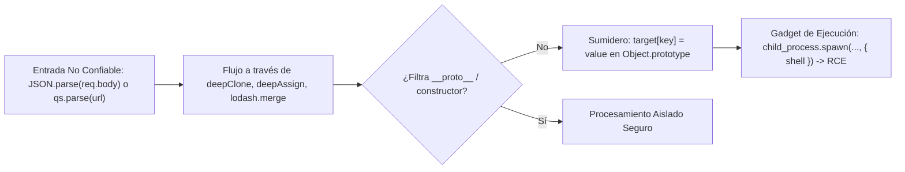

# Guía SAST de Detección y Prevención de Prototype Pollution en JavaScript / Node.js

Esta referencia técnica describe los principios de análisis estático (SAST), trazabilidad de taint y patrones de mitigación inmutables para vulnerabilidades de **Prototype Pollution**, catalogada como **`VULN-SAST-018`** en **Devia-CyberSecurity**.

---

## 🏛️ Contexto y Mecanismo del Fallo

En JavaScript y TypeScript, los objetos heredan propiedades y métodos de su prototipo (`Object.prototype`). Si una aplicación permite que propiedades no confiables provenientes de entradas JSON, cadenas de consulta (query strings) o parámetros de ruta modifiquen el prototipo raíz a través de claves reservadas:
- `__proto__`
- `constructor.prototype`
- `prototype`

Cualquier nuevo objeto instanciado en el proceso heredará la propiedad inyectada. Este comportamiento, conocido como **Prototype Pollution**, puede provocar:
1. **Bypass de Controles de Acceso:** Inyección de propiedades como `isAdmin: true` o `role: "admin"` en comprobaciones que evalúan `if (user.isAdmin)`.
2. **Denegación de Servicio (DoS):** Sobrescritura de métodos nativos (`toString`, `valueOf`) causando que llamadas posteriores lancen excepciones fatales.
3. **Ejecución Remota de Código (RCE):** Si el runtime o una librería de terceros (e.g. `child_process.fork`, motores de plantillas como Pug/Handlebars) consulta propiedades no definidas que ahora existen en `Object.prototype` (e.g. `shell`, `NODE_OPTIONS`, `env`).

---

## 🔍 Taxonomía y Mapeo Multimarco

| Estándar / Marco | Identificador | Denominación Oficial |
| :--- | :--- | :--- |
| **CWE** | **CWE-1321** | Improperly Controlled Modification of Object Prototype Attributes ('Prototype Pollution') |
| **OWASP Top 10** | **A03:2021/2025** | Injection |
| **MITRE ATT&CK** | **T1059.007** | Command and Scripting Interpreter: JavaScript |
| **Devia Catalog** | **`VULN-SAST-018`** | Prototype Pollution & Arbitrary Object Property Injection in Dynamic Languages |

---

## 💻 Patrones Vulnerables vs Implementación Segura

### Antipatrón Vulnerable: Merge Recursivo Inseguro
```typescript
// VULNERABLE: Asignación recursiva sin filtrado de claves mágicas
function deepMerge(target: any, source: any): any {
  for (const key of Object.keys(source)) {
    if (typeof source[key] === "object" && source[key] !== null) {
      if (!target[key]) target[key] = {};
      deepMerge(target[key], source[key]); // Si key es '__proto__', contamina Object.prototype!
    } else {
      target[key] = source[key];
    }
  }
  return target;
}
```

### Patrón Seguro 1: Filtrado Determinista de Claves Reservadas
```typescript
// SEGURO: Bloqueo explícito de claves mágicas
const DANGEROUS_KEYS = new Set(["__proto__", "constructor", "prototype"]);

function safeDeepMerge(target: Record<string, any>, source: Record<string, any>): Record<string, any> {
  for (const key of Object.keys(source)) {
    if (DANGEROUS_KEYS.has(key)) {
      throw new SecurityException(`Prototype pollution attempt detected with key: ${key}`);
    }
    if (typeof source[key] === "object" && source[key] !== null && !Array.isArray(source[key])) {
      if (!target[key] || typeof target[key] !== "object") {
        target[key] = Object.create(null); // Sin prototipo
      }
      safeDeepMerge(target[key], source[key]);
    } else {
      target[key] = source[key];
    }
  }
  return target;
}
```

### Patrón Seguro 2: Congelamiento Inmutable en el Arranque del Proceso
```typescript
// SEGURO: Invariante global que impide mutaciones del prototipo
Object.freeze(Object.prototype);
Object.freeze(Array.prototype);
```

### Patrón Seguro 3: Uso de `Object.create(null)` o `Map` para Diccionarios
```typescript
// SEGURO: Un objeto creado con null no tiene prototipo ni propiedades mágicas
const safeLookupTable = Object.create(null);
// O preferir estructuras Map nativas:
const safeMap = new Map<string, any>();
```

---

## 🔬 Trazabilidad de Taint (Fuentes hacia Sumideros)



---

## ✅ Checklist de Auditoría SAST para Evaluadores de Devia-CyberSecurity

- [ ] Todas las funciones de clonación o fusión recursiva descartan explícitamente las claves `__proto__`, `constructor` y `prototype`.
- [ ] Las tablas de búsqueda o diccionarios dinámicos se instancian con `Object.create(null)` o `new Map()`.
- [ ] Se ejecuta `Object.freeze(Object.prototype)` al inicio del ciclo de vida de la aplicación en entornos Node.js.
- [ ] No se utilizan versiones vulnerables de librerías utilitarias (`lodash` < 4.17.21, `minimist` < 1.2.6, `qs` < 6.9.7).
- [ ] Las entradas JSON de endpoints API se validan contractualmente mediante esquemas **Zod** antes de pasarse a la capa de servicios.
