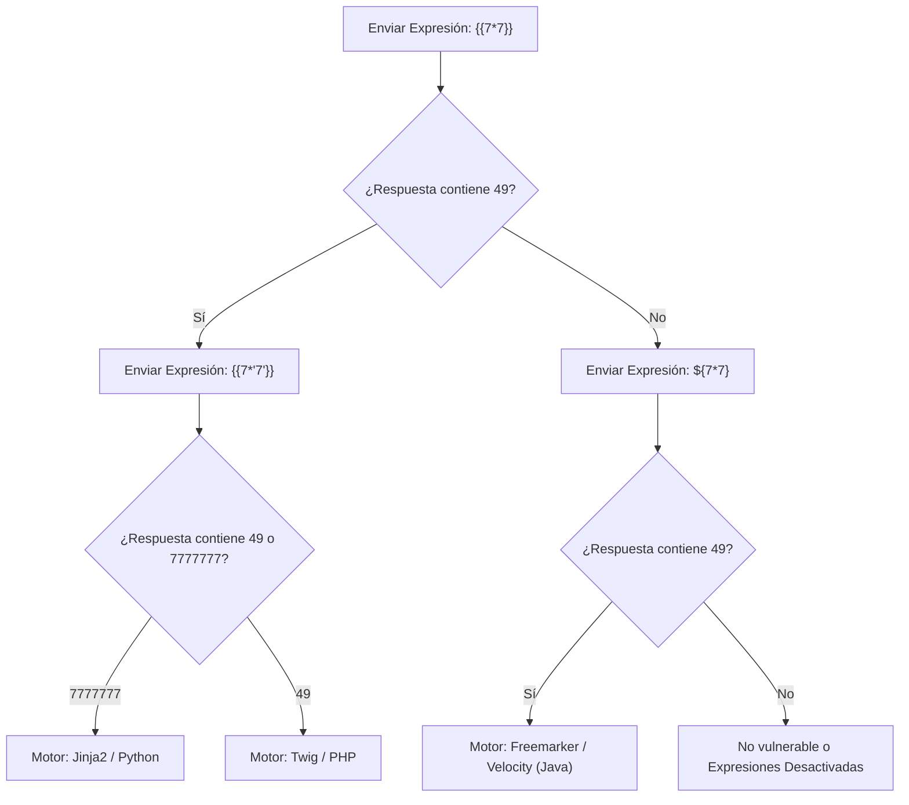

# Guía de Auditoría de Server-Side Template Injection (SSTI) y Escapes de Sandbox

Esta referencia técnica describe los principios de análisis estático (SAST), oráculos diferenciales de evaluación y remediación para vulnerabilidades de **Inyección de Plantillas en Servidor (SSTI)**, catalogada bajo **`VULN-SAST-020`** en **Devia-CyberSecurity**.

---

## 🏛️ Contexto y Mecanismo del Fallo

Los motores de plantillas (Jinja2, Twig, Freemarker, Velocity, Thymeleaf, Smarty, Pebble) permiten separar la lógica de presentación de la lógica de negocio, procesando expresiones delimitadas (e.g. `{{ ... }}`, `${ ... }`).

La vulnerabilidad ocurre cuando los desarrolladores **concatenan entradas no confiables directamente dentro de la cadena de la plantilla antes de su compilación**, en lugar de compilar una plantilla estática y suministrar las entradas como variables del contexto de datos:
- El motor de plantillas interpreta la entrada del usuario como código fuente de la plantilla.
- Dependiendo del lenguaje y del motor, la sintaxis de plantillas permite acceder a objetos globales, propiedades reflectivas de clases o APIs del sistema operativo, resultando en **Ejecución Remota de Código (RCE)**.

---

## 🔍 Taxonomía y Mapeo Multimarco

| Estándar / Marco | Identificador | Denominación Oficial |
| :--- | :--- | :--- |
| **CWE** | **CWE-1336** | Improper Neutralization of Special Elements Used in a Template Engine |
| **CWE** | **CWE-94** | Improper Control of Generation of Code ('Code Injection') |
| **OWASP Top 10** | **A03:2021/2025** | Injection |
| **MITRE ATT&CK** | **T1190** | Exploit Public-Facing Application |
| **Devia Catalog** | **`VULN-SAST-020`** | Server-Side Template Injection (SSTI) & Sandboxed Context Escape |

---

## 🔬 Árbol de Decisión y Oráculo Diferencial Polimórfico

Para identificar el motor de plantillas de forma determinista y sin payloads dañinos, se utiliza el árbol de evaluación diferencial de expresiones aritméticas:



---

## 💻 Código Vulnerable vs Implementación Segura

### Antipatrón Vulnerable: Concatenación Directa en Jinja2 / Flask
```python
# VULNERABLE: Concatenación directa de parámetro en la cadena de plantilla
from flask import Flask, request, render_template_string
from jinja2 import Environment

app = Flask(__name__)

@app.route("/greet")
def greet():
    user_name = request.args.get("name", "Guest")
    # Peligro: Si user_name es "{{ config.items() }}", se filtra la configuración!
    template = f"<h1>Hello, {user_name}!</h1>"
    return render_template_string(template)
```

### Patrón Seguro: Plantilla Estática y Paso de Variables por Contexto
```python
# SEGURO: La plantilla es estática e inmutable; los datos viajan en el contexto
from flask import Flask, request, render_template

app = Flask(__name__)

# La plantilla en templates/greet.html contiene: <h1>Hello, {{ user_name }}!</h1>
@app.route("/greet")
def greet():
    user_name = request.args.get("name", "Guest")
    # El motor trata user_name estrictamente como dato, jamás como sintaxis ejecutable
    return render_template("greet.html", user_name=user_name)
```

### Patrón Seguro con Motores Logic-Less (Mustache)
```typescript
// SEGURO: Motores sin lógica de ejecución de código impiden RCE por diseño
import Mustache from "mustache";

function renderEmail(user: { name: string }): string {
  const template = "Hello, {{name}}! Welcome to our platform.";
  // Mustache no soporta llamadas a funciones ni expresiones aritméticas
  return Mustache.render(template, { name: user.name });
}
```

---

## 🛡️ Bastionado de Sandboxes de Plantillas

Si la aplicación requiere que usuarios administren plantillas dinámicas:
1. **Desactivar Introspección Reflectiva:**
   - En Jinja2: Utilizar `jinja2.sandbox.SandboxedEnvironment` y bloquear accesos a `__class__`, `__mro__`, `__subclasses__`, `__globals__`, `__builtins__`.
2. **Restricción de Funciones Disponibles:**
   - Limitar el contexto global a tipos primitivos y funciones puras sin efectos secundarios.
3. **Límites de Tiempo y Recursión:**
   - Establecer límites estrictos de CPU y tiempo de ejecución para evitar DoS por bucles infinitos en plantillas.

---

## ✅ Checklist de Auditoría SAST para Evaluadores de Devia-CyberSecurity

- [ ] Ninguna llamada a `render_template_string`, `compile()`, `Template()` o equivalentes recibe cadenas generadas mediante concatenación o interpolación (`f"..."`, `+`).
- [ ] Todas las plantillas residen en archivos inmutables en disco y los datos dinámicos se suministran a través del diccionario de contexto.
- [ ] No existen accesos a variables del sistema o configuración del framework (`config`, `app`, `settings`) en los contextos expuestos a las plantillas.
- [ ] En aplicaciones Java, `Configuration.setNewBuiltinClassResolver(TemplateClassResolver.ALLOWS_NOTHING_RESOLVER)` está configurado para Freemarker.
- [ ] Se priorizan motores de plantillas logic-less (Mustache, Handlebars con `noEscape: false`) frente a motores de evaluación arbitraria.
