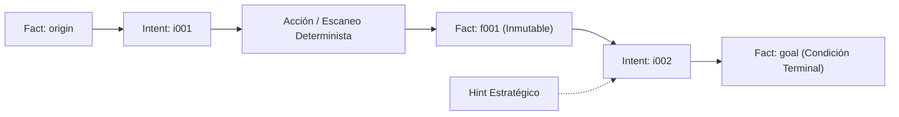

# Guía Autoritativa: Orquestación de Auditorías con Arquitectura de Pizarra (Protocolo Cairn & Bucle OODA)

**Dimensión Canónica:** `THREAT_MODELING_ATTACK_SURFACE`  
**Taxonomía:** CWE-1059 (Incomplete Documentation of Architecture), MITRE ATT&CK TA0043 (Reconnaissance)  
**Skill Asignada:** [`threat-modeling-attack-surface`](file:///.agents/skills/threat-modeling-attack-surface/SKILL.md)  
**Origen:** Absorción forense de Cairn Audit Orchestrator (`cairn-audit-orchestrator/SKILL.md` y `audit-graph-schema.md`)  

---

## 🏛️ 1. Fundamentos del Protocolo Cairn y Arquitectura de Pizarra

En auditorías de seguridad sobre sistemas complejos o repositorios extensos, los agentes basados en bucles conversacionales planos (ReAct) sufren de dos patologías graves:
1. **Deriva de Contexto y Pérdida de Memoria:** Al acumularse cientos de líneas de salida, el agente olvida los objetivos iniciales o repite verificaciones ya superadas.
2. **Alucinación de Cobertura:** El agente asume que una hipótesis no comprobada es un hecho o declara erróneamente que un sistema está seguro tras un escaneo parcial.

Para erradicar estas debilidades, **Devia-CyberSecurity** adopta el **Protocolo Cairn adaptado a modo local**: una **Arquitectura de Pizarra (*Blackboard Architecture*)** gobernada por un bucle iterativo **OODA** (*Observe, Orient, Decide, Act*), modelada en un archivo declarativo `audit-graph.yaml`.

---

## 🧭 2. La Tripleta Canónica: Facts, Intents y Hints

El estado de la auditoría se representa mediante tres entidades discretas:



### 1. `facts` (Hechos Objetivos Inmutables)
- Representan observaciones empíricas confirmadas (evidencia verificada en código, puertos abiertos, fallos de esquema demostrados).
- **Invariante Sagrado de Inmutabilidad:** Un Fact una vez escrito **JAMÁS se modifica ni se elimina**. Los cambios de estado se registran como hechos sucesivos:
  - `f003`: "Identificado endpoint /api/v1/export sin autenticación en código."
  - `f007`: "El endpoint /api/v1/export está mitigado a nivel de API Gateway por regla WAF."
- IDs reservados: `origin` (punto de partida) y `goal` (condición de éxito / término).
- IDs secuenciales: `f001`, `f002`, `f003`, ...

### 2. `intents` (Intenciones de Exploración)
- Representan hipótesis o tareas pendientes de comprobación derivadas de uno o más Facts existentes.
- Cada intención define explícitamente:
  - `id`: Identificador secuencial (`i001`, `i002`, ...).
  - `from`: Lista de IDs de Facts que fundamentan y justifican la intención.
  - `description`: Objetivo concreto de la exploración técnica.
  - `status`: `pending`, `in_progress`, `completed`, `abandoned`.

### 3. `hints` (Guías Estratégicas y Heurísticas)
- Pistas de alto nivel introducidas por el operador humano o por la memoria proactiva (`docs/PROACTIVE.md`) para orientar la exploración hacia vectores de alto impacto sin imponer acciones rígidas.

---

## 🔄 3. El Ciclo OODA de Auditoría (Bootstrap-Explore-Reason)

El agente opera ejecutando ciclos formales en 4 fases:

1. **Bootstrap (Inicialización):**
   - Se crea `audit-graph.yaml` con metadatos del proyecto (`title`, `origin`, `goal`, `level`).
   - Se inyectan los dos Facts semilla: `origin` y `goal`.
   - Se derivan las primeras intenciones de exploración en nivel L1.
2. **Explore (Ejecución Determinista):**
   - El agente selecciona el Intent prioritario no completado.
   - Ejecuta la inspección estática o script determinista correspondiente (Capa 3).
   - Recoge la salida cruda y calcula digests SHA-256 de las evidencias.
3. **Reason (Destilación y Cristalización de Hechos):**
   - Si la hipótesis se confirma o se refuta con certeza, se escribe un nuevo `Fact` inmutable (`fNNN`).
   - El Intent ejecutado se marca como `completed`.
   - Si surgen nuevas ramificaciones de ataque, se añaden nuevos `Intents` vinculados al nuevo `Fact`.
4. **Complete (Cierre y Validación de Condición Terminal):**
   - Cuando se alcanza la condición estipulada en `goal`, o se agotan los Intents de todos los niveles autorizados, el proyecto transiciona a `status: completed`.

---

## 📊 4. Taxonomía de 4 Niveles de Madurez de Auditoría (L1–L4)

| Nivel | Nombre | Alcance Operativo | Criterio de Finalización |
| :---: | :--- | :--- | :--- |
| **L1** | **Reconocimiento y Superficie** | Mapeo de rutas, puertos, manifiestos de dependencias, endpoints y componentes expuestos. | Inventario forense completo (`inventory.jsonl`). |
| **L2** | **Análisis de Fronteras y Configuración** | Inspección de controles de acceso, encabezados de seguridad, autenticación y configuraciones por defecto. | Matriz de controles de entrada y salida evaluada. |
| **L3** | **Auditoría Lógica y Caza de Vulnerabilidades** | Análisis de taint (fuente a sumidero), deserialización, RLS, memory safety y control de flujo. | Candidatos validados o refutados de forma independiente. |
| **L4** | **Modelado de Cadenas de Explotabilidad** | Correlación de vectores en exploit chains (e.g. Open Redirect + OAuth ATO), evaluación de impacto sistémico. | Dossier final de auditoría y paquete sellado. |

---

## 🛡️ 5. Esquema Canónico de `audit-graph.yaml`

```yaml
project:
  title: "Auditoría de Arquitectura y Superficie - Objetivo X"
  origin: "K:\\proyectos\\objetivo\\"
  goal: "Identificar bypasses de autenticación, inyecciones críticas o fugas de datos sensibles"
  status: active
  level: L1

hints:
  - content: "Priorizar controladores REST con subida de archivos multipart"
  - content: "Verificar si las consultas RLS utilizan InitPlan O(1) con subconsultas escalares"

facts:
  - id: origin
    description: "Repositorio Node.js / TypeScript con Express y PostgreSQL montado en K:\\proyectos\\objetivo\\"
  - id: goal
    description: "Confirmación de vulnerabilidades explotables de severidad High/Critical con evidencia en código"
  - id: f001
    description: "Inventario forense determinista finalizado: 84 archivos, 12 endpoints REST identificados"
  - id: f002
    description: "El endpoint /api/v1/upload extrae archivos comprimidos usando unzipper sin verificación de prefijo de destino (CWE-22 Zip Slip)"

intents:
  - id: i001
    from: [origin]
    description: "Ejecutar escaneo de inventario forense determinista con forensic_inventory.py"
    status: completed
  - id: i002
    from: [f001]
    description: "Auditar controladores de carga de archivos en busca de sanitización de rutas"
    status: completed
  - id: i003
    from: [f002]
    description: "Verificar si el directorio de descompresión está dentro del docroot web público o en un directorio temporal aislado"
    status: pending
```

---

## ⚡ 6. Reglas de Integración con Devia-CyberSecurity

1. **Persistencia Confinada:** El archivo `audit-graph.yaml` reside exclusivamente en el directorio de la auditoría (`audits/<target>/`), jamás en la raíz del repositorio objetivo.
2. **Validación Automática:** Antes de finalizar una auditoría, el grafo debe validarse para garantizar ausencia de IDs duplicados, referencias huérfanas o violaciones de inmutabilidad.
3. **Proyección hacia Hallazgos Canónicos:** Los Facts clasificados como vulnerabilidades en nivel L3/L4 se proyectan automáticamente hacia el contrato Zod `SecurityFindingSchema` para su incorporación en `findings.json`.
