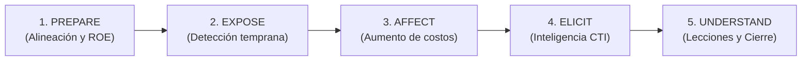

# Estrategia de Ciberengaño y Operaciones con MITRE Engage

Este documento establece el marco metodológico y operativo para diseñar, ejecutar y evaluar operaciones de ciberengaño (*Adversary Engagement*) dentro del ecosistema **Devia-CyberSecurity**, fundamentado en la matriz **MITRE Engage**.

---

## 🎯 1. Filosofía Operacional: Del Engaño Ad-Hoc a la Estrategia Medible

Tradicionalmente, las tecnologías de engaño (*honeypots*, *honeytokens*, archivos canario) se despliegan de forma fragmentada sin una estrategia unificadora, generando alertas que los analistas del SOC no saben cómo interpretar o gestionar.

MITRE Engage proporciona la capa estratégica que vincula los artefactos de engaño tácticos con las debilidades intrínsecas de las técnicas del adversario (**MITRE ATT&CK**), bajo cinco objetivos estratégicos de alto nivel:



1. **`PREPARE` (Planificación Estratégica):** Confirmar el encuadre legal, reglas de enfrentamiento (ROE), autorización ejecutiva y modelo de amenazas del actor objetivo.
2. **`EXPOSE` (Detección de Alta Fidelidad):** Forzar al atacante a interactuar con artefactos trampa con tasa cero de falsos positivos (*the alert is the compromise*).
3. **`AFFECT` (Fricción y Desvío):** Incrementar los costos operativos del adversario, retrasando su avance y desviándolo hacia zonas de contención controladas.
4. **`ELICIT` (Captura de CTI de Primera Parte):** Provocar que el adversario despliegue sus herramientas propietarias, scripts no documentados y TTPs para recolectar indicadores de compromiso (IoCs).
5. **`UNDERSTAND` (Análisis y Maduración):** Traducir los hallazgos en defensas de ingeniería permanentes en el entorno de producción.

---

## 🧭 2. El Proceso Operativo en 10 Pasos de MITRE Engage

```
┌────────────────────────────────────────────────────────────────────────┐
│               EL CICLO OPERACIONAL EN 10 PASOS DE ENGAGE                │
├─────────────────────────┬────────────────────────┬─────────────────────┤
│ 1. Ajuste Estratégico   │ 4. Seleccionar Activos │ 8. Despliegue       │
│ 2. Modelo de Amenazas   │ 5. Definir Objetivos   │ 9. Monitoreo Activo │
│ 3. Identificar Actores  │ 6. Diseñar Escenario   │ 10. Desmantelamiento│
│                         │ 7. Gating Legal / ROE  │    y CTI Post-Op    │
└─────────────────────────┴────────────────────────┴─────────────────────┘
```

1. **Confirmar Ajuste Estratégico:** Definir qué problema de seguridad aborda la operación (e.g. reducir tiempo de permanencia de intrusos en servidores de desarrollo).
2. **Revisar Amenazas Internas y Externas:** Mapear los vectores de ataque plausibles en la organización.
3. **Seleccionar Actor Objetivo o Clase de Amenaza:** Identificar a qué adversario o técnica se busca confrontar (e.g. brokers de acceso inicial, operadores de ransomware).
4. **Inventariar Activos a Proteger (Crown Jewels):** Determinar qué datos o servicios no deben ser alcanzados bajo ninguna circunstancia.
5. **Fijar Objetivos Falsificables y Medibles:** Establecer métricas claras (e.g. latencia de alerta $< 90$ segundos, detección de enumeración de Active Directory).
6. **Diseñar el Escenario de Engaño:** Crear personas ficticias, historiales convincentes (*Pocket Litter*), señuelos y caminos creíbles.
7. **Compuerta Legal y Reglas de Enfrentamiento (ROE):** Aprobación por asesoría legal; definir umbrales de desconexión inmediata (*Trigger-to-Tear-Down*).
8. **Despliegue y Validación:** Plantar señuelos e inducir una activación de prueba controlada para certificar el enrutamiento de telemetría.
9. **Operación y Monitoreo Activo:** Supervisión en tiempo real por el equipo de detección sin alertar al adversario de que está en una jaula.
10. **Desmantelamiento y Absorción:** Recolección de evidencia con cadena de custodia forense y retroalimentación hacia el catálogo de amenazas (`docs/VULNERABILITIES.md`).

---

## 🗺️ 3. Matriz Canónica: Técnicas ATT&CK hacia Actividades Engage

La siguiente matriz define qué actividades de engaño deben seleccionarse frente a técnicas comunes de intrusión:

| Técnica ATT&CK | Nombre de la Técnica | Debilidad del Adversario | Actividades MITRE Engage Asignadas |
| :--- | :--- | :--- | :--- |
| **`T1078`** | Valid Accounts | No puede distinguir credenciales legítimas de señuelos. | `Decoy Credentials`, `Lures`, `Decoy Account` |
| **`T1558.003`** | Kerberoasting | Solicita tickets TGS para todos los SPNs descubiertos. | `Decoy Account` (AdminCount=1), `Lures` (SPN trampa) |
| **`T1552`** | Unsecured Credentials | Busca archivos de contraseñas, scripts `.env` y claves. | `Pocket Litter`, `Decoy Credentials`, `Artifact Diversity` |
| **`T1083`** | File & Directory Discovery | Enumera carpetas masivamente en orden alfabético. | `Decoy Content` (`_AAAA_`, `~zzzz_`), `Pocket Litter` |
| **`T1046`** | Network Service Discovery | Escanea puertos en busca de servicios abiertos. | `Network Diversity`, `Network Manipulation` (Dark Cloud SDP) |
| **`T1021`** | Remote Services | Salta lateralmente hacia hosts visibles en red. | `Network Manipulation`, `Isolation`, `Decoy Content` |
| **`T1486`** | Data Encrypted for Impact | Cifra todos los documentos encontrados sin discriminar. | `Decoy Content` (Canary Files con monitoreo de entropía) |

---

## 🔒 4. Salvaguardas Críticas y Reglas Inmutables

1. **Prohibición Absoluta de Contratacar (*Zero Hack-Back*):** Las operaciones son estrictamente pasivas y de contención interna. Queda terminantemente prohibido ejecutar acciones ofensivas contra infraestructura externa del atacante.
2. **Aislamiento Férreo de Red:** Los entornos señuelo deben estar confinados en VLANs o cuentas cloud segregadas sin conectividad saliente hacia sistemas de producción.
3. **Gating de Desconexión Inmediata (*Emergency Kill-Switch*):** Si el adversario intenta utilizar el entorno señuelo como puente para atacar a terceros o pivota fuera de la jaula, la sesión se termina automáticamente cortando la red a nivel de kernel/firewall.
