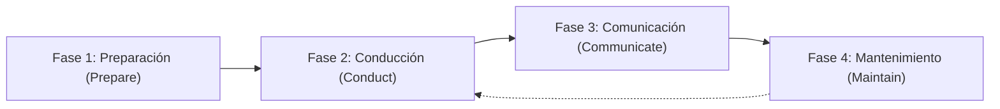

# Guía Operativa de Evaluación de Riesgos según NIST SP 800-30 Rev 1

Esta guía establece el marco metodológico y operativo para la conducción de evaluaciones de riesgo de ciberseguridad dentro de **Devia-CyberSecurity**, fundamentado en la publicación especial **NIST SP 800-30 Rev 1** (*Guide for Conducting Risk Assessments*).

---

## 🏛️ 1. Las 4 Fases Canónicas del Ciclo de Vida de Evaluación de Riesgo

El marco NIST SP 800-30 estructura la evaluación en cuatro fases iterativas e interconectadas:

1. **Fase 1: Preparación (Prepare):**
   - Identificar el propósito de la evaluación, el alcance (Scope) y los límites del sistema.
   - Determinar el nivel organizacional evaluado (Tier 1: Gobernanza Estratégica, Tier 2: Procesos de Misión/Negocio, Tier 3: Sistemas de Información).
   - Fijar las fuentes de información técnica y el apetito de riesgo institucional.

2. **Fase 2: Conducción de la Evaluación (Conduct):**
   - **Identificar Fuentes de Amenaza (Threat Sources):** Clasificar en `ADVERSARIAL`, `ACCIDENTAL`, `STRUCTURAL` o `ENVIRONMENTAL`.
   - **Identificar Eventos de Amenaza (Threat Events):** Modelar las acciones específicas que un adversario puede ejecutar (e.g. TTPs de MITRE ATT&CK).
   - **Identificar Vulnerabilidades y Condiciones Predisponentes:** Mapear fallas en código, configuraciones o debilidades arquitectónicas (CWE).
   - **Determinar Verosimilitud (Likelihood):** Evaluar la probabilidad de que el evento ocurra considerando la capacidad del adversario y la exposición.
   - **Determinar Impacto (Impact):** Evaluar el daño a la confidencialidad, integridad y disponibilidad de los activos.
   - **Calcular Nivel de Riesgo (Risk Determination):** Proyectar sobre la matriz 5x5 formal.

3. **Fase 3: Comunicación y Compartición (Communicate):**
   - Emitir el registro formal de riesgos (`RiskAssessmentReportSchema`) y reportes ejecutivos Markdown para la dirección y los equipos de ingeniería.
   - Documentar planes de tratamiento de riesgos y controles compensatorios.

4. **Fase 4: Mantenimiento Continuo (Maintain):**
   - Monitorear periódicamente los factores de riesgo (nuevos CVEs, cambios en la infraestructura, degradación de controles).
   - Actualizar el estado de remediación de los eventos de amenaza (`OPEN` $\to$ `MITIGATING` $\to$ `CLOSED`).

---

## 🎯 2. Taxonomía de Fuentes de Amenaza (Threat Sources)

Toda evaluación debe clasificar rigurosamente sus amenazas bajo las 4 categorías cerradas:

| Fuente de Amenaza (`ThreatSourceTypeSchema`) | Descripción Técnica | Ejemplos Representativos |
| :--- | :--- | :--- |
| **`ADVERSARIAL`** | Actores maliciosos humanos con intención y capacidades hostiles deliberadas. | APTs, grupos de ransomware, ciberdelincuentes, insiders maliciosos, competidores corporativos. |
| **`ACCIDENTAL`** | Acciones humanas no intencionadas o errores de operación que comprometen la seguridad. | Desarrollador comiteando credenciales en Git, administrador configurando bucket S3 público, mala aplicación de ACL. |
| **`STRUCTURAL`** | Fallos en componentes físicos o lógicos de la arquitectura sin intervención humana directa. | Corrupción silenciosa de datos, degradación de hardware de almacenamiento, fallos de reloj en servidores, desbordamiento de búfer por carga. |
| **`ENVIRONMENTAL`** | Eventos naturales o externos de fuerza mayor fuera del control directo de la organización. | Incendios, inundaciones, cortes de suministro eléctrico general, caída masiva de fibra submarina. |

---

## 📊 3. Matriz Canónica 5x5 de Determinación de Riesgo (NIST SP 800-30 Tabla I-2)

La asignación de severidad no debe realizarse por intuición o fórmulas lineales aditivas. Se rige por la tabla de cruce formal:

| Verosimilitud \ Impacto | 1 - Muy Bajo (VERY_LOW) | 2 - Bajo (LOW) | 3 - Moderado (MODERATE) | 4 - Alto (HIGH) | 5 - Muy Alto (VERY_HIGH) |
| :---: | :---: | :---: | :---: | :---: | :---: |
| **5 - Muy Alta (VERY_HIGH)** | Bajo | Moderado | Alto | **Muy Alto** | **Muy Alto** |
| **4 - Alta (HIGH)** | Bajo | Moderado | Alto | **Alto** | **Muy Alto** |
| **3 - Moderada (MODERATE)** | Muy Bajo | Bajo | Moderado | **Alto** | **Alto** |
| **2 - Baja (LOW)** | Muy Bajo | Bajo | Bajo | Moderado | Moderado |
| **1 - Muy Baja (VERY_LOW)** | Muy Bajo | Muy Bajo | Bajo | Bajo | Bajo |

### Puntuación Semi-Cuantitativa Normalizada
Para cálculo algorítmico en Capa 3 (`src/scripts/risk_assessment_engine.py`):
$$\text{Risk Score} = \frac{\text{Likelihood} \times \text{Impact}}{25} \times 100.0$$

---

## 🛠️ 4. Integración Contract-First en Devia-CyberSecurity

- **Capa 2 (Contrato Zod):** `src/schemas/cyber-risk-assessment.schema.ts` valida en runtime la estructura de todo registro emitido.
- **Capa 3 (Motor Determinista):** `src/scripts/risk_assessment_engine.py` ejecuta el cálculo automatizado con soporte `--json` y `--markdown`.
- **Compuerta de Tratamiento:** Todo hallazgo clasificado como `VERY_HIGH` o `HIGH` debe incorporarse a los planes de tratamiento con SLA estricto (7 a 14 días) vinculado con [`docs/VULNERABILITIES.md`](file:///docs/VULNERABILITIES.md).
