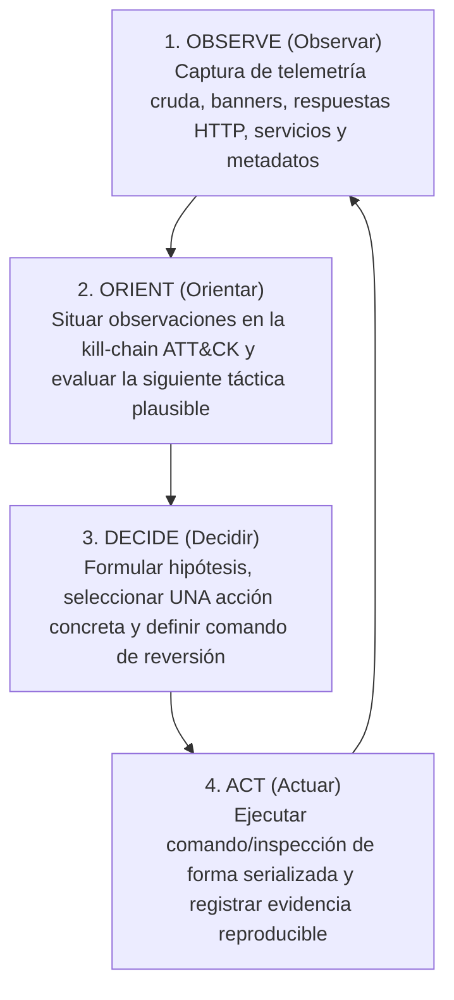

# Bucle OODA y Orientación Táctica con MITRE ATT&CK en Threat Modeling

Este documento define la metodología autoritativa para integrar el ciclo cognitivo **Observe $\to$ Orient $\to$ Decide $\to$ Act (OODA)** y la taxonomía de **MITRE ATT&CK Enterprise/Cloud** dentro del modelado de amenazas y la orquestación de auditorías en **Devia-CyberSecurity**.

---

## 1. El Bucle OODA como Motor de Razonamiento Agéntico

En auditorías complejas y evaluaciones de superficie de ataque, los agentes de seguridad no deben actuar como scripts lineales ciegos ni depender de suposiciones abstractas. El bucle OODA estructura el ciclo de vida de cada acción:

### Formato Canónico de Registro y Trazabilidad:
Toda iteración agéntica debe encabezar su ejecución con el descriptor unificado:
`OODA — <FASE> (paso <N>): <descripción de una línea>`
Donde `FASE` $\in$ `{OBSERVE, ORIENT, DECIDE, ACT}` y `N` es el contador incremental del ciclo de auditoría.

---

## 2. MITRE ATT&CK como Lenguaje de Orientación Táctica

MITRE ATT&CK **no es un procedimiento de ataque ni una checklist rígida**: es la **ontología de orientación** para identificar qué busca el adversario y qué táctica corresponde a continuación:

| ID Táctica | Nombre de Táctica | Objetivo del Adversario en la Fase | Pregunta de Orientación OODA |
| :--- | :--- | :--- | :--- |
| **TA0043** | Reconnaissance | Recopilar información previa al acceso. | ¿Qué activos externos, dominios o subredes están expuestos? |
| **TA0042** | Resource Development | Establecer infraestructura o credenciales. | ¿Qué dependencias de terceros o cuentas pueden ser abusadas? |
| **TA0001** | Initial Access | Cruzar el perímetro de la red u organización. | ¿Cuál es el punto de entrada explotable (e.g. T1190)? |
| **TA0002** | Execution | Ejecutar código no confiable en el objetivo. | ¿Qué interprete de comandos o runtime fue alcanzado (e.g. T1059)? |
| **TA0003** | Persistence | Mantener la presencia tras reinicios. | ¿Qué cuentas, tokens o claves fueron manipuladas (e.g. T1098)? |
| **TA0004** | Privilege Escalation | Obtener privilegios más elevados. | ¿Qué controles de elevación o roles pueden ser abusados (e.g. T1548)? |
| **TA0005** | Defense Evasion | Evadir detección o controles de seguridad. | ¿Qué mecanismos de auditoría o logging fueron eludidos? |
| **TA0006** | Credential Access | Robar credenciales y hashes en memoria o disco. | ¿Qué credenciales no cifradas fueron descubiertas (e.g. T1552)? |
| **TA0007** | Discovery | Comprender el entorno interno tras el acceso. | ¿Qué servicios internos o configuraciones cloud se observan (e.g. T1046)? |
| **TA0008** | Lateral Movement | Pivotar hacia otros sistemas o subredes. | ¿Qué servicios remotos autentican con las credenciales obtenidas? |
| **TA0009** | Collection | Extraer datos y activos de alto valor. | ¿Qué repositorios de datos o buckets S3 fueron accedidos (e.g. T1530)? |
| **TA0011** | Command and Control | Mantener comunicación con sistemas comprometidos. | ¿Qué canales HTTP/S o perfiles de beaconing están activos? |
| **TA0010** | Exfiltration | Extraer datos confidenciales hacia el exterior. | ¿Qué volumen de datos fue transferido fuera de la frontera de confianza? |
| **TA0040** | Impact | Manipular, degradar o destruir sistemas. | ¿Qué daño potencial a la integridad o disponibilidad fue demostrado? |

---

## 3. Disciplina Epistemológica de Hallazgos

Un agente de ciberseguridad nunca debe certificar una vulnerabilidad basándose exclusivamente en una sospecha o inferencia:

1. **`hypothesis`:** Sospecha fundada tras la fase Observe/Orient (ej. puerto web expuesto, versión susceptible de CVE).
2. **`partial`:** Sumidero sensible alcanzado o respuesta diferencial observada, pero con controles defensivos intermedios aún no evaluados.
3. **`confirmed`:** Evidencia reproducible verificada. Requiere **comando exacto re-ejecutable** y **salida verbatim cruda** ($\ge 16$ bytes) con código de retorno exitoso. Sin prueba empírica, queda terminantemente prohibido categorizar un hallazgo como `confirmed`.
4. **`discarded`:** Vector evaluado y descartado mediante prueba explícita (ej. "sudoers no concede privilegios al usuario auditado"). Permite que el auditor posterior no gaste tiempo repitiendo rutas infructuosas.

---

## 4. Confinamiento de Contexto y Delegación a Subagentes

En auditorías con escaneos extensivos (barridos masivos de puertos, fuzzing de rutas con miles de peticiones), incorporar la salida cruda directamente en la ventana de chat satura el contexto y degrada el razonamiento OODA.

- **Directiva:** Delegar barridos y tareas mecánicas de recolección a subagentes efímeros de investigación (`research` o scripts de Capa 3).
- **Invariante:** El subagente procesa la salida masiva en su propio sandbox y entrega al agente conductor **únicamente el resumen estructurado de hallazgos confirmados**. La toma de decisiones estratégicas del bucle OODA nunca se delega.
