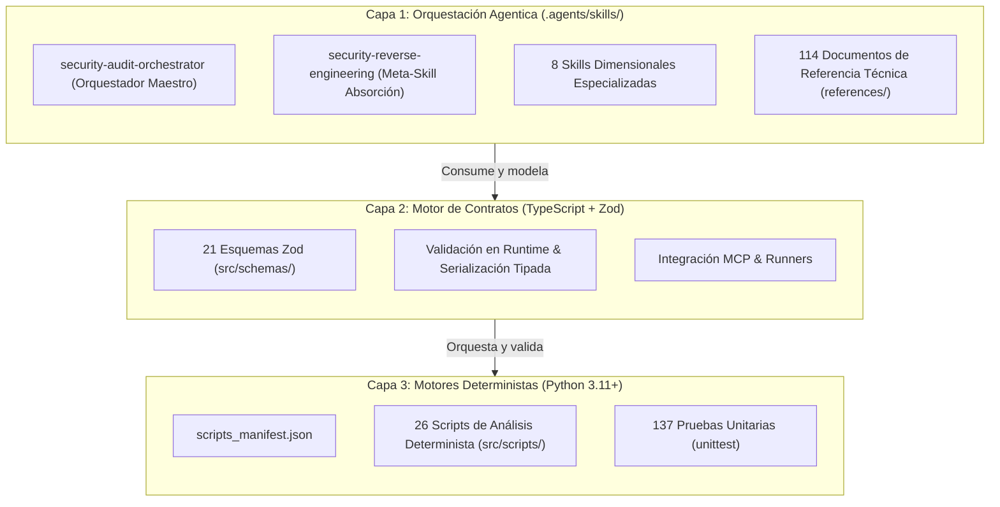
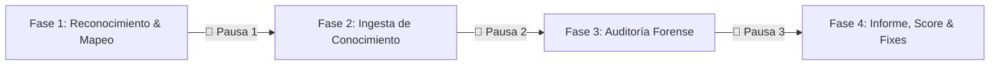

# Devia-CyberSecurity

**Ecosistema Unificado, Agnóstico y Contract-First de Auditoría de Ciberseguridad, Modelado de Amenazas y Arquitectura Defensiva (Offline & Cloud).**

---

## 🎯 Misión, Utilidad y Propósito

**Devia-CyberSecurity** es un marco de ingeniería de seguridad agnóstico y sistemático, diseñado para evaluar con rigor industrial cualquier base de código, repositorio, aplicación o infraestructura externa sin importar su tecnología subyacente.

### ¿Para qué sirve este proyecto?
1. **Auditorías Externas Exhaustivas de Grado Militar:** Inspeccionar cualquier repositorio externo sin ejecutar código no confiable, identificando vulnerabilidades lógicas, inyecciones, fugas de secretos, configuraciones erróneas y dependencias comprometidas.
2. **Modelado Formal de Amenazas & Postura Zero Trust:** Mapear superficies de ataque, flujos de datos inter-componente (*DFD*) y escenarios STRIDE/PASTA, evaluando límites de aislamiento entre procesos y la nube.
3. **Remediación Contract-First de Código:** Producir diagnósticos reproducibles con evidencia en 7 roles semánticos y bloques directos de código corregido (*Vulnerable vs Bastionado*), eliminando falsos positivos obvios.
4. **Ingeniería Inversa Forense y Absorción:** Deconstruir herramientas, repositorios y estándares de seguridad para absorberlos sistemáticamente en contratos Zod, referencias y scripts deterministas.

---

## 🏛️ Arquitectura Híbrida de Tres Capas (Tri-Tier Hybrid Engine)

El sistema desacopla la orquestación metodológica, la validación estricta de datos y el análisis determinista de bajo nivel:



- **Capa 1 (Skills & Metodología):** **10 Skills** en `.agents/skills/` (1 Orquestadora Maestra + 1 Meta-Skill de absorción + 8 Dimensionales) y **114 guías de referencia técnica** con diagramas Mermaid y código vulnerable vs seguro.
- **Capa 2 (Motor de Contratos):** Implementado en **TypeScript 5.8+** y **Node.js 22+ ESM** con **Zod**. Define esquemas autoritativos (`Finding`, `ThreatModel`, `ScanContract`, `FrameworkMapping`) que garantizan datos fuertemente tipados.
- **Capa 3 (Motores Deterministas):** Implementado en **Python 3.11+** en `src/scripts/`. Ejecuta análisis intensivo de baja latencia ($O(1)$ / $O(n \log n)$): cálculo de entropía de Shannon, detección de balizas C2, verificación de lockfiles, minería de roles y parsing de artefactos sin ejecutar código hostil.

---

## 🧭 Flujo Operativo de Auditoría Militar en 4 Fases

Toda auditoría de un repositorio externo es conducida por la Skill **`security-audit-orchestrator`** siguiendo un protocolo secuencial estricto con **pausas de confirmación estratégica obligatorias (*Strategic Gating*)**:



1. **Fase 1: Reconocimiento de Stack y Mapeo Dimensional:**
   - Inspección estática del objetivo con `stack_detector_mapper.py`.
   - Identificación de lenguajes, frameworks, APIs, bases de datos y CI/CD.
   - Activación precisa de dimensiones, skills, referencias y scripts aplicables.
   - **🛑 Pausa Estratégica 1:** Presentación de situación (*SitRep*) y confirmación del usuario para avanzar.
2. **Fase 2: Lectura e Ingesta Recursiva de Conocimiento:**
   - Asimilación en profundidad de las Skills y referencias técnicas específicas del stack detectado.
   - Calibración de fuentes de entrada (*Sources*) y sumideros de ejecución (*Sinks*).
   - **🛑 Pausa Estratégica 2:** Presentación de vectores priorizados y confirmación del usuario para avanzar.
3. **Fase 3: Auditoría Forense Exhaustiva Línea por Línea:**
   - Ejecución de motores de Capa 3 (`scan_secrets.py`, `check_lockfiles.py`, `target_snapshot.py`, etc.).
   - Análisis estático de código (SAST) y trazabilidad completa de *Taint* (Source $\to$ Propagation $\to$ Sink).
   - Estructuración de evidencias bajo los 7 roles semánticos y cálculo de huellas primarias estables.
   - **🛑 Pausa Estratégica 3:** Presentación de cobertura (100%) y conteo de hallazgos por severidad.
4. **Fase 4: Generación del Informe Técnico y Postura de Seguridad:**
   - Cálculo del **Devia Security Health Score (0 - 100)**:
     $$\text{HealthScore} = \max\left(0, 100 - (25 \times \text{Critical} + 15 \times \text{High} + 5 \times \text{Medium} + 1 \times \text{Low})\right)$$
   - Generación de informe exhaustivo en `audits/<target>/audit-report.md` con remediaciones directas.
   - Hoja de ruta de mitigación por fases (`IMMEDIATE_HOTFIX`, `SHORT_TERM`, `ARCHITECTURAL_LONG_TERM`).
   - **🛑 Pausa Estratégica 4:** Entrega formal del informe y sesión de remediación guiada paso a paso.

---

## 🛡️ Las 8 Dimensiones Canónicas de Auditoría (Taxonomía MECE)

Toda auditoría clasifica sus hallazgos dentro de una taxonomía cerrada e inmutable:

| Skill Operativa | Dimensión Canónica / Ámbito | Responsabilidad y Herramientas de Capa 3 (`src/scripts/`) |
| :--- | :--- | :--- |
| **`security-audit-orchestrator`** | **Orquestador Maestro de Auditorías** | Punto de entrada primario. Conduce el protocolo en 4 fases, gating, scoring 0-100 y reportes.<br>• `stack_detector_mapper.py` + Orquestación de la Suite Completa. |
| **`security-reverse-engineering`** | **Meta-Skill de Auditoría y Absorción** | Deconstrucción forense y adopción hacia las 3 capas.<br>• `forensic_inventory.py`, `absorption_planner.py`, `forensic_artifact_parser.py`. |
| **`threat-modeling-attack-surface`** | **1. `THREAT_MODELING_ATTACK_SURFACE`** | Modelado STRIDE/PASTA, diagramas DFD y evaluación de riesgos NIST SP 800-30.<br>• `target_snapshot.py`, `risk_assessment_engine.py`, `navigator_mapper.py`, `incident_triage_scorer.py`, `vulnerability_sla_analyzer.py`, `prompt_injection_detector.py`. |
| **`source-code-sast`** | **2. `SOURCE_CODE_SAST`** | Análisis estático de código fuente, inyecciones (SQL, OS, SSTI), deserialización y taint.<br>• `differential_exploit_verifier.py`, `attack_vector_assessment_engine.py`, `poc_safety_linter.py`. |
| **`secrets-cryptography`** | **3. `SECRETS_CRYPTOGRAPHY`** | Escaneo de credenciales hardcodeadas, entropía de Shannon y postura PQC (FIPS 203/204).<br>• `scan_secrets.py`, `pqc_inventory_scanner.py`. |
| **`identity-access-session`** | **4. `IDENTITY_ACCESS_SESSION`** | Autenticación, control de acceso (RBAC/ABAC), IDOR/BOLA, políticas RLS y sesiones.<br>• `role_mining_analyzer.py`. |
| **`supply-chain-sca`** | **5. `SUPPLY_CHAIN_SCA`** | Verificación de lockfiles, CVEs en dependencias, scripts de instalación y typosquatting.<br>• `check_lockfiles.py`. |
| **`architecture-boundaries-zero-trust`** | **6. `ARCHITECTURE_BOUNDARIES_ZERO_TRUST`** | Fronteras Zero Trust, seguridad Electron/IPC, aislamiento Docker/sandbox y MCP security.<br>• `mcp_tool_poisoning_scanner.py`, `c2_beaconing_detector.py`, `deception_canary_auditor.py`, `threat_detection_engine.py`, `url_validator.py`, `hard_exclusions.py`. |
| **`configuration-hardening`** | **7. `CONFIGURATION_HARDENING`** | Bastionado de endpoints (ASR), Dockerfiles, Kubernetes, IaC y variables de entorno.<br>• `endpoint_hardening_auditor.py`. |
| **`resilience-logging-telemetry`** | **8. `RESILIENCE_LOGGING_TELEMETRY`** | Mitigación de DoS/ReDoS, prevención de fuga de datos en logs y reportes SARIF 2.1.0.<br>• `scan_covert_telemetry.py`, `sarif_toolkit.py`. |

---

## 🌐 Alcance y Tecnologías Auditables

El motor inspecciona de forma nativa:
- **Lenguajes:** TypeScript, JavaScript, Python, Go, Rust, Java, C#, PHP, C/C++, Solidity.
- **Frameworks Web & API:** Node.js, Express, Fastify, NestJS, React, Angular, Vue, Next.js, Django, FastAPI, Flask, Spring Boot, ASP.NET Core, Laravel.
- **Bases de Datos & ORMs:** PostgreSQL (RLS), MySQL, SQLite, MongoDB, Redis, Prisma, TypeORM, SQLAlchemy.
- **Autenticación & Identidad:** JWT, OAuth 2.0 / OIDC, Passkeys/WebAuthn, Active Directory (ESAE/PAW), Cookies de sesión.
- **Infraestructura & Cloud:** Docker, Kubernetes, Terraform, Nginx, GitHub Actions, GitLab CI.
- **Sistemas Emergentes:** Model Context Protocol (MCP), LLMs / Agentes Autónomos, Aplicaciones Desktop Electron y Smart Contracts.

---

## 🔒 Regla de Sincronización Cuádruple Canónica

Para garantizar **Zero Drift (cero deriva técnica)**, toda funcionalidad en el repositorio mantiene una sincronización estricta de cuatro puntos:
$$\text{Skill Operativa (Capa 1)} \longleftrightarrow \text{Referencias (references/)} \longleftrightarrow \text{Scripts (Capa 3)} \longleftrightarrow \text{Catálogo (docs/VULNERABILITIES.md)}$$

Consulta el catálogo centralizado de scripts en [`src/scripts/scripts_manifest.json`](src/scripts/scripts_manifest.json).

---

## 🚀 Comandos Rápidos de Verificación y Uso

### 1. Pruebas Unitarias de Capa 2 (TypeScript / Zod)
```bash
# Compilar TypeScript
pnpm build

# Ejecutar los 65 tests de contratos Zod
pnpm test
```

### 2. Pruebas Unitarias de Capa 3 (Python Determinista)
```bash
# Ejecutar los 137 tests unitarios de Python
python -m unittest discover -s src/scripts -p "test_*.py"
```

### 3. Operaciones de Auditoría de Ejemplo
```bash
# 1. Reconocimiento de Stack y Mapeo Dimensional (Fase 1)
python src/scripts/stack_detector_mapper.py "ruta/al/proyecto" --json

# 2. Escaneo de secretos por entropía de Shannon (Fase 3)
python src/scripts/scan_secrets.py "ruta/al/proyecto" --json

# 3. Auditoría estática de integridad de lockfiles (Fase 3)
python src/scripts/check_lockfiles.py "ruta/al/proyecto" --json

# 4. Snapshot determinista y huellas primarias
python src/scripts/target_snapshot.py "ruta/al/proyecto" --json

# 5. Traversal forense e inventario sin ejecución (Meta-Skill)
python src/scripts/forensic_inventory.py "ruta/al/proyecto" -o "audits/mi-auditoria/inventory"
```

---

## 📚 Documentación Técnica y SSOTs

- [`AGENTS.md`](AGENTS.md): Constitución técnica del repositorio, directivas maestras y las 8 leyes de ingeniería.
- [`docs/ARCHITECTURE.md`](docs/ARCHITECTURE.md): Especificación detallada de la arquitectura híbrida tri-tier.
- [`docs/VULNERABILITIES.md`](docs/VULNERABILITIES.md): Catálogo canónico y vivo de vulnerabilidades (`VULN-*`).
- [`docs/PROACTIVE.md`](docs/PROACTIVE.md): Playbook de invariantes de ingeniería, determinismo algorítmico y entorno Windows.
- [`src/scripts/scripts_manifest.json`](src/scripts/scripts_manifest.json): Manifiesto declarativo de herramientas de Capa 3.

---

## ⚖️ Licencia y Enfoque Defensivo

Este proyecto se distribuye bajo licencia **Apache-2.0**. Todas las herramientas, metodologías y scripts son estrictamente defensivos y orientados a la auditoría de seguridad, prevención, remediación y modelado de amenazas. Queda terminantemente prohibida la generación de cargas destructivas o exploits armamentizados.
