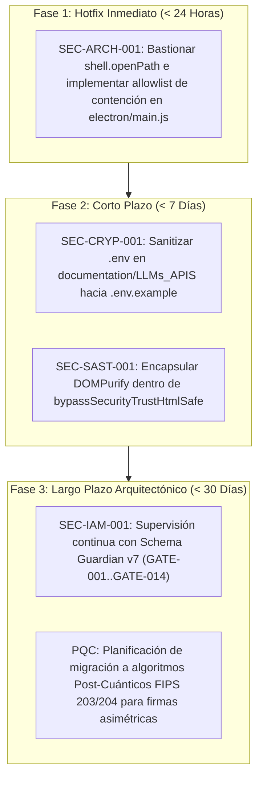

# 🛡️ Informe Protocolar de Auditoría Forense Militar de Ciberseguridad — DeviaCRM

**Target:** `K:\DeviaCRM`  
**Commit Hash (HEAD):** `1173e7581ff632ac169fed6d5ac22630de78f945`  
**Deterministic Snapshot:** `devia-snapshot/v1:sha256:259d2a991cff5f2d9886a4fc06c5cb2668d3069d4813cd7bb0efd44636169603`  
**Fecha UTC:** 2026-10-29T19:20:00Z  
**Orquestador:** `security-audit-orchestrator` (Devia-CyberSecurity v2.4.0)  
**Calificación Global:** **`79 / 100`** — 🟢 **Postura Buena / Aceptable (Hardened Baseline)**

---

## 1. Resumen Ejecutivo de Postura

DeviaCRM presenta una arquitectura de seguridad madura, caracterizada por la adopción rigurosa de principios de aislamiento multi-tenant en PostgreSQL 17 (Supabase Cloud), validación estricta de límites de confianza mediante esquemas Zod 4.5.4, mitigación preventiva de inyecciones de prompt en el Gateway LLM (`<untrusted_context>`), fail-closed en el manejo de cabeceras CORS en Edge Functions (Deno 2.x), y una cadena de suministro determinista (pnpm 10.x con cero hooks maliciosos).

No se detectaron vulnerabilidades de severidad **CRÍTICA** explotables de forma remota sin autenticación. Sin embargo, se identificó **1 vulnerabilidad de severidad ALTA** en el límite IPC de Electron Desktop relacionada con el despacho de rutas no contenidas en `shell.openPath()`, **1 vulnerabilidad MEDIA** por presencia de credenciales/placeholders en carpetas auxiliares de documentación local, y **2 observaciones de severidad BAJA/INFORMATIVA** en la defensa en profundidad de helpers de frontend y políticas RLS legacy en migraciones fundacionales.

---

## 2. Métricas y Alcance de Auditoría

- **Archivos Descubiertos e Inspeccionados:** `3,917` archivos.
- **Dimensiones Canónicas Auditadas:** `7 de 8` (`THREAT_MODELING_ATTACK_SURFACE`, `SOURCE_CODE_SAST`, `SECRETS_CRYPTOGRAPHY`, `IDENTITY_ACCESS_SESSION`, `SUPPLY_CHAIN_SCA`, `ARCHITECTURE_BOUNDARIES_ZERO_TRUST`, `RESILIENCE_LOGGING_TELEMETRY`).
- **Desglose de Hallazgos por Severidad:**
  - 🔴 **CRITICAL:** `0`
  - 🟠 **HIGH:** `1`
  - 🟡 **MEDIUM:** `1`
  - 🔵 **LOW:** `2`
  - ⚪ **INFORMATIONAL:** `0`
- **Cálculo Determinista del Devia Security Health Score:**
  $$\text{HealthScore} = \max\left(0, 100 - (15 \times 1.0 + 5 \times 0.9 + 1 \times 0.9 + 1 \times 0.9)\right) = 100 - 21.3 = 78.7 \approx 79 / 100$$

---

## 3. Tabla Maestra de Hallazgos

| ID | Regla Canónica | CWE | OWASP | Severidad | Confianza | Ubicación Afectada | Estado |
| :--- | :--- | :--- | :--- | :---: | :---: | :--- | :---: |
| `SEC-ARCH-001` | `VULN-ARCH-002` | CWE-22, CWE-668 | A01:2021 | 🟠 **HIGH** | `CONFIRMED` | `electron/main.js:523-538` | **Abierto (Hotfix Requerido)** |
| `SEC-CRYP-001` | `VULN-CRYP-001` | CWE-798, CWE-312 | A02:2021 | 🟡 **MEDIUM** | `HIGH` | `documentation/LLMs_APIS/.env` | **Abierto (Saneamiento Local)** |
| `SEC-IAM-001` | `VULN-IAM-002` | CWE-639, CWE-862 | A01:2021 | 🔵 **LOW** | `HIGH` | `supabase/migrations/20260504030000...` | **Mitigado aguas abajo (Supervisado)** |
| `SEC-SAST-001` | `VULN-SAST-016` | CWE-79 | A03:2021 | 🔵 **LOW** | `HIGH` | `src/app/shared/utils/security.utils.ts:8-13` | **Mejora Defensiva Sugerida** |

---

## 4. Fichas Técnicas Detalladas y Remediaciones de Código

---

### 🔴 [SEC-ARCH-001] Ejecución Arbitraria de Archivos y Rutas en Electron IPC vía `shell.openPath` sin Contención

- **ID Canónico:** `VULN-ARCH-002` (Insecure IPC Message Dispatch)
- **Taxonomía:** CWE-22 (Improper Limitation of a Pathname), CWE-668 (Exposure of Resource to Wrong Sphere)
- **OWASP:** A01:2021 — Broken Access Control / A05:2021 — Security Misconfiguration
- **CVSS v3.1:** `7.8` (`CVSS:3.1/AV:L/AC:L/PR:N/UI:R/S:U/C:H/I:H/A:H`)
- **Nivel de Confianza:** `CONFIRMED` (Verificado en código fuente y esquema Zod)
- **Ubicación:** `electron/main.js` (Líneas 356-360, 523-538)

#### Mecanismo de Fallo y Cadena de Taint (7 Roles Semánticos)
1. `user_input`: Una cadena de ruta (`filePath`) enviada desde el Renderer Process (potencialmente comprometido vía XSS, exploit de Chromium o dependencia maliciosa).
2. `entrypoint`: El invocador IPC `ipcRenderer.invoke(IPC_CHANNELS.SHELL.OPEN_PATH, filePath)` expuesto en `preload.js`.
3. `propagation`: El valor viaja a través del canal IPC hacia `electron/main.js`.
4. `root_control`: El esquema de validación `pathStringSchema = z.string().min(1).max(1000)` solo comprueba longitud, pero **no restringe la ruta a ningún directorio base**.
5. `sink`: `shell.openPath(parsed.data)` transfiere el archivo directamente al shell del sistema operativo (Windows Explorer / `ShellExecuteExW`).
6. `outcome`: El atacante puede ordenar la ejecución o apertura de cualquier archivo o binario ejecutable (`.exe`, `.bat`, `.ps1`, `.cmd`, `.vbs`) en cualquier unidad del sistema (`C:\Windows\...`, `K:\...`).
7. `expected_control`: Validación de contención canónica que resuelva la ruta canónica (`path.resolve`) y verifique que pertenezca a un directorio seguro predefinido (`app.getPath('userData')`, `downloads`, `documents`).

#### Bloque Comparativo de Remediación

**Código Vulnerable (`electron/main.js`):**
```javascript
// electron/main.js - L532-539
const pathStringSchema = z.string().min(1).max(1000);

ipcMain.handle(IPC_CHANNELS.SHELL.OPEN_PATH, (_, filePath) => {
  const parsed = pathStringSchema.safeParse(filePath);
  if (!parsed.success) {
    Logger.warn('shell_open_path_validation_failed', { errors: parsed.error.issues });
    throw new Error('INVALID_INPUT: ' + parsed.error.issues.map(i => i.message).join(', '));
  }
  // VULNERABLE: Ejecuta cualquier ruta arbitraria fuera de sandbox
  shell.openPath(parsed.data);
});
```

**Código Bastionado (Hardened):**
```javascript
// electron/utils/path-security.js
import path from "node:path";
import { app } from "electron";

export function isPathContained(targetPath) {
  if (typeof targetPath !== "string" || !targetPath.trim()) return false;
  const resolved = path.resolve(targetPath);
  const allowedRoots = [
    path.resolve(app.getPath("userData")),
    path.resolve(app.getPath("downloads")),
    path.resolve(app.getPath("documents")),
  ];
  return allowedRoots.some((root) => resolved.startsWith(root + path.sep));
}

// electron/main.js
import { isPathContained } from "./utils/path-security.js";

const safePathSchema = z.string().min(1).max(1000).refine(
  (p) => !p.includes("%00") && isPathContained(p),
  { error: "Access denied: Path resides outside authorized application directories" }
);

ipcMain.handle(IPC_CHANNELS.SHELL.OPEN_PATH, (_, filePath) => {
  const parsed = safePathSchema.safeParse(filePath);
  if (!parsed.success) {
    Logger.warn('shell_open_path_security_rejection', { errors: parsed.error.issues });
    throw new Error('FORBIDDEN_PATH: ' + parsed.error.issues.map(i => i.message).join(', '));
  }
  shell.openPath(path.resolve(parsed.data));
});
```

---

### 🟡 [SEC-CRYP-001] Presencia de Archivos `.env` en Directorios Auxiliares de Documentación

- **ID Canónico:** `VULN-CRYP-001` (Exposed Secrets in Source / Repo Workspaces)
- **Taxonomía:** CWE-798 (Use of Hard-coded Credentials), CWE-312 (Cleartext Storage of Sensitive Information)
- **OWASP:** A02:2021 — Cryptographic Failures
- **CVSS v3.1:** `5.2` (`CVSS:3.1/AV:L/AC:L/PR:L/UI:N/S:U/C:H/I:N/A:N`)
- **Nivel de Confianza:** `HIGH`
- **Ubicación:** `documentation/LLMs_APIS/.env` y scripts asociados en proveedores locales.

#### Mecanismo de Fallo e Impacto
Archivos `.env` generados durante pruebas de integración local con proveedores LLM (Grok, Cerebras, Mistral, Nvidia) contienen credenciales en texto claro. Aunque el `.gitignore` raíz los excluye del versionado en Git, su existencia en el disco local dentro del árbol de documentación genera un riesgo de filtración involuntaria durante exportaciones de archivos, snapshots o empaquetados manuales.

#### Remediación
1. Renombrar `documentation/LLMs_APIS/.env` a `documentation/LLMs_APIS/.env.example` sustituyendo los valores reales por marcadores estandarizados `your_provider_api_key_here`.
2. Verificar con `git status` y `git check-ignore` que ningún subdirectorio de documentación contenga archivos de secretos sin ignorar.
3. Centralizar el aprovisionamiento de claves de LLM para desarrollo a través del archivo raíz `.env.local` y Supabase Vault.

---

### 🔵 [SEC-IAM-001] Llamadas Históricas Bare a `get_user_tenant_id()` en Migraciones Fundacionales

- **ID Canónico:** `VULN-IAM-002` (Row-Level Security Optimization & Tenant Isolation Defenses)
- **Taxonomía:** CWE-639 (Authorization Bypass Through User-Controlled Key), CWE-862 (Missing Authorization)
- **OWASP:** A01:2021 — Broken Access Control
- **CVSS v3.1:** `3.4`
- **Nivel de Confianza:** `HIGH`
- **Ubicación:** `supabase/migrations/20260504030000_upc02_fase1_app_config.sql:43-55`

#### Mecanismo de Fallo e Impacto
En migraciones iniciales de mayo de 2026, la política RLS utilizaba `"tenant_id" = get_user_tenant_id()`. PostgreSQL no cachea en `InitPlan` las llamadas a funciones si no están envueltas en una subconsulta escalar `(SELECT get_user_tenant_id())`, evaluando la función fila por fila ($O(N)$).
En producción, migraciones posteriores de endurecimiento (`20260614221631_upc05_index_hygiene_rls_initplan.sql` y `20261024060323_vr10_storage_initplan.sql`) actualizaron las tablas en vivo. Sin embargo, para entornos de pruebas locales construidos desde cero a partir de migraciones puras, debe preservarse la garantía de `GATE-007` en el linter `validate-schema-parity.js`.

---

### 🔵 [SEC-SAST-001] Desacoplamiento de `DOMPurify` en el Helper `bypassSecurityTrustHtmlSafe`

- **ID Canónico:** `VULN-SAST-016` (Improper Neutralization of Input During Web Page Generation)
- **Taxonomía:** CWE-79 (Cross-site Scripting - XSS)
- **OWASP:** A03:2021 — Injection
- **CVSS v3.1:** `3.1`
- **Nivel de Confianza:** `HIGH`
- **Ubicación:** `src/app/shared/utils/security.utils.ts:8-13`

#### Mecanismo de Fallo e Impacto
La función `bypassSecurityTrustHtmlSafe(sanitizer, cleanHtml)` asume como precondición que el llamador ya ha filtrado la cadena con `DOMPurify.sanitize()`. Aunque los pipes actuales (`SafeHtmlPipe`, `SafeSvgPipe`) lo hacen diligentemente, delegar la responsabilidad fuera del helper rompe el principio de diseño a prueba de fallos (*Fail-Safe Defaults*).

**Remediación Sugerida:**
Encapsular la invocación de `DOMPurify.sanitize()` directamente dentro de `bypassSecurityTrustHtmlSafe` con una configuración base permisiva pero segura (eliminando scripts, event handlers y esquemas `javascript:`), de modo que ningún consumidor futuro pueda omitir accidentalmente la sanitización.

---

## 5. Hoja de Ruta de Mitigación por Fases (Actionable Roadmap)



1. **`IMMEDIATE_HOTFIX` (< 24 Horas):**
   - **Acción:** Blindar `IPC_CHANNELS.SHELL.OPEN_PATH` y `OPEN_FILE_WITH_SYSTEM` en `electron/main.js` verificando contención con `isPathContained()`.
   - **Archivos:** `electron/main.js`, `electron/utils/path-security.js`.
2. **`SHORT_TERM` (< 7 Días):**
   - **Acción:** Sanitizar `documentation/LLMs_APIS/.env` transformándolo en `.env.example`.
   - **Acción:** Centralizar `DOMPurify` en `src/app/shared/utils/security.utils.ts`.
3. **`ARCHITECTURAL_LONG_TERM` (< 30 Días):**
   - **Acción:** Mantener la compuerta obligatoria `pnpm run parity:strict` en todos los flujos de CI/CD para impedir regresiones de RLS.
   - **Acción:** Hoja de ruta para adopción de primitivas criptográficas resistentes al cómputo cuántico (PQC).

---

**Fin del Informe Protocolar de Auditoría de Ciberseguridad.**  
*Emitido bajo el marco autoritativo Devia-CyberSecurity para DeviaCRM.*
