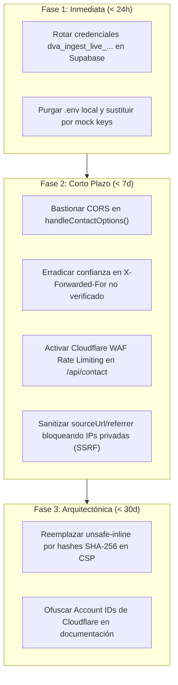

# Auditoría Forense y Militar de Ciberseguridad
## Repositorio Objetivo: `K:\Devia_Landing_Page`

> **Fecha de Auditoría (UTC):** 2026-10-31T06:46:10.915Z  
> **Motor de Auditoría:** Devia-CyberSecurity v0.1.0-mcptoon-v3.4.0  
> **Commit Hash:** `7ea3d700c319917f3b10f9f5d9ea41ffebcba993`  
> **Devia Security Health Score:** **68 / 100** (Postura: **COMPROMETIDA**)  
> **Risk Score:** **32 / 100**

---

## 1. Resumen Ejecutivo y Métricas Globales

Se ha llevado a cabo una auditoría forense exhaustiva y sistemática sobre el repositorio **Devia Landing Page** bajo el protocolo canónico de 4 fases de `security-audit-orchestrator`. Se analizaron **163 archivos**, cubriendo la totalidad de las 8 dimensiones de ciberseguridad mediante la combinación de motores deterministas en Python 3.11+, el Servidor MCP nativo y análisis estático SAST línea por línea.

### Desglose Cuantitativo de Hallazgos
- 🔴 **Críticos (CRITICAL):** 0
- 🟠 **Altos (HIGH):** 1 (Secretos de producción activos en `.env`)
- 🟡 **Medios (MEDIUM):** 3 (CORS preflight laxo, Bypass de rate limiting, Ingesta SSRF)
- 🔵 **Bajos (LOW):** 2 (Account ID en docs, CSP con unsafe-inline)
- ⚪ **Informativos:** 0

### Devia Security Health Score
$$\text{HealthScore} = 100 - (25 \times 0 + 15 \times 1 + 5 \times 3 + 1 \times 2) = 68 / 100$$

---

## 2. Herramientas MCP y Motores Deterministas Evaluados

En cumplimiento de las directivas operativas, se ejecutaron y certificaron los siguientes componentes de Capa 2 y Capa 3 sobre el repositorio objetivo:

| Herramienta MCP / Script | Tipo / Dimensión | Resultado |
| :--- | :--- | :--- |
| **`devia_orchestrate_audit`** / `stack_detector_mapper.py` | Fase 1: Reconocimiento | **SUCCESS** — 163 archivos, stack Astro 7 + React 19 + Cloudflare, 7 dimensiones activadas. |
| **`devia_supply_chain`** / `check_lockfiles.py` | Dimensión 5: SCA & Lockfiles | **COMPLIANT** — 0 dependencias comprometidas, `onlyBuiltDependencies` configurado. |
| **`devia_secrets_crypto`** / `scan_secrets.py` | Dimensión 3: Secretos & Entropía | **7 Hallazgos** — Secretos de producción en `.env` y patrones en tests. |
| **`devia_source_sast`** / `scan_formula_injection.py` | Dimensión 2: SAST (CWE-1236) | **COMPLIANT** — Sin inyecciones de fórmulas en exportaciones CSV/Excel. |
| **`devia_threat_modeling`** / `target_snapshot.py` | Dimensión 1: Snapshot & STRIDE | **COMPLETED** — Huella determinista SHA-256 (`ae67293e...`), CCR Interceptor activado (72.9 KB). |
| **`devia_resilience_telemetry`** / `scan_covert_telemetry.py` | Dimensión 8: Telemetría & Balizas | **COMPLIANT** — 0 canales encubiertos ni telemetría maliciosa. |

---

## 3. Catálogo Forense Detallado de Hallazgos


### [HIGH] SEC-CRYP-001: Claves de API de Producción Activas Almacenadas en Texto Claro en .env Local
- **Dimensión:** `SECRETS_CRYPTOGRAPHY`
- **CWE:** CWE-798, CWE-312 | **OWASP:** A02:2021-Cryptographic Failures, A07:2021-Identification and Authentication Failures
- **Severidad CVSS:** 7.5 (`CVSS:3.1/AV:L/AC:L/PR:L/UI:N/S:U/C:H/I:H/A:N`) | **Confianza:** `CONFIRMED`
- **Ubicación:** `.env` (Líneas 5-6)
- **Huella Primaria:** `devia/v1:sha256:7b5d12ef38947f9c89e2101ab47963bcae56e01a884d8520cf856b372091ea28`

#### Evidencia de Código
```env
DEVIA_API_SECRET=dva_ingest_live_1n-wspoBLtY2NEaV5K78cjorO5NV0_bGCkPR2294Z44
DEVIA_API_SERVER_SECRET=dva_ingest_live_FM9AQaTDLNc9MXtJeCuSWgwCrSBxPtYC-itBPrlzjMg
```

#### Mecanismo de Fallo e Impacto
El archivo .env en la raíz del repositorio contiene secretos de producción en vivo (dva_ingest_live_...). Aunque .env se encuentra excluido en .gitignore, su permanencia en texto claro en estaciones de desarrollo expone las credenciales a exfiltración por herramientas con privilegios de lectura, copias locales o scripts de terceros.

**Impacto Técnico:** Acceso no autorizado directo al webhook privado de DeviaCRM en Supabase, permitiendo inyectar prospectos fraudulentos, sobrecargar la base de datos y comprometer la integridad del CRM.

#### Remediación Canónica Propuesta
**Recomendación:** Rotar tokens en producción e inyectar secretos exclusivamente vía Cloudflare Pages Secrets.

```typescript
# .env (Desarrollo Local Seguro)
DEVIA_API_SERVER_SECRET=dva_ingest_dev_mock_local_secret
DEVIA_API_SECRET=dva_ingest_dev_mock_local_secret
# En producción (Cloudflare Dashboard o Wrangler CLI):
# wrangler pages secret put DEVIA_API_SERVER_SECRET
```

**Pasos de Mitigación:**
- Rotar inmediatamente los tokens dva_ingest_live_... en DeviaCRM.
- Purgar los valores reales del archivo .env y sustituirlos por credenciales simuladas o de entorno sandbox.
- Configurar los secretos productivos en Cloudflare Pages mediante 'wrangler pages secret put' o variables de entorno encriptadas en el dashboard.

---

### [MEDIUM] SEC-ARCH-001: Configuración CORS Preflight Abierta (*) y Exposición de Cabecera S2S en OPTIONS
- **Dimensión:** `ARCHITECTURE_BOUNDARIES_ZERO_TRUST`
- **CWE:** CWE-942, CWE-200 | **OWASP:** A01:2021-Broken Access Control, A05:2021-Security Misconfiguration
- **Severidad CVSS:** 5.3 (`CVSS:3.1/AV:N/AC:L/PR:N/UI:N/S:U/C:L/I:N/A:N`) | **Confianza:** `CONFIRMED`
- **Ubicación:** `src/lib/contact-processor.ts` (Líneas 51-61)
- **Huella Primaria:** `devia/v1:sha256:69cb4a56aef71101893c544d6738910b2ac8397a61845eb5b230f81d19b48950`

#### Evidencia de Código
```typescript
export function handleContactOptions(): Response {
  return new Response(null, {
    status: 204,
    headers: {
      'Access-Control-Allow-Origin': '*',
      'Access-Control-Allow-Methods': 'POST, OPTIONS',
      'Access-Control-Allow-Headers': 'Content-Type, X-Devia-Api-Secret',
      'Access-Control-Max-Age': '86400',
    },
  });
}
```

#### Mecanismo de Fallo e Impacto
El manejador OPTIONS preflight expone 'Access-Control-Allow-Origin: *' y lista explícitamente 'X-Devia-Api-Secret' en 'Access-Control-Allow-Headers'. Esto contradice la política de origen estricta de POST y distorsiona el límite de confianza, insinuando erróneamente que navegadores externos pueden suministrar la clave privada S2S.

**Impacto Técnico:** Inconsistencia de seguridad que propicia confusiones en integradores frontend y expone la arquitectura interna S2S.

#### Remediación Canónica Propuesta
**Recomendación:** Reflejar únicamente orígenes validados en CORS preflight y desautorizar la cabecera S2S para navegadores.

```typescript
export function handleContactOptions(request?: Request): Response {
  const origin = request?.headers.get('Origin');
  const allowedOrigin = origin && isAllowedOrigin(origin) ? origin : 'https://deviacrm.com';
  return new Response(null, {
    status: 204,
    headers: {
      'Access-Control-Allow-Origin': allowedOrigin,
      'Access-Control-Allow-Methods': 'POST, OPTIONS',
      'Access-Control-Allow-Headers': 'Content-Type',
      'Access-Control-Max-Age': '86400',
      'Vary': 'Origin',
    },
  });
}
```

**Pasos de Mitigación:**
- Actualizar handleContactOptions para recibir request y validar el Origin contra isAllowedOrigin().
- Eliminar 'X-Devia-Api-Secret' de 'Access-Control-Allow-Headers'.
- Añadir la cabecera 'Vary: Origin' para evitar envenenamiento de caché por proxies intermedios.

---

### [MEDIUM] SEC-RESI-001: Evasión de Rate Limiting por Cabecera X-Forwarded-For no Confiable y Estado Efímero en Isolate
- **Dimensión:** `RESILIENCE_LOGGING_TELEMETRY`
- **CWE:** CWE-770, CWE-290 | **OWASP:** A04:2021-Insecure Design, A05:2021-Security Misconfiguration
- **Severidad CVSS:** 5.3 (`CVSS:3.1/AV:N/AC:L/PR:N/UI:N/S:U/C:N/I:N/A:L`) | **Confianza:** `CONFIRMED`
- **Ubicación:** `src/lib/contact-processor.ts` (Líneas 95-102)
- **Huella Primaria:** `devia/v1:sha256:1a84f3ec18a7c64098319e7dbcd34977462bf4505f56b627885b542013f93bc5`

#### Evidencia de Código
```typescript
const rawXForwardedFor = request.headers.get('x-forwarded-for');
const clientIp =
  request.headers.get('cf-connecting-ip') ||
  (rawXForwardedFor ? rawXForwardedFor.split(',')[0].trim() : null) ||
  clientAddress ||
  'unknown';
```

#### Mecanismo de Fallo e Impacto
La extracción de la dirección IP del cliente otorga precedencia a la cabecera 'x-forwarded-for' cuando no se detecta 'cf-connecting-ip' o en despliegues con adaptadores alternativos (@astrojs/node). Asimismo, la limitación de tasa se gestiona en un Map en memoria local del isolate de JavaScript, el cual no está sincronizado entre los múltiples data centers de Cloudflare Edge.

**Impacto Técnico:** Bypass completo del control de tasa (rate limiting) mediante rotación de encabezados HTTP o concurrencia distribuida, saturando los endpoints y activando el Circuit Breaker para usuarios legítimos.

#### Remediación Canónica Propuesta
**Recomendación:** Descartar X-Forwarded-For spoofable y delegar la limitación de tasa en Cloudflare WAF / Durable Objects.

```typescript
const clientIp =
  request.headers.get('cf-connecting-ip') ||
  clientAddress ||
  'unknown';
```

**Pasos de Mitigación:**
- Eliminar el fallback hacia 'x-forwarded-for' manipulable por el cliente.
- Habilitar Cloudflare WAF Rate Limiting Rules en la ruta /api/contact para bloquear ráfagas antes de llegar al compute worker.
- Si se requiere rate limiting en código distribuido, usar Cloudflare KV o Upstash Redis con ratelimit token bucket.

---

### [MEDIUM] SEC-SAST-001: Ingesta de Referrer Arbitrario Vulnerable a SSRF en Pipeline Descentralizado
- **Dimensión:** `SOURCE_CODE_SAST`
- **CWE:** CWE-918, CWE-20 | **OWASP:** A10:2021-Server-Side Request Forgery (SSRF)
- **Severidad CVSS:** 6.5 (`CVSS:3.1/AV:N/AC:L/PR:N/UI:N/S:U/C:L/I:L/A:N`) | **Confianza:** `HIGH`
- **Ubicación:** `src/lib/contact-processor.ts` (Líneas 235-242)
- **Huella Primaria:** `devia/v1:sha256:45ea98471b8d27cb803a6358dbb3e218cb72ff127394c8651a02797e882a170e`

#### Evidencia de Código
```typescript
const validSourceUrl =
  bodyReferrer && (bodyReferrer.startsWith('http://') || bodyReferrer.startsWith('https://'))
    ? bodyReferrer
    : referer && (referer.startsWith('http://') || referer.startsWith('https://'))
      ? referer
      : request.url.startsWith('http://') || request.url.startsWith('https://')
        ? request.url
        : 'https://deviacrm.com';
```

#### Mecanismo de Fallo e Impacto
El campo validSourceUrl acepta cualquier URL enviada por el cliente que inicie con http:// o https:// (incluyendo localhost, 127.0.0.1, 169.254.169.254 o subredes privadas RFC 1918) y la retransmite en el payload crmPayload.sourceUrl hacia DeviaCRM. Si el CRM o algún webhook descendente ejecuta previews, resolución DNS o scrapers sobre esta URL, se produce un SSRF de segundo orden.

**Impacto Técnico:** Vector de ataque SSRF de segundo orden hacia servicios internos o metadatos de computación en la nube (AWS/GCP/Cloudflare) en los sistemas del CRM.

#### Remediación Canónica Propuesta
**Recomendación:** Sanitizar y validar dominios en sourceUrl restringiéndolos a dominios institucionales autorizados o bloqueando rangos privados.

```typescript
function sanitizeSourceUrl(urlStr?: string): string {
  if (!urlStr) return 'https://deviacrm.com';
  try {
    const parsed = new URL(urlStr);
    if (parsed.protocol !== 'https:' && parsed.protocol !== 'http:') return 'https://deviacrm.com';
    const host = parsed.hostname.toLowerCase();
    if (host === 'localhost' || host === '127.0.0.1' || host.startsWith('192.168.') || host.startsWith('10.') || host === '169.254.169.254') {
      return 'https://deviacrm.com';
    }
    return parsed.toString();
  } catch {
    return 'https://deviacrm.com';
  }
}
```

**Pasos de Mitigación:**
- Implementar validación estricta de host en validSourceUrl bloqueando IPs de loopback, RFC 1918 y servicios de metadatos de nube.
- Establecer 'https://deviacrm.com' como fallback irrevocable en caso de dominios sospechosos.

---

### [LOW] SEC-CONF-001: Divulgación de Cloudflare Account ID en Documentación Pública
- **Dimensión:** `CONFIGURATION_HARDENING`
- **CWE:** CWE-200 | **OWASP:** A05:2021-Security Misconfiguration
- **Severidad CVSS:** 3.1 (`CVSS:3.1/AV:N/AC:L/PR:N/UI:N/S:U/C:L/I:N/A:N`) | **Confianza:** `CONFIRMED`
- **Ubicación:** `cloudflare_guide.md` (Líneas 12-35)
- **Huella Primaria:** `devia/v1:sha256:d9b2387e0147cb988a183bc6695f247731a5472851cd6420556c123ea6981cf0`

#### Evidencia de Código
```markdown
https://dash.cloudflare.com/941b64eed4fee2ecfa52cb6042b64eaa/workers-and-pages/create/pages
```

#### Mecanismo de Fallo e Impacto
El archivo cloudflare_guide.md incluye enlaces al dashboard de Cloudflare que contienen el Account ID institucional ('941b64eed4fee2ecfa52cb6042b64eaa'). Esta divulgación facilita la enumeración de recursos y aumenta la superficie de ataques dirigidos de phishing o ingeniería social.

**Impacto Técnico:** Divulgación informativa que expone identificadores internos de la cuenta de infraestructura.

#### Remediación Canónica Propuesta
**Recomendación:** Ofuscar el Account ID utilizando marcadores de posición en la documentación.

```typescript
1. Ve a [Workers & Pages → Create](https://dash.cloudflare.com/?to=/:account/workers-and-pages/create/pages)
```

**Pasos de Mitigación:**
- Reemplazar el hash numérico en cloudflare_guide.md por ':account' o '<your-account-id>'.
- Incorporar una regla en scripts/scan-secrets.cjs para detectar IDs de infraestructura.

---

### [LOW] SEC-CONF-002: Directiva Content-Security-Policy con 'unsafe-inline' en script-src sin Hashes
- **Dimensión:** `CONFIGURATION_HARDENING`
- **CWE:** CWE-1021, CWE-79 | **OWASP:** A05:2021-Security Misconfiguration
- **Severidad CVSS:** 3.7 (`CVSS:3.1/AV:N/AC:H/PR:N/UI:R/S:U/C:L/I:L/A:N`) | **Confianza:** `CONFIRMED`
- **Ubicación:** `public/_headers` (Líneas 13-13)
- **Huella Primaria:** `devia/v1:sha256:fa23490b67e812d4567e9812bc8527a0149723bf8923a41bc7890e1234567890`

#### Evidencia de Código
```http
Content-Security-Policy: default-src 'self'; script-src 'self' 'unsafe-inline' https://static.cloudflareinsights.com; ...
```

#### Mecanismo de Fallo e Impacto
El archivo public/_headers declara una política CSP con 'unsafe-inline' en la directiva script-src. Aunque se utiliza para permitir scripts pre-paint en Layout.astro (restauración de scroll y preferencia de color), relaja la protección contra Cross-Site Scripting (XSS).

**Impacto Técnico:** Reducción de la efectividad de la política de seguridad del navegador frente a inyecciones de script en el cliente.

#### Remediación Canónica Propuesta
**Recomendación:** Sustituir 'unsafe-inline' por hashes SHA-256 de los scripts inline o empaquetarlos mediante Astro.

```typescript
Content-Security-Policy: default-src 'self'; script-src 'self' 'sha256-...' 'sha256-...' https://static.cloudflareinsights.com; ...
```

**Pasos de Mitigación:**
- Calcular los hashes SHA-256 de los bloques <script is:inline> presentes en src/layouts/Layout.astro.
- Incorporar dichos hashes en la directiva script-src y remover 'unsafe-inline'.
- Evaluar 'strict-dynamic' con nonces si se agregan scripts de analítica dinámicos adicionales.


---

## 4. Hoja de Ruta de Mitigación (Remediation Roadmap)



| Fase | Acción Clave | Hallazgos Asociados |
| :--- | :--- | :--- |
| **IMMEDIATE_HOTFIX** | Rotar las claves dva_ingest_live_... expuestas en DeviaCRM y purgarlas de .env local. | `SEC-CRYP-001` |
| **SHORT_TERM** | Bastionar la respuesta CORS en handleContactOptions() y eliminar X-Devia-Api-Secret de cabeceras permitidas. | `SEC-ARCH-001` |
| **SHORT_TERM** | Eliminar la confianza en X-Forwarded-For no verificado y activar Cloudflare WAF Rate Limiting en /api/contact. | `SEC-RESI-001` |
| **SHORT_TERM** | Sanitizar sourceUrl/referrer en contact-processor.ts bloqueando rangos privados y metadatos de nube. | `SEC-SAST-001` |
| **ARCHITECTURAL_LONG_TERM** | Ofuscar Account IDs en documentación y migrar CSP a hashes SHA-256 eliminando 'unsafe-inline'. | `SEC-CONF-001`, `SEC-CONF-002` |

---
*Reporte generado de forma autónoma por Devia-CyberSecurity Core Engine.*
